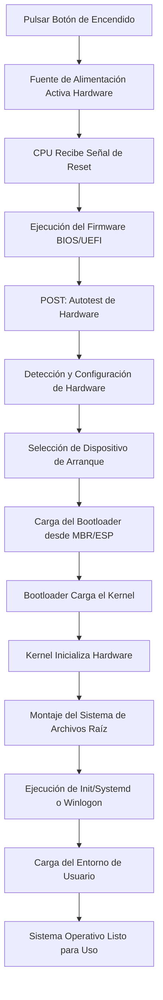
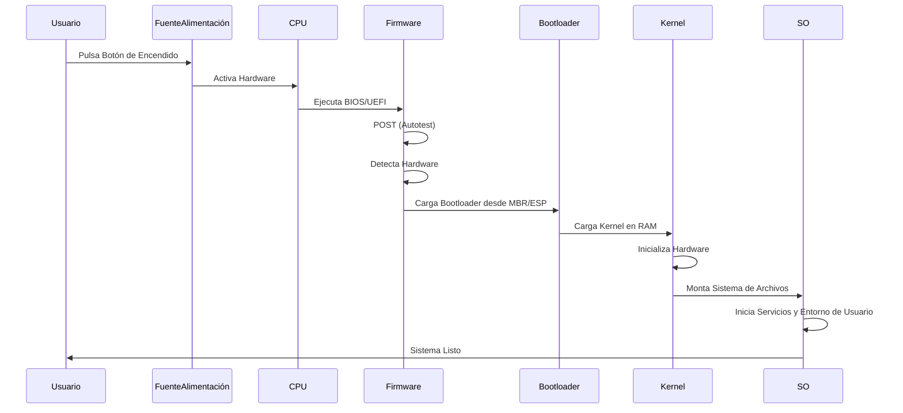
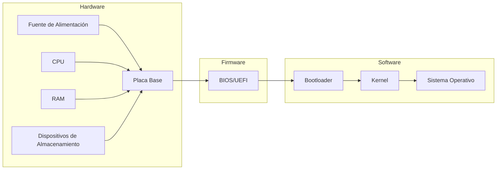

# Proceso de Arranque de un Sistema Operativo

---

## **1. Introducción**

El proceso de arranque (o *boot*) de un sistema operativo es una secuencia crítica que permite que un ordenador pase de un estado de apagado total a la ejecución del sistema operativo. Este proceso involucra tanto hardware como software, y su correcta ejecución es esencial para el funcionamiento del sistema.

---

## **2. Componentes Clave Involucrados**

### **2.1. Hardware**

- **Fuente de alimentación**: Proporciona energía a todos los componentes.
- **Placa base (Motherboard)**: Contiene el firmware (BIOS/UEFI) y conecta todos los componentes.
- **CPU (Unidad Central de Procesamiento)**: Ejecuta las instrucciones del firmware y el sistema operativo.
- **RAM (Memoria de Acceso Aleatorio)**: Almacena temporalmente los datos y programas necesarios para el arranque.
- **Dispositivos de almacenamiento (HDD/SSD)**: Contienen el sistema operativo y los archivos de arranque.
- **ROM (Memoria de Solo Lectura)**: Almacena el firmware (BIOS/UEFI).
- **Tarjeta gráfica, teclado, ratón, etc.**: Dispositivos periféricos que pueden ser necesarios para la interacción durante el arranque.

### **2.2. Software**

- **Firmware (BIOS/UEFI)**: Software de bajo nivel almacenado en la ROM que inicializa el hardware y carga el bootloader.
- **Bootloader (GRUB, LILO, Windows Boot Manager, etc.)**: Programa que carga el sistema operativo en la memoria RAM.
- **Sistema Operativo (Windows, Linux, macOS, etc.)**: Gestiona los recursos del hardware y proporciona una interfaz para el usuario.

---

## **3. Fases del Proceso de Arranque**

### **3.1. Encendido del Hardware**

1. **Pulsación del botón de encendido**:
  - El usuario pulsa el botón de encendido de la torre o portátil.
  - La fuente de alimentación recibe la señal y comienza a suministrar energía a la placa base y al resto de componentes.
2. **Señal de Power-On Reset (POR)**:
  - La placa base envía una señal de *reset* a la CPU para inicializarla.
  - La CPU comienza a ejecutar instrucciones desde una dirección de memoria predefinida (generalmente `0xFFFFFFF0` en arquitecturas x86), donde reside el firmware (BIOS/UEFI).

---

### **3.2. Ejecución del Firmware (BIOS/UEFI)**

#### **3.2.1. POST (Power-On Self-Test)**

- **Objetivo**: Verificar que el hardware esencial está funcionando correctamente.
- **Proceso**:
  1. La CPU ejecuta el código del **BIOS/UEFI** almacenado en la ROM.
  2. El firmware realiza un **autotest** de los componentes críticos:
    - Comprueba la integridad de la CPU.
    - Verifica la presencia y funcionalidad de la RAM.
    - Detecta y configura dispositivos de almacenamiento (HDD/SSD).
    - Inicializa la tarjeta gráfica y otros periféricos.
  3. Si algún componente falla, el sistema emite un **código de error** (pitidos, mensajes en pantalla o códigos numéricos).

#### **3.2.2. Detección y Configuración del Hardware**

- El firmware identifica todos los dispositivos conectados (teclado, ratón, discos duros, USB, etc.).
- Configura los parámetros básicos del hardware (frecuencia de la CPU, temporización de la RAM, etc.).
- En sistemas modernos con **UEFI**, esta fase puede incluir la carga de controladores básicos para dispositivos.

#### **3.2.3. Selección del Dispositivo de Arranque**

- El firmware busca el **orden de arranque** configurado en su configuración (generalmente accesible mediante una tecla como `F2`, `F12`, `DEL`, etc.).
- El orden de arranque determina qué dispositivo (HDD, SSD, USB, CD/DVD, red) se utilizará para cargar el sistema operativo.
- Si no se encuentra ningún dispositivo de arranque válido, el sistema muestra un error (ej: `No bootable device found`).

---

### **3.3. Carga del Bootloader**

#### **3.3.1. Localización del Bootloader**

- El firmware busca en el **MBR (Master Boot Record)** del dispositivo de arranque seleccionado.
  - En discos con **MBR**, el bootloader reside en los primeros **512 bytes** del disco (sector de arranque).
  - En discos con **GPT (Tabla de Particiones GUID)**, el firmware busca en la **EFI System Partition (ESP)**.
- El **MBR** contiene:
  - Código del bootloader (ej: **GRUB** en Linux, **Windows Boot Manager** en Windows).
  - Tabla de particiones (en el caso de MBR).

#### **3.3.2. Ejecución del Bootloader**

- El firmware carga el **bootloader** en la memoria RAM y le transfiere el control.
- **Funciones del bootloader**:
  1. **Cargar el kernel del sistema operativo**:
    - En sistemas **Linux**, el bootloader (ej: GRUB) carga el kernel (`vmlinuz`) y el sistema de archivos inicial (`initramfs`).
    - En sistemas **Windows**, el **Windows Boot Manager** carga el archivo `bootmgr` y luego el kernel (`ntoskrnl.exe`).
  2. **Configuración de parámetros de arranque**:
    - El bootloader puede permitir al usuario seleccionar entre diferentes sistemas operativos (arranque dual) o configuraciones del kernel (ej: modo seguro, modo recuperación).
  3. **Transición a modo protegido (en arquitecturas x86)**:
    - El bootloader prepara la CPU para pasar del **modo real** (16 bits) al **modo protegido** (32 bits) o **modo largo** (64 bits), necesario para sistemas operativos modernos.

---

### **3.4. Carga del Kernel del Sistema Operativo**

#### **3.4.1. Inicialización del Kernel**

- El **kernel** (núcleo del sistema operativo) es cargado en la memoria RAM por el bootloader.
- El kernel es el componente central del sistema operativo y se encarga de:
  - Gestionar los recursos del hardware (CPU, RAM, dispositivos de E/S).
  - Proporcionar una interfaz entre el hardware y el software de aplicación.

#### **3.4.2. Configuración del Hardware en Modo Kernel**

- El kernel realiza una **detección más avanzada** del hardware:
  - Inicializa controladores para dispositivos no detectados por el firmware.
  - Configura la gestión de memoria (paginación, segmentación).
  - Inicializa el sistema de archivos.

#### **3.4.3. Montaje del Sistema de Archivos Raíz**

- En sistemas **Linux/Unix**:
  - El kernel monta el sistema de archivos raíz (`/`) utilizando el `initramfs` (sistema de archivos inicial en memoria).
  - El `initramfs` contiene los controladores y herramientas necesarios para montar el sistema de archivos real desde el disco.
- En sistemas **Windows**:
  - El kernel carga el **Registry** y los controladores esenciales.
  - Inicializa el sistema de archivos NTFS.

---

### **3.5. Inicio del Sistema Operativo**

#### **3.5.1. Ejecución del Proceso Init (Linux/Unix)**

- El kernel ejecuta el proceso **`init`** (en sistemas modernos, suele ser `systemd` o `upstart`).
- **`init`** es el primer proceso (PID 1) y se encarga de:
  - Inicializar los servicios del sistema (red, gráficos, sonido, etc.).
  - Montar el resto de sistemas de archivos.
  - Iniciar el entorno gráfico (ej: GNOME, KDE, Xfce) o la interfaz de línea de comandos.

#### **3.5.2. Inicio de Sesión (Windows)**

- En Windows, el kernel carga el **Subsistema de Entrada/Salida (Win32)** y el **Administrador de Sesiones (SMSS)**.
- El **Administrador de Inicio de Sesión (Winlogon)** muestra la pantalla de inicio de sesión.
- Una vez que el usuario inicia sesión, se carga el **Explorador de Windows** (`explorer.exe`) y el resto de aplicaciones de inicio.

#### **3.5.3. Carga del Entorno de Usuario**

- El sistema operativo carga la configuración específica del usuario (perfil, preferencias, aplicaciones de inicio).
- En sistemas gráficos, se muestra el **escritorio** o el **gestor de ventanas**.

---

## **4. Esquemas del Proceso de Arranque**

### **4.1. Diagrama de Flujo**

---

### **4.2. Diagrama de Secuencia**

---

### **4.3. Diagrama de Componentes**

---

## **5. Diferencias entre BIOS y UEFI**

| **Característica**      | **BIOS**                       | **UEFI**                        |
| ----------------------- | ------------------------------ | ------------------------------- |
| **Arquitectura**        | 16 bits                        | 32/64 bits                      |
| **Interfaz**            | Texto (modo legado)            | Gráfica (GUI)                   |
| **Soporte para discos** | MBR (hasta 2TB)                | GPT (más de 2TB)                |
| **Tiempo de arranque**  | Lento                          | Rápido                          |
| **Seguridad**           | Sin soporte para Secure Boot   | Soporte para Secure Boot        |
| **Compatibilidad**      | Legado                         | Compatible con BIOS (CSM)       |
| **Particiones**         | Máximo 4 particiones primarias | Hasta 128 particiones primarias |

---

## **6. Arranque de Linux con GRUB**

1. **Encendido**: El usuario pulsa el botón de encendido.
2. **POST**: El BIOS/UEFI verifica el hardware.
3. **Selección de dispositivo**: El firmware busca el dispositivo de arranque (ej: `/dev/sda`).
4. **Carga de GRUB**: El BIOS/UEFI carga el **GRUB** desde el MBR o la ESP.
5. **Menú de GRUB**: El usuario puede seleccionar entre diferentes kernels o sistemas operativos.
6. **Carga del kernel**: GRUB carga el kernel (`vmlinuz`) y el `initramfs` en la RAM.
7. **Inicialización del kernel**: El kernel detecta el hardware y monta el sistema de archivos raíz.
8. **Ejecución de `systemd`**: El kernel ejecuta `systemd`, que inicializa los servicios.
9. **Entorno gráfico**: Se carga el gestor de ventanas (ej: GNOME) y el usuario puede interactuar con el sistema.

---

## **7. Arranque de Windows**

1. **Encendido**: El usuario pulsa el botón de encendido.
2. **POST**: El UEFI verifica el hardware.
3. **Selección de dispositivo**: El UEFI busca el dispositivo de arranque (ej: `C:\`).
4. **Carga del Windows Boot Manager**: El UEFI carga `bootmgr` desde la ESP.
5. **Carga del kernel**: `bootmgr` carga `ntoskrnl.exe` y el Registry.
6. **Inicialización del kernel**: El kernel detecta el hardware y carga los controladores.
7. **Winlogon**: Se muestra la pantalla de inicio de sesión.
8. **Explorador de Windows**: Tras el inicio de sesión, se carga `explorer.exe` y el escritorio.

---

## **8. Problemas Comunes y Soluciones**

| **Problema**                | **Posible Causa**                            | **Solución**                                |
| --------------------------- | -------------------------------------------- | ------------------------------------------- |
| No hay señal en la pantalla | Fallo en la tarjeta gráfica o RAM            | Revisar conexiones, probar con otra RAM     |
| Pitidos al encender         | Fallo en el POST (hardware defectuoso)       | Consultar manual de la placa base           |
| "No bootable device found"  | Dispositivo de arranque no detectado         | Verificar orden de arranque en BIOS/UEFI    |
| "GRUB rescue&gt;"           | Bootloader dañado o configuración incorrecta | Reinstalar GRUB o reparar con Live CD       |
| Pantallazo azul en Windows  | Fallo en controladores o hardware            | Iniciar en modo seguro y actualizar drivers |
| Sistema operativo no carga  | Kernel dañado o falta de archivos            | Reparar instalación con herramientas del SO |

