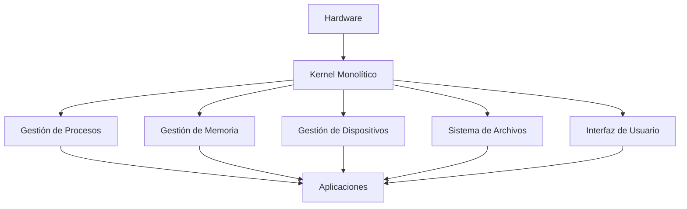
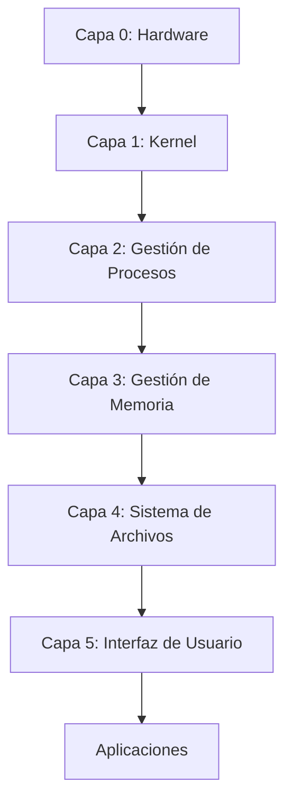
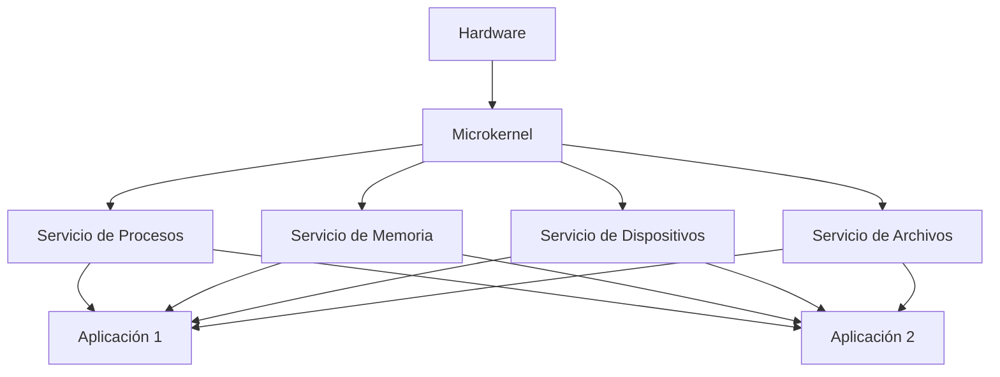
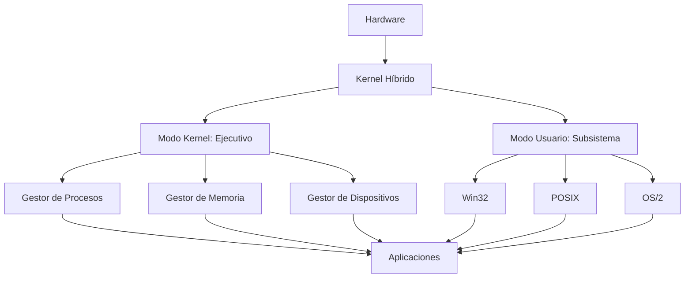
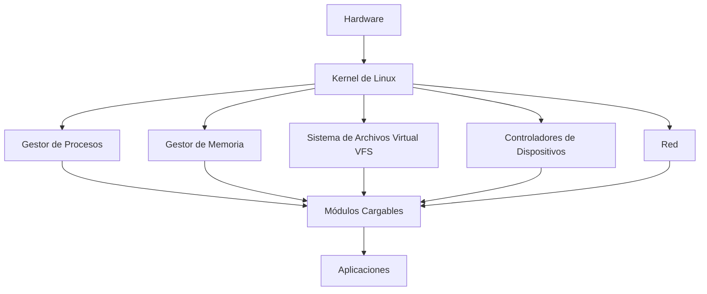
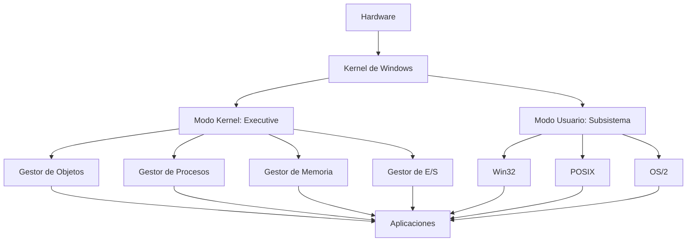
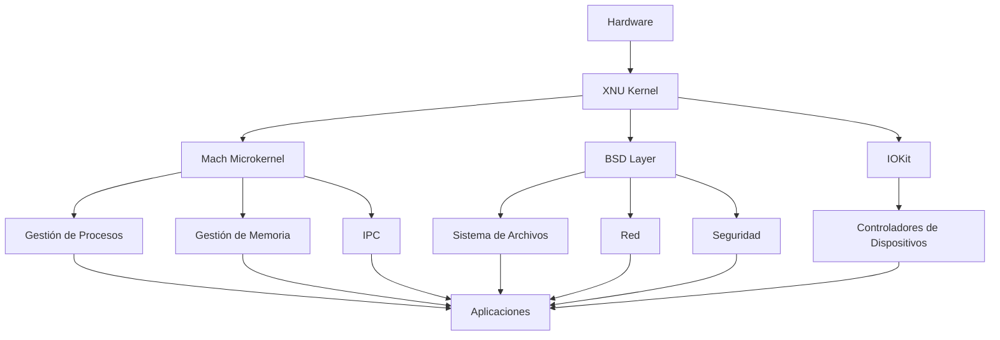
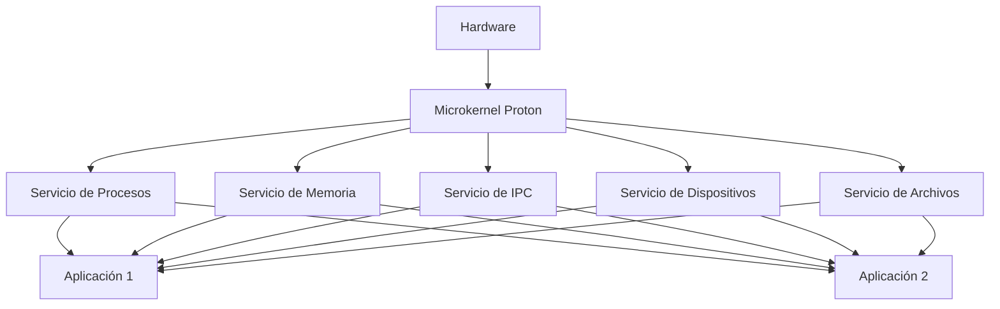
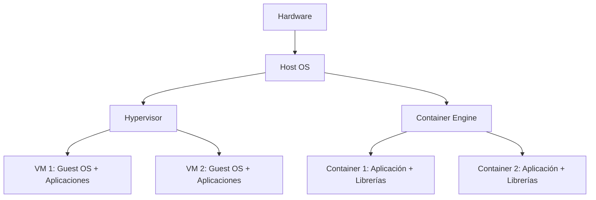

## **1. Introducción**
Los sistemas operativos (SO) son el **corazón** de cualquier dispositivo computacional, desde supercomputadoras hasta sistemas embebidos. Su diseño y arquitectura determinan la eficiencia, seguridad y funcionalidad del sistema en su conjunto. Esta documentación explora en profundidad los conceptos fundamentales, estructuras, componentes y tendencias modernas en la arquitectura de los SO.

---

## **2. Definición y Evolución de los Sistemas Operativos**

### **2.1. ¿Qué es un Sistema Operativo?**
Un **sistema operativo** es un **software de sistema** que actúa como **interfaz entre el hardware y las aplicaciones de usuario**, gestionando los recursos del sistema de manera eficiente, segura y transparente. Su objetivo principal es:
- **Abstraer la complejidad del hardware** para que las aplicaciones puedan ejecutarse sin conocer detalles físicos.
- **Gestionar recursos** (CPU, memoria, dispositivos de E/S) de forma óptima.
- **Proporcionar un entorno de ejecución** estable y predecible para programas y usuarios.

---

### **2.2. Evolución Histórica**
La arquitectura de los SO ha evolucionado en respuesta a los avances tecnológicos y las necesidades de los usuarios. A continuación, se presenta una línea temporal con los hitos más relevantes:

| **Período**       | **Generación**       | **Características Principales**                                                                                     | **Ejemplos de SO**               |
|-------------------|----------------------|---------------------------------------------------------------------------------------------------------------------|----------------------------------|
| **1940-1950**     | Primera Generación   | Sin SO. Programación directa en lenguaje máquina. Uso exclusivo de tarjetas perforadas.                              | ENIAC, UNIVAC                    |
| **1950-1960**     | Segunda Generación   | Primeros SO **monotarea** y **por lotes (batch)**. Uso de transistores.                                             | GM-NAA I/O, IBM SOS             |
| **1960-1970**     | Tercera Generación   | **Multitarea** y **multiprogramación**. Introducción de circuitos integrados.                                        | IBM/360, Unix (1969)            |
| **1970-1980**     | Cuarta Generación    | **Sistemas de tiempo compartido** y **redes**. SO más interactivos.                                                 | Unix (AT&T), CP/M, MS-DOS       |
| **1980-1990**     | Quinta Generación    | **Interfaz gráfica (GUI)**. SO para PCs.                                                                           | Windows 3.1, Mac OS, AmigaOS    |
| **1990-2000**     | Sexta Generación     | **Multimedia**, **redes avanzadas** y **soportes para 64 bits**.                                                   | Windows 95/NT, Linux, Solaris   |
| **2000-2010**     | Séptima Generación   | **SO distribuidos**, **virtualización** y **móviles**.                                                             | Windows XP, macOS X, Android     |
| **2010-Actualidad** | Octava Generación  | **Cloud computing**, **IoT**, **containers** y **seguridad avanzada**.                                              | Windows 10/11, iOS, Chrome OS   |

---
### **2.3. Clasificación de los Sistemas Operativos**
Los SO pueden clasificarse según distintos criterios:

#### **Por su Estructura**
1. **Monolíticos**: Todo el código del SO se ejecuta en un único espacio de memoria (ej. **MS-DOS**, **Unix temprano**).
2. **Por Capas**: El SO se organiza en capas jerárquicas, cada una con funciones específicas (ej. **Windows NT**).
3. **Microkernel**: Solo las funciones esenciales (gestión de procesos, memoria) se ejecutan en modo kernel; el resto en modo usuario (ej. **QNX**, **MINIX**).
4. **Híbridos**: Combinan elementos de las arquitecturas anteriores (ej. **Windows 7/10**, **macOS**).

#### **Por su Uso**
| **Tipo**               | **Descripción**                                                                                     | **Ejemplos**                          |
|------------------------|-----------------------------------------------------------------------------------------------------|---------------------------------------|
| **SO de Propósito General** | Diseñados para una amplia variedad de aplicaciones (oficina, desarrollo, entretenimiento).        | Windows, macOS, Linux                 |
| **SO en Tiempo Real (RTOS)** | Garantizan respuestas en plazos de tiempo estrictos. Usados en sistemas críticos.                | FreeRTOS, VxWorks, QNX                |
| **SO Embebidos**       | Optimizados para dispositivos con recursos limitados (ej. electrodomésticos, routers).          | Embedded Linux, FreeRTOS             |
| **SO Distribuidos**    | Gestionan recursos en múltiples máquinas interconectadas.                                         | Plan 9, Amoeba                       |
| **SO de Red**          | Proporcionan servicios de red (ej. enrutamiento, firewall).                                       | Cisco IOS, Juniper JunOS              |
| **SO para Móviles**    | Optimizados para dispositivos portátiles (bajo consumo, tactil).                                | Android, iOS                         |

#### **Por su Interfaz**
- **CLI (Command Line Interface)**: Interfaz basada en texto (ej. **MS-DOS**, **Linux Bash**).
- **GUI (Graphical User Interface)**: Interfaz gráfica con ventanas, iconos y menús (ej. **Windows**, **macOS**).
- **Híbrida**: Combina CLI y GUI (ej. **Linux con GNOME/KDE**).

---
## **3. Arquitecturas de Sistemas Operativos**

---
### **3.1. Arquitectura Monolítica**
#### **Definición**
En una arquitectura **monolítica**, **todo el sistema operativo se ejecuta en un único espacio de dirección de memoria** (modo kernel). Todas las funciones (gestión de procesos, memoria, dispositivos) están integradas en un solo programa.

---
#### **Características**
| **Aspecto**               | **Descripción**                                                                                     |
|---------------------------|-----------------------------------------------------------------------------------------------------|
| **Estructura**            | Código único y compacto.                                                                           |
| **Rendimiento**           | Alto (sin overhead de comunicación entre módulos).                                                |
| **Modularidad**           | Baja (cambios requieren recompilar todo el SO).                                                     |
| **Seguridad**             | Baja (un error en un módulo puede colgar todo el sistema).                                         |
| **Ejemplos**              | MS-DOS, Unix (versiones tempranas), Linux (en su núcleo).                                          |

---
#### **Diagrama de Arquitectura Monolítica**

---
#### **Ventajas y Desventajas**
| **Ventajas**                          | **Desventajas**                          |
|---------------------------------------|-----------------------------------------|
| Alto rendimiento (sin overhead).      | Poco modular (difícil de mantener).     |
| Simple de implementar.                | Poco seguro (fallos afectan a todo el SO). |
| Comunicación rápida entre módulos.    | Difícil de escalar.                     |

---
### **3.2. Arquitectura por Capas**
#### **Definición**
En una arquitectura **por capas**, el SO se divide en **capas jerárquicas**, donde cada capa proporciona servicios a la capa superior y utiliza los servicios de la capa inferior.

---
#### **Características**
| **Aspecto**               | **Descripción**                                                                                     |
|---------------------------|-----------------------------------------------------------------------------------------------------|
| **Estructura**            | Capas bien definidas (ej. hardware, kernel, servicios, aplicaciones).                             |
| **Rendimiento**           | Medio (overhead por llamadas entre capas).                                                          |
| **Modularidad**           | Alta (cada capa puede modificarse independientemente).                                            |
| **Seguridad**             | Media (fallos en una capa pueden afectar a capas superiores).                                     |
| **Ejemplos**              | Windows NT, THE OS.                                                                                 |

---
#### **Diagrama de Arquitectura por Capas**

---
#### **Ventajas y Desventajas**
| **Ventajas**                          | **Desventajas**                          |
|---------------------------------------|-----------------------------------------|
| Alta modularidad.                     | Overhead en llamadas entre capas.       |
| Fácil de mantener y actualizar.       | Menor rendimiento que monolítico.      |
| Mejor seguridad que monolítico.      | Complejidad en el diseño.              |

---
### **3.3. Arquitectura Microkernel**
#### **Definición**
En una arquitectura **microkernel**, **solo las funciones esenciales del SO se ejecutan en modo kernel** (ej. gestión de procesos, memoria, comunicación entre procesos). El resto de servicios (ej. sistema de archivos, controladores de dispositivos) se ejecutan en **modo usuario** como procesos independientes.

---
#### **Características**
| **Aspecto**               | **Descripción**                                                                                     |
|---------------------------|-----------------------------------------------------------------------------------------------------|
| **Estructura**            | Kernel mínimo + servicios en modo usuario.                                                         |
| **Rendimiento**           | Medio-bajo (overhead en comunicación entre procesos).                                              |
| **Modularidad**           | Muy alta (servicios pueden añadirse o eliminarse dinámicamente).                                  |
| **Seguridad**             | Alta (fallos en servicios no afectan al kernel).                                                   |
| **Ejemplos**              | QNX, MINIX, L4, macOS (en parte).                                                                  |

---
#### **Diagrama de Arquitectura Microkernel**

---
#### **Ventajas y Desventajas**
| **Ventajas**                          | **Desventajas**                          |
|---------------------------------------|-----------------------------------------|
| Alta modularidad y extensibilidad.    | Overhead en comunicación entre procesos.|
| Alta seguridad y estabilidad.        | Menor rendimiento que monolítico.      |
| Fácil de portar a nuevas plataformas. | Complejidad en el diseño.              |

---
#### **Ejemplo: QNX**
- **Microkernel**: **Proton** (gestión de procesos, IPC, interrupciones).
- **Servicios en Modo Usuario**:
  - **Gestor de procesos**: `proc`.
  - **Gestor de archivos**: `fs`.
  - **Controladores de dispositivos**: `devc-*`.

---
### **3.4. Arquitectura Híbrida**
#### **Definición**
Una arquitectura **híbrida** combina elementos de las arquitecturas **monolítica**, **por capas** y **microkernel**. Por ejemplo, puede tener un kernel monolítico con algunos servicios en modo usuario.

---
#### **Características**
| **Aspecto**               | **Descripción**                                                                                     |
|---------------------------|-----------------------------------------------------------------------------------------------------|
| **Estructura**            | Kernel con algunos servicios integrados y otros en modo usuario.                                  |
| **Rendimiento**           | Alto (similar a monolítico para servicios integrados).                                            |
| **Modularidad**           | Media-Alta (depende de qué servicios están en modo usuario).                                       |
| **Seguridad**             | Media-Alta (fallos en servicios en modo usuario no afectan al kernel).                            |
| **Ejemplos**              | Windows (a partir de NT), macOS, Linux (con módulos cargables).                                     |

---
#### **Diagrama de Arquitectura Híbrida (Windows NT)**

---
#### **Ventajas y Desventajas**
| **Ventajas**                          | **Desventajas**                          |
|---------------------------------------|-----------------------------------------|
| Alto rendimiento.                     | Complejidad en el diseño.              |
| Buen equilibrio entre modularidad y eficiencia. | Menos modular que microkernel puro. |
| Compatibilidad con múltiples APIs.   | Riesgo de fallos en el kernel.          |

---
## **4. Ejemplos Prácticos de Arquitecturas**

### **4.1. Linux (Arquitectura Híbrida/Monolítica)**
- **Kernel**: Monolítico con módulos cargables (`.ko`).
- **Modo de Operación**:
  - **Modo Kernel**: Ejecuta el kernel y controladores.
  - **Modo Usuario**: Ejecuta aplicaciones y servicios.
- **Sistema de Archivos**: Soporte para ext4, XFS, Btrfs, etc.
- **Interfaz**: CLI (Bash) y GUI (GNOME, KDE).

---
#### **Estructura del Kernel de Linux**

---
#### **Ventajas de Linux**
- **Open Source**: Código abierto y personalizable.
- **Portabilidad**: Funciona en múltiples arquitecturas (x86, ARM, etc.).
- **Estabilidad**: Kernel robusto y bien probado.
- **Comunidad**: Gran soporte de la comunidad y empresas (Red Hat, Canonical).

---
### **4.2. Windows (Arquitectura Híbrida)**
- **Kernel**: Híbrido (modo kernel + modo usuario).
- **Modo de Operación**:
  - **Modo Kernel**: Ejecuta el **Executive** (gestión de procesos, memoria, E/S).
  - **Modo Usuario**: Ejecuta el **Subsistema Win32**, aplicaciones y servicios.
- **Sistema de Archivos**: NTFS, FAT32, ReFS.
- **Interfaz**: GUI (Explorador de Windows) y CLI (PowerShell, cmd.exe).

---
#### **Estructura de Windows NT**

---
#### **Ventajas de Windows**
- **Compatibilidad**: Soporte para una amplia gama de hardware y software.
- **Interfaz Gráfica**: GUI intuitiva y fácil de usar.
- **Integración**: Buena integración con otros productos de Microsoft (Office, Azure).
- **Soporte**: Amplio soporte técnico y documentación.

---
### **4.3. macOS (Arquitectura Híbrida/Microkernel)**
- **Kernel**: **XNU** (híbrido: Mach microkernel + BSD + IOKit).
- **Modo de Operación**:
  - **Modo Kernel**: Ejecuta Mach y el kernel BSD.
  - **Modo Usuario**: Ejecuta aplicaciones y servicios (ej. Finder, Safari).
- **Sistema de Archivos**: APFS (Apple File System).
- **Interfaz**: GUI (Aqua) y CLI (Terminal).

---
#### **Estructura de XNU (macOS)**

---
#### **Ventajas de macOS**
- **Diseño Integrado**: Optimizado para hardware de Apple.
- **Seguridad**: Sandboxing, Gatekeeper, FileVault (cifrado de disco).
- **Ecosistema**: Integración con iOS, iPadOS y otros dispositivos Apple.
- **Rendimiento**: Optimizado para SSDs y chips Apple Silicon (M1, M2).

---
### **4.4. QNX (Arquitectura Microkernel)**
- **Kernel**: **Microkernel Proton** (gestión de procesos, memoria, IPC).
- **Modo de Operación**:
  - **Modo Kernel**: Solo el microkernel.
  - **Modo Usuario**: Todos los servicios (ej. sistema de archivos, red) se ejecutan como procesos.
- **Sistema de Archivos**: Soporte para múltiples sistemas de archivos (ext2, NTFS, etc.).
- **Interfaz**: CLI (QNX Shell) y GUI (Photon).

---
#### **Estructura de QNX**

---
#### **Ventajas de QNX**
- **Microkernel Puro**: Alta modularidad y seguridad.
- **Tiempo Real**: Ideal para sistemas embebidos y críticos (ej. automoción, medicina).
- **Escalabilidad**: Funciona en sistemas desde microcontroladores hasta servidores.
- **Fiabilidad**: Usado en sistemas donde el fallo no es una opción (ej. coches autónomos).

---
## **5. Tendencias Modernas en Arquitecturas de SO**

### **5.1. Virtualización**
La **virtualización de sistemas operativos** es una tecnología que permite ejecutar varios sistemas operativos de forma independiente en un mismo equipo físico. Cada sistema funciona dentro de una **máquina virtual**, administrada por un software llamado **hipervisor**, que distribuye los recursos del hardware, como memoria, procesador y almacenamiento.

Sus principales ventajas son el mejor aprovechamiento de recursos, el aislamiento entre sistemas, la reducción de costos y la facilidad para probar o administrar diferentes entornos.

Los hipervisores son programas que permiten crear y administrar máquinas virtuales. Existen dos tipos principales:

#### Hipervisor de tipo 1

Se instala directamente sobre el hardware físico, sin necesitar un sistema operativo anfitrión. Por eso también se llama **bare-metal**.

- Ofrece mayor rendimiento y seguridad.
- Se utiliza principalmente en servidores y centros de datos.
- Ejemplos: **VMware ESXi, Microsoft Hyper-V y Proxmox**.

#### Hipervisor de tipo 2

Se instala como una aplicación dentro de un sistema operativo existente, que actúa como anfitrión.

- Es más sencillo de instalar y utilizar.
- Resulta adecuado para computadoras personales, pruebas y aprendizaje.
- Puede tener un rendimiento ligeramente menor que el tipo 1.
- Ejemplos: **VirtualBox, VMware Workstation y Parallels Desktop**.

En resumen: el **tipo 1** es más eficiente y se usa en entornos profesionales; el **tipo 2** es más práctico para usuarios y desarrolladores.

#### Herramientas de Virtualización

| **Herramienta**               | **Descripción**                                                                                     | **SO Compatible**               |
|-------------------------------|-----------------------------------------------------------------------------------------------------|---------------------------------|
| **QEMU**                      | Emulador de hardware de código abierto.                                                           | Linux, macOS, Windows           |
| **VirtualBox**                | Software de virtualización para ejecutar múltiples SO en una sola máquina.                        | Linux, macOS, Windows           |
| **VMware**                    | Plataforma de virtualización comercial.                                                           | Linux, macOS, Windows           |
| **KVM (Kernel-based Virtual Machine)** | Módulo del kernel de Linux para virtualización.                                              | Linux                           |
| **Docker**                    | Plataforma para desarrollar, enviar y ejecutar aplicaciones en containers.                      | Linux, macOS, Windows           |

### **5.2. Containers y Virtualización**
#### **Containers**
- **Definición**: Tecnología de **virtualización a nivel de SO** que permite ejecutar aplicaciones en entornos aislados (**containers**).
- **Ventajas**:
  - **Aislamiento**: Cada container tiene su propio espacio de usuario, librerías y configuraciones.
  - **Portabilidad**: Los containers pueden moverse entre sistemas sin cambios.
  - **Eficiencia**: Comparten el mismo kernel del SO, por lo que son más ligeros que las máquinas virtuales.
- **Ejemplos**: Docker, LXC (Linux Containers), Podman.

---
#### **Diferencia entre Containers y Máquinas Virtuales (VMs)**

| **Aspecto**               | **Containers**                          | **Máquinas Virtuales**               |
|---------------------------|-----------------------------------------|-------------------------------------|
| **Nivel de Virtualización** | SO (comparten kernel).               | Hardware (requieren Guest OS).      |
| **Rendimiento**           | Alto (sin overhead de Guest OS).       | Medio (overhead del Hypervisor).    |
| **Aislamiento**           | Medio (comparten kernel).              | Alto (aislamiento completo).         |
| **Portabilidad**          | Alta (mismo SO host).                  | Media (depende del Hypervisor).     |
| **Uso de Recursos**       | Bajo (comparten recursos del host).    | Alto (requieren recursos dedicados).|
| **Ejemplos**              | Docker, LXC.                           | VMware, VirtualBox, KVM.             |

---
### **5.3. Sistemas Operativos para la Nube**
Los SO modernos están optimizados para entornos de **cloud computing**, donde la escalabilidad, la virtualización y la gestión de recursos distribuidos son clave. Ejemplos:
- **AWS Amazon Linux**: Optimizado para Amazon Web Services (AWS).
- **Google Container OS**: Diseñado para ejecutar containers en Google Cloud.
- **Azure Linux**: Versión de Linux optimizada para Microsoft Azure.

---
#### **Características de los SO en la Nube**
| **Característica**               | **Descripción**                                                                                     |
|----------------------------------|-----------------------------------------------------------------------------------------------------|
| **Escalabilidad Automática**     | Capacidad de ajustar recursos (CPU, memoria) según la demanda.                                      |
| **Alta Disponibilidad**          | Diseñados para minimizar el tiempo de inactividad (ej. balanceo de carga).                         |
| **Seguridad Avanzada**          | Incluyen mecanismos de cifrado, autenticación y control de acceso granular.                         |
| **Soporte para Containers**      | Integración nativa con Docker, Kubernetes, etc.                                                    |
| **Gestión de Recursos Distribuidos** | Capacidad de gestionar recursos en múltiples nodos (ej. clústeres de Kubernetes).              |

---
### **5.4. Sistemas Operativos para IoT**
Los dispositivos **IoT (Internet of Things)** requieren SO ligeros, eficientes y seguros. Ejemplos:
- **FreeRTOS**: SO en tiempo real para microcontroladores.
- **Zephyr**: SO modular y escalable para IoT.
- **Raspberry Pi OS**: Basado en Linux, optimizado para la Raspberry Pi.

---
#### **Requisitos de los SO para IoT**
| **Requisito**               | **Descripción**                                                                                     |
|-----------------------------|-----------------------------------------------------------------------------------------------------|
| **Bajo Consumo**            | Optimizados para funcionar con baterías o energía limitada.                                       |
| **Poco Espacio**            | Tamaño reducido para caber en dispositivos con memoria limitada (ej. 16 KB - 1 MB).              |
| **Tiempo Real**             | Capacidad de responder a eventos en plazos estrictos (ej. sensores, actuadores).                     |
| **Seguridad**              | Protección contra ataques (ej. cifrado, autenticación ligera).                                     |
| **Conectividad**            | Soporte para protocolos de red (ej. MQTT, CoAP, Bluetooth, LoRaWAN).                                |

---
### **5.5. Sistemas Operativos para Edge Computing**
El **edge computing** lleva el procesamiento de datos cerca de la fuente de generación (ej. dispositivos IoT, sensores). Los SO para edge computing deben ser:
- **Ligeros**: Para ejecutarse en dispositivos con recursos limitados.
- **Eficientes**: Capaces de procesar datos en tiempo real.
- **Seguros**: Protegidos contra ciberataques.

---
#### **Ejemplos de SO para Edge Computing**
| **SO**               | **Descripción**                                                                                     | **Casos de Uso**                          |
|---------------------|-----------------------------------------------------------------------------------------------------|------------------------------------------|
| **KubeEdge**        | Extensión de Kubernetes para edge computing.                                                        | Orquestación de containers en el edge.   |
| **Akraino**         | Plataforma de código abierto para edge computing.                                                 | Redes 5G, IoT industrial.                |
| **Azure IoT Edge**  | SO de Microsoft para ejecutar contenedores y funciones en dispositivos edge.                    | Análisis de datos en tiempo real.        |

---
### **5.6. Sistemas Operativos en Tiempo Real (RTOS)**
Los **RTOS (Real-Time Operating Systems)** están diseñados para sistemas donde el tiempo de respuesta es crítico. Ejemplos:
- **FreeRTOS**: SO en tiempo real para microcontroladores.
- **VxWorks**: SO para sistemas embebidos en aerospace, defensa y automoción.
- **QNX**: SO microkernel para sistemas en tiempo real.

---
#### **Características de los RTOS**
| **Característica**               | **Descripción**                                                                                     |
|----------------------------------|-----------------------------------------------------------------------------------------------------|
| **Determinismo**                | Capacidad de garantizar que una operación se complete en un tiempo máximo conocido.                 |
| **Prioridades**                  | Los procesos se ejecutan según prioridades estrictas.                                               |
| **Latencia Baja**                | Tiempo mínimo entre la solicitud de una operación y su finalización.                               |
| **Soporte para Interrupciones**  | Manejo eficiente de interrupciones para responder rápidamente a eventos externos.                    |
| **Escalabilidad**                | Capacidad de funcionar en sistemas desde microcontroladores hasta servidores.                      |
