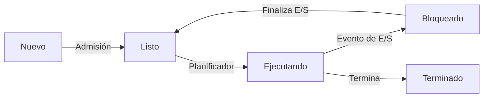
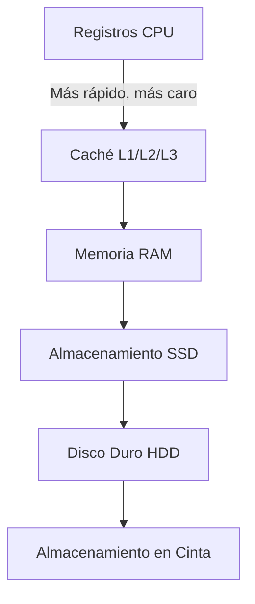
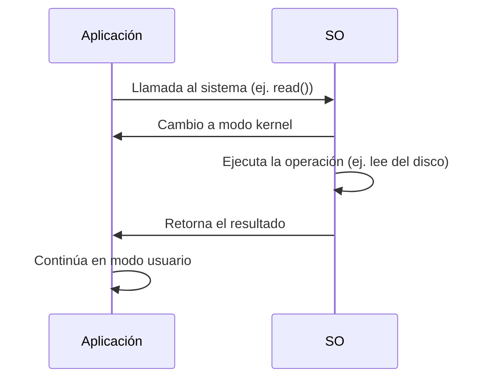

## **1. Funciones Principales de un Sistema Operativo**

Las funciones de un SO pueden agruparse en **6 pilares fundamentales**:

---

### **1.1. Gestión de Procesos**
#### **Definición**
Un **proceso** es un **programa en ejecución** que requiere recursos (CPU, memoria, archivos). El SO es responsable de:
- Crear, suspender, reanudar y terminar procesos.
- Asignar tiempo de CPU a cada proceso (**planificación**).
- Gestionar la **comunicación entre procesos (IPC)**.

#### **Estados de un Proceso**
Los procesos pueden estar en uno de los siguientes estados:



| **Estado**      | **Descripción**                                                                                     |
|-----------------|-----------------------------------------------------------------------------------------------------|
| **Nuevo**       | El proceso se ha creado pero aún no se ha cargado en memoria.                                       |
| **Listo**       | El proceso está en memoria y listo para ejecutarse (espera CPU).                                    |
| **Ejecutando**  | El proceso está usando la CPU.                                                                     |
| **Bloqueado**   | El proceso espera un evento externo (ej. lectura de disco, entrada de usuario).                   |
| **Terminado**   | El proceso ha finalizado su ejecución.                                                             |

---
#### **Planificación de Procesos (CPU Scheduling)**
El **planificador de CPU** decide qué proceso se ejecuta y en qué orden. Los algoritmos más comunes son:

| **Algoritmo**          | **Descripción**                                                                                     | **Ventajas**                          | **Desventajas**                          |
|------------------------|-----------------------------------------------------------------------------------------------------|---------------------------------------|-----------------------------------------|
| **FCFS (First-Come, First-Served)** | Ejecuta los procesos en el orden en que llegan.                                                   | Simple, justo.                        | Poco eficiente (efecto "convoy").       |
| **SJF (Shortest Job First)** | Ejecuta primero el proceso con el tiempo de ejecución más corto.                                 | Minimiza el tiempo de espera promedio.| Difícil de predecir el tiempo de ejecución. |
| **Round Robin (RR)**   | Asigna a cada proceso un **cuanto de tiempo (time slice)** en orden cíclico.                       | Justo, evita monopolio de CPU.        | Puede aumentar el tiempo de espera.    |
| **Prioridad**          | Los procesos con mayor prioridad se ejecutan primero.                                             | Flexible (prioridades dinámicas).     | Riesgo de **inanición (starvation)**.   |
| **Multinivel**         | Combina varios algoritmos (ej. RR para procesos interactivos, FCFS para procesos por lotes).      | Adaptable a diferentes tipos de procesos. | Complejidad en la implementación.       |

---
#### **Comunicación entre Procesos (IPC)**
Los procesos pueden comunicarse mediante:
1. **Memoria Compartida**: Ambos procesos acceden a una región de memoria común (ej. **POSIX Shared Memory**).
2. **Pasaje de Mensajes**: Los procesos se comunican mediante mensajes (ej. **pipes**, **colas de mensajes**).
   - **Pipes**: Comunicación unidireccional (ej. `ls | grep "txt"` en Linux).
   - **Colas de Mensajes**: Comunicación bidireccional (ej. **Message Queuing Telemetry Transport (MQTT)**).
3. **Semaforos**: Mecanismo de sincronización para evitar condiciones de carrera (ej. **semaforos de Dijkstra**).
4. **Sockets**: Comunicación entre procesos en diferentes máquinas (ej. **TCP/IP**).

---
### **1.2. Gestión de Memoria**
#### **Jerarquía de Memoria**
Los sistemas operativos gestionan una **jerarquía de memoria** para optimizar el acceso a datos:



| **Nivel**       | **Tecnología**       | **Velocidad**       | **Capacidad** | **Coste por GB** |
|-----------------|----------------------|---------------------|---------------|-------------------|
| Registros       | Registros internos CPU | ~1 ns               | KB            | Muy alto          |
| Caché L1        | SRAM                 | ~1-4 ns             | KB-MB         | Alto              |
| Caché L2/L3     | SRAM                 | ~10-50 ns           | MB            | Alto              |
| RAM             | DRAM                 | ~100 ns             | GB            | Medio             |
| SSD             | Flash (NAND)         | ~10-100 µs          | TB            | Bajo              |
| HDD             | Discos magnéticos    | ~5-10 ms            | TB            | Muy bajo          |
| Cinta           | Cinta magnética      | ~Segundos           | TB-PB         | Muy bajo          |

---
#### **Técnicas de Gestión de Memoria**
| **Técnica**               | **Descripción**                                                                                     | **Ventajas**                          | **Desventajas**                          |
|---------------------------|-----------------------------------------------------------------------------------------------------|---------------------------------------|-----------------------------------------|
| **Partición Fija**        | La memoria se divide en particiones estáticas. Cada proceso se carga en una partición.           | Simple.                              | Fragmentación interna.                  |
| **Partición Dinámica**    | Las particiones se crean dinámicamente según el tamaño del proceso.                               | Sin fragmentación interna.           | Fragmentación externa.                  |
| **Paginación**            | La memoria física se divide en **marcos (frames)** y la lógica en **páginas**.                    | Sin fragmentación externa.            | Overhead en tablas de páginas.           |
| **Segmentación**          | La memoria se divide en **segmentos lógicos** (código, datos, pila).                              | Protección y compartición fácil.     | Fragmentación externa.                  |
| **Memoria Virtual**       | Combina paginación y almacenamiento en disco para simular una memoria más grande que la RAM.      | Permite ejecutar programas grandes.  | Overhead en acceso a disco.             |

---
#### **Paginación y Memoria Virtual**
- **Página**: Bloque de tamaño fijo (ej. 4 KB) en memoria lógica.
- **Marco (Frame)**: Bloque de tamaño fijo en memoria física.
- **Tabla de Páginas**: Estructura que mapea páginas lógicas a marcos físicos.
- **Page Fault**: Ocurre cuando una página no está en RAM y debe cargarse desde el disco (**swap**).

**Ejemplo de Tabla de Páginas**:
| **Página Lógica** | **Marco Físico** | **Bit de Presencia** | **Bit de Modificación** | **Bit de Referencia** |
|-------------------|-------------------|----------------------|-------------------------|-----------------------|
| 0                 | 5                 | 1                    | 0                       | 1                     |
| 1                 | -                 | 0                    | -                       | -                     |
| 2                 | 10                | 1                    | 1                       | 1                     |

## **2. Modos de Operación del Procesador**

Los procesadores modernos soportan **dos modos principales de operación** para proteger el sistema:

---
### **2.1. Modo Usuario (User Mode)**
- **Definición**: Modo de ejecución con **restricciones**. Las aplicaciones se ejecutan en este modo.
- **Características**:
  - No puede acceder directamente al hardware.
  - No puede ejecutar instrucciones privilegiadas (ej. deshabilitar interrupciones).
  - Si intenta acceder a recursos protegidos, genera una **excepción (trap)** y el control pasa al SO.
- **Ejemplo**: Un programa en Python o un navegador web.

---
### **2.2. Modo Kernel (Kernel Mode)**
- **Definición**: Modo de ejecución con **acceso total al hardware**. El SO se ejecuta en este modo.
- **Características**:
  - Puede ejecutar cualquier instrucción (ej. leer/escribir en puertos de E/S).
  - Tiene acceso directo a la memoria física y dispositivos.
  - Si un proceso en modo kernel falla, puede **colgar todo el sistema**.
- **Ejemplo**: El kernel de Linux o Windows.

---
### **2.3. Transición entre Modos**
La transición entre **modo usuario** y **modo kernel** se realiza mediante:
1. **Llamadas al Sistema (System Calls)**:
   - Un proceso en modo usuario solicita un servicio del SO (ej. leer un archivo).
2. **Interrupciones (Interrupts)**:
   - Señales generadas por hardware (ej. teclado, disco duro) que requieren atención del SO.
3. **Excepciones (Traps)**:
   - Eventos generados por el software (ej. división por cero, acceso a memoria no válida).

---
#### **Mecanismo de una Llamada al Sistema**



## **3. Componentes Clave de un Sistema Operativo**

---
### **3.1. Kernel**
El **kernel** es el **núcleo del sistema operativo** y se encarga de:
- **Gestión de procesos**: Creación, planificación y terminación.
- **Gestión de memoria**: Asignación y liberación de memoria.
- **Gestión de dispositivos**: Controladores de hardware.
- **Sistema de archivos**: Organización y acceso a datos.
- **Comunicación entre procesos (IPC)**: Mecanismos para que los procesos se comuniquen.

---
#### **Tipos de Kernel**
| **Tipo**               | **Descripción**                                                                                     | **Ejemplos**                          |
|------------------------|-----------------------------------------------------------------------------------------------------|---------------------------------------|
| **Monolítico**         | Todo el kernel se ejecuta en un solo espacio de memoria.                                           | Linux (en su núcleo), Unix           |
| **Microkernel**        | Solo funciones esenciales en modo kernel; el resto en modo usuario.                               | QNX, MINIX, L4                       |
| **Híbrido**           | Combina elementos de monolítico y microkernel.                                                     | Windows NT, macOS                    |

---
### **3.2. Shell**
El **shell** es la **interfaz entre el usuario y el kernel**. Su función es:
- **Interpretar comandos**: Traduce comandos del usuario a llamadas al sistema.
- **Ejecutar programas**: Inicia aplicaciones o scripts.
- **Gestionar el entorno**: Configura variables de entorno y redirecciones.

---
#### **Tipos de Shell**
| **Shell**               | **Descripción**                                                                                     | **SO**               |
|-------------------------|-----------------------------------------------------------------------------------------------------|---------------------|
| **Bash**               | Shell por defecto en Linux. Soporte para scripts avanzados.                                         | Linux, macOS        |
| **PowerShell**          | Shell avanzado de Microsoft con soporte para objetos .NET.                                         | Windows             |
| **Zsh**                | Shell mejorado con autocompletado y temas personalizables.                                         | Linux, macOS        |
| **cmd.exe**            | Shell básico de Windows.                                                                             | Windows             |

---
#### **Ejemplo de Script en Bash**
```bash
#!/bin/bash
# Script para listar archivos y mostrar la fecha
echo "Hoy es: $(date)"
echo "Archivos en el directorio actual:"
ls -l
```

---
### **3.3. Sistema de Archivos**
Como se mencionó anteriormente, el **sistema de archivos** organizan los datos en el almacenamiento. Sus componentes son:
1. **Superbloque**: Contiene metadatos del sistema de archivos (ej. tamaño, número de bloques libres).
2. **Tabla de Inodos**: Almacena metadatos de los archivos (ej. permisos, tamaño, punteros a bloques de datos).
3. **Bloques de Datos**: Contienen los datos reales de los archivos.

---
### **3.4. Controladores de Dispositivos**
Los **controladores de dispositivos** (drivers) son módulos de software que permiten al SO interactuar con el hardware. Pueden ser:
- **Controladores de Bloque**: Para dispositivos como discos duros (ej. `sda` en Linux).
- **Controladores de Carácter**: Para dispositivos como teclados o ratones (ej. `/dev/tty` en Linux).
- **Controladores de Red**: Para tarjetas de red (ej. `eth0`, `wlan0`).

---
#### **Ejemplo: Carga de un Controlador en Linux**
```bash
# Cargar un controlador de dispositivo (ej. para una tarjeta de red)
sudo modprobe e1000

# Ver controladores cargados
lsmod
```

---
### **3.5. Bibliotecas del Sistema**
Las **bibliotecas del sistema** son conjuntos de funciones precompiladas que las aplicaciones pueden usar para interactuar con el SO. Ejemplos:
- **glibc (GNU C Library)**: Biblioteca estándar de C en Linux.
- **WinAPI**: Biblioteca de funciones para Windows.
- **POSIX**: Conjunto de estándares para SO tipo Unix.