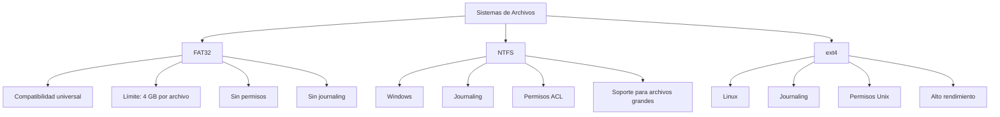

Un **sistema de archivos** es una estructura lógica que organizan y gestionan los datos en un dispositivo de almacenamiento (discos duros, SSD, memorias USB, etc.). Define cómo se almacenan, acceden y organizan los archivos, así como los metadatos asociados (permisos, fechas, tamaño, etc.).

Cada sistema de archivos tiene **ventajas, limitaciones y casos de uso específicos**, lo que los hace más adecuados para ciertas situaciones. A continuación, se detallan tres de los más relevantes: **FAT32**, **NTFS** y **ext4**.

---

## **1. Agrupación de Registros**
En el almacenamiento de datos, **los registros son la unidad lógica de acceso a la información**, mientras que **los bloques representan la unidad física mínima** de transferencia de datos en disco. Los registros se pueden agrupar en bloques de tamaño fijo, de longitud variable por tramos o sin tramos.

Además, a la hora de asignar memoria esta puede ser predefinida asignando un espacio fijo en el momento de la creación o de forma dinámica a medida que el fichero crece.

Se pueden seguir varias estrategias a la hora de la asignación. Si se realiza de **forma continua** el archivo recibe un conjunto de bloques contiguos. Esto es eficiente para un acceso de memoria secuencial, pero provoca fragmentación en el disco no llegando a ocupar todos los bloques disponibles.



**Asignación encadenada** es cuando un archivo se divide en bloques individuales y cada bloque tiene un puntero al siguiente, no provoca fragmentación, pero ralentiza la lectura ya que el sistema debe recorrer toda la cadena de bloques para acceder a los datos.



**La asignación indexada** es cuando se usa un índice para almacenar las direcciones de todos los bloques de un archivo, evita la fragmentación y permite el acceso tanto secuencial como aleatorio. Es el método más utilizado.



Para administrar las partes del almacenamiento que están ocupadas o disponibles, se usan tablas de asignación. Estas pueden ser de bits o listas.

## **2. FAT32 (File Allocation Table 32)**

### **2.1. Definición**

- **FAT32** es un sistema de archivos desarrollado por Microsoft como una evolución de los sistemas **FAT16** y **FAT12**. Utiliza una tabla de asignación de archivos de **32 bits** para gestionar el espacio en disco.

### **2.2. Características**

| **Atributo**                    | **Detalle**                                                                     |
| ------------------------------- | ------------------------------------------------------------------------------- |
| **Estructura**                  | Tabla de asignación de archivos (FAT) para rastrear clusters.                   |
| **Tamaño máximo de archivo**    | **4 GB** (limitación por diseño).                                               |
| **Tamaño máximo de partición**  | **2 TB** (con sectores de 512 bytes). La herramienta de formateo de Windows solo crea volúmenes FAT32 de hasta **32 GB**, pero es un límite de esa herramienta, no del sistema de archivos. |
| **Compatibilidad**              | Amplia: Windows, macOS (solo lectura), Linux, consolas, dispositivos embebidos. |
| **Soporte para permisos**       | **No** (no tiene gestión de permisos de usuario).                               |
| **Fragmentación**               | Alta (no maneja bien la fragmentación en discos grandes).                       |
| **Journaling**                  | **No** (no registra cambios para recuperación ante fallos).                     |
| **Soporte para nombres largos** | Sí (hasta 255 caracteres, Unicode).                                             |

### **2.3. Ventajas**

- **Compatibilidad universal**: Funciona en casi cualquier dispositivo o sistema operativo.
- **Bajo consumo de recursos**: Ideal para dispositivos con poca memoria o procesamiento (ej: memorias USB).
- **Sencillez**: Fácil de implementar y mantener.

### **2.4. Desventajas**

- **Límite de 4 GB por archivo**: No puede manejar archivos más grandes.
- **No soporta permisos de seguridad**: No es adecuado para entornos multiusuario.
- **Fragmentación**: Puede degradar el rendimiento con el tiempo.
- **Sin journaling**: Mayor riesgo de corrupción de datos ante fallos repentinos.

### **2.5. Casos de Uso**

- Memorias USB y tarjetas SD.
- Discos duros externos para compatibilidad entre sistemas.
- Sistemas embebidos o dispositivos antiguos.

---

## **3. NTFS (New Technology File System)**

### **3.1. Definición**

- **NTFS** es el sistema de archivos principal de Microsoft, introducido con **Windows NT** y utilizado en versiones modernas de Windows (Windows 2000, XP, 7, 10, 11).

### **3.2. Características**

| **Atributo**                    | **Detalle**                                                                             |
| ------------------------------- | --------------------------------------------------------------------------------------- |
| **Estructura**                  | Basado en una **Master File Table (MFT)** que almacena metadatos de todos los archivos. |
| **Tamaño máximo de archivo**    | **16 EB** (Exabytes) en teoría (limitado por el hardware).                              |
| **Tamaño máximo de partición**  | **16 EB** (en la práctica, depende del hardware).                                       |
| **Compatibilidad**              | Windows (completo), Linux (lectura/escritura con controladores), macOS (solo lectura).  |
| **Soporte para permisos**       | **Sí** (ACLs: Listas de Control de Acceso).                                             |
| **Fragmentación**               | Manejo avanzado (menos fragmentación que FAT32).                                        |
| **Journaling**                  | **Sí** (registra cambios para recuperación ante fallos).                                |
| **Compresión**                  | Soporte nativo para compresión de archivos y carpetas.                                  |
| **Cifrado**                     | Soporte para **EFS (Encrypting File System)**.                                          |
| **Nombres largos**              | Sí (hasta 255 caracteres, Unicode).                                                     |
| **Hard Links y Symbolic Links** | Soporte para enlaces duros y simbólicos.                                                |

### **3.3. Ventajas**

- **Rendimiento**: Más eficiente que FAT32 en discos grandes.
- **Seguridad**: Permisos de usuario, cifrado y auditoría.
- **Journaling**: Recuperación de datos ante fallos.
- **Soporte para archivos grandes**: Ideal para discos duros modernos.
- **Características avanzadas**: Cuotas de disco, compresión, enlaces simbólicos.

### **3.4. Desventajas**

- **Menor compatibilidad**: No funciona en algunos dispositivos antiguos o sistemas no Windows.
- **Mayor consumo de recursos**: Requiere más memoria y procesamiento.

### **3.5. Casos de Uso**

- Discos duros internos en sistemas Windows.
- Servidores con Windows Server.
- Entornos donde se requieren permisos de seguridad y journaling.

---

## **4. ext4 (Fourth Extended Filesystem)**

### **4.1. Definición**

- **ext4** es el sistema de archivos más utilizado en distribuciones de **Linux**. Es una evolución de **ext3**, que a su vez proviene de **ext2**. Fue lanzado en 2008 y es el estándar en la mayoría de las distribuciones modernas.

### **4.2. Características**

| **Atributo**                    | **Detalle**                                                                   |
| ------------------------------- | ----------------------------------------------------------------------------- |
| **Estructura**                  | Basado en **inodos** (estructuras que almacenan metadatos de archivos).       |
| **Tamaño máximo de archivo**    | **16 TB** (con bloques de 4 KB).                                              |
| **Tamaño máximo de partición**  | **1 EB** (Exabyte) en teoría.                                                 |
| **Compatibilidad**              | Linux (completo), Android, algunos sistemas embebidos.                        |
| **Soporte para permisos**       | **Sí** (permisos Unix: usuario, grupo, otros).                                |
| **Fragmentación**               | Manejo eficiente (mejor que FAT32 y NTFS en algunos casos).                   |
| **Journaling**                  | **Sí** (modo completo, ordenado o solo metadatos).                            |
| **Compresión**                  | No nativamente (pero se puede usar con herramientas externas como `e2compr`). |
| **Cifrado**                     | Soporte mediante herramientas como `eCryptfs` o `LUKS`.                       |
| **Nombres largos**              | Sí (hasta 255 caracteres, UTF-8).                                             |
| **Hard Links y Symbolic Links** | Soporte nativo.                                                               |

### **4.3. Ventajas**

- **Rendimiento**: Optimizado para Linux, con alto rendimiento en operaciones de lectura/escritura.
- **Escalabilidad**: Soporte para particiones y archivos muy grandes.
- **Journaling**: Recuperación rápida ante fallos.
- **Permisos avanzados**: Compatible con el modelo de permisos de Unix.
- **Extensiones**: Soporte para **extensiones** (ej: `extents` para manejo eficiente de espacio).
- **Compatibilidad con SSDs**: Optimizado para dispositivos de almacenamiento rápido.

### **4.4. Desventajas**

- **Compatibilidad limitada**: No es nativamente compatible con Windows (requiere controladores de terceros).
- **Sin compresión nativa**: Requiere herramientas externas.

### **4.5. Casos de Uso**

- Discos duros y SSDs en sistemas Linux.
- Servidores con Linux.
- Dispositivos embebidos con Linux (ej: Raspberry Pi).

---

## **5. Comparativa entre FAT32, NTFS y ext4**

### **5.1. Tabla Comparativa**

| **Característica**              | **FAT32**           | **NTFS**                 | **ext4**                     |
| ------------------------------- | ------------------- | ------------------------ | ---------------------------- |
| **Sistema Operativo Principal** | Todos (universal)   | Windows                  | Linux                        |
| **Tamaño máximo de archivo**    | 4 GB                | 16 EB                    | 16 TB                        |
| **Tamaño máximo de partición**  | 2 TB (*)            | 16 EB                    | 1 EB                         |
| **Journaling**                  | No                | Sí                     | Sí                         |
| **Permisos de seguridad**       | No                | Sí (ACL)               | Sí (Unix)                  |
| **Compatibilidad con Windows**  | Sí                | Sí                     | No (sin controladores)     |
| **Compatibilidad con Linux**    | Sí                | Sí (lectura/escritura) | Sí                         |
| **Compatibilidad con macOS**    | Sí (solo lectura) | Sí (solo lectura)      | No                         |
| **Fragmentación**               | Alta                | Baja                     | Baja                         |
| **Compresión nativa**           | No                | Sí                     | No                         |
| **Cifrado nativo**              | No                | Sí (EFS)               | No (herramientas externas) |
| **Enlaces simbólicos**          | No                | Sí                     | Sí                         |
| **Uso típico**                  | USB, tarjetas SD    | Discos duros (Windows)   | Discos duros (Linux)         |

(*) Límite del sistema de archivos con sectores de 512 bytes. El formateador de Windows solo permite crear volúmenes FAT32 de hasta 32 GB; para volúmenes mayores hay que usar otras herramientas (por ejemplo, `mkfs.vfat` en Linux) o elegir exFAT o NTFS.

---

## **6. ¿Cuál Elegir?**

### **6.1. FAT32**

- **Elige este si**:
  - Necesitas **compatibilidad universal** (USB, tarjetas SD, dispositivos antiguos).
  - No trabajas con archivos mayores a **4 GB**.
  - No requieres permisos de seguridad.

### **6.2. NTFS**

- **Elige este si**:
  - Usas **Windows** como sistema operativo principal.
  - Necesitas **seguridad** (permisos, cifrado).
  - Trabajas con **archivos muy grandes** (más de 4 GB).
  - Requieres **journaling** para recuperación de datos.

### **6.3. ext4**

- **Elige este si**:
  - Usas **Linux** como sistema operativo principal.
  - Necesitas **alto rendimiento** en discos duros o SSDs.
  - Requieres **journaling** y permisos avanzados.
  - Trabajas con **particiones o archivos muy grandes**.

---

## **7. Otros Sistemas de Archivos Relevantes**

### **7.1. exFAT (Extended File Allocation Table)**

- **Desarrollado por**: Microsoft.
- **Ventajas**:
  - Sin límite de **4 GB por archivo** (soporte para archivos &gt; 4 GB).
  - Compatible con **Windows, macOS y Linux** (con controladores).
  - Ideal para **memorias USB y tarjetas SD de alta capacidad**.
- **Desventajas**:
  - No soporta **permisos de seguridad** ni **journaling**.

### **7.2. Btrfs (B-tree File System)**

- **Desarrollado para**: Linux.
- **Ventajas**:
  - **Journaling avanzado** y **snapshots** (copias de seguridad instantáneas).
  - **Compresión transparente** y **deduplicación**.
  - Soporte para **RAID por software**.
- **Desventajas**:
  - Menos maduro que ext4 en algunos entornos.

### **7.3. ZFS (Z File System)**

- **Desarrollado por**: Sun Microsystems (ahora Oracle).
- **Ventajas**:
  - **Alta integridad de datos** (checksums, detección de corrupción).
  - **Snapshots**, **clonación** y **compresión**.
  - Soporte para **pools de almacenamiento** y **RAID avanzado**.
- **Desventajas**:
  - Alto consumo de **RAM** (requiere al menos 4 GB para funcionamiento óptimo).
  - No es nativo en Windows (requiere controladores).

