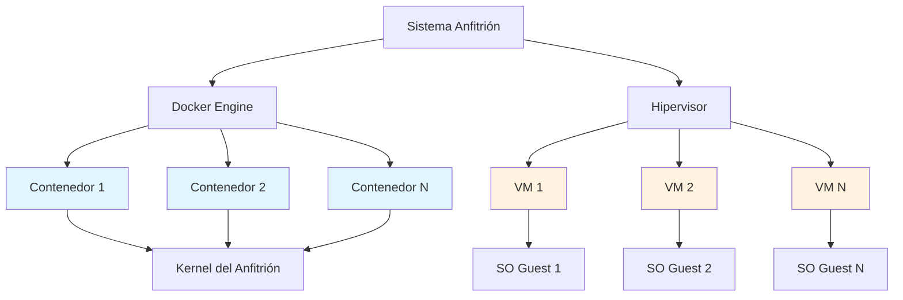
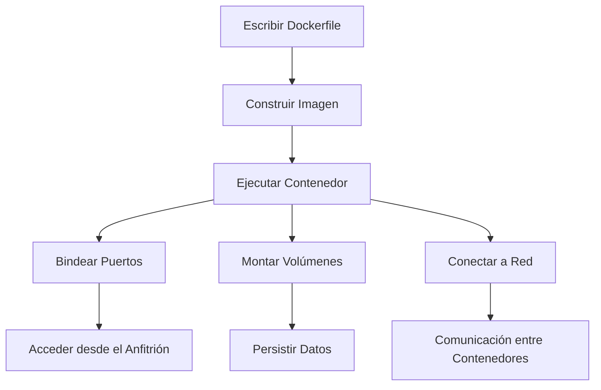

## **1. ¿Qué es Docker?**

Docker es una **plataforma de contenedorización** que permite empaquetar, distribuir y ejecutar aplicaciones en **contenedores**. Un contenedor es una unidad ligera y portable que incluye todo lo necesario para ejecutar una aplicación: código, runtime, herramientas del sistema, bibliotecas y configuraciones.

### **1.1 Características principales de Docker**

- **Aislamiento**: Cada contenedor se ejecuta de forma independiente, sin interferir con otros contenedores o el sistema anfitrión.
- **Portabilidad**: Los contenedores pueden ejecutarse en cualquier entorno que tenga Docker instalado (Linux, Windows, macOS, cloud, etc.).
- **Eficiencia**: Los contenedores comparten el kernel del sistema operativo del anfitrión, lo que los hace más ligeros que las máquinas virtuales.
- **Escalabilidad**: Facilita la escalabilidad horizontal de aplicaciones.
- **Automatización**: Permite definir infraestructuras como código (IaC) mediante archivos `Dockerfile`.

---

## **2. Comparación entre Docker y Máquinas Virtuales (VM)**

### **2.1 Docker (Contenedores)**

- **Arquitectura**: Comparte el kernel del sistema operativo del anfitrión.
- **Rendimiento**: Más rápido y ligero, ya que no requiere un sistema operativo completo por contenedor.
- **Recursos**: Consume menos CPU, RAM y almacenamiento.
- **Aislamiento**: Aislamiento a nivel de procesos (menos seguro que las VMs, pero suficiente para la mayoría de casos de uso).
- **Uso típico**: Aplicaciones microservicios, entornos de desarrollo, despliegues en la nube.

### **2.2 Máquinas Virtuales (VM)**

- **Arquitectura**: Requiere un sistema operativo completo (guest OS) para cada VM.
- **Rendimiento**: Más lento y pesado debido a la virtualización completa del hardware.
- **Recursos**: Consume más CPU, RAM y almacenamiento.
- **Aislamiento**: Aislamiento completo a nivel de hardware (más seguro).
- **Uso típico**: Ejecución de múltiples sistemas operativos en un mismo hardware, entornos de prueba, servidores completos.

| **Aspecto**             | **Docker (Contenedores)**        | **Máquinas Virtuales (VM)**    |
| ----------------------- | -------------------------------- | ------------------------------ |
| **Sistema Operativo**   | Comparte el kernel del anfitrión | Requiere un SO completo        |
| **Rendimiento**         | Alto (ligero)                    | Bajo (pesado)                  |
| **Consumo de Recursos** | Bajo                             | Alto                           |
| **Aislamiento**         | A nivel de procesos              | A nivel de hardware            |
| **Tiempo de Inicio**    | Segundos                         | Minutos                        |
| **Portabilidad**        | Alta                             | Media (depende del hipervisor) |
| **Uso Típico**          | Microservicios, desarrollo       | Entornos completos, servidores |


---

## **3. Conceptos Clave en Docker**

### **3.1 Bindeo de Puertos**

El **bindeo de puertos** permite mapear un puerto del contenedor a un puerto del anfitrión, lo que facilita el acceso a servicios que se ejecutan dentro del contenedor desde el exterior.

**Ejemplo:**

```bash
# Mapear el puerto 80 del contenedor al puerto 8080 del anfitrión
docker run -p 8080:80 nginx
```

- **`-p 8080:80`**: El puerto `80` del contenedor se expone en el puerto `8080` del anfitrión.

**Casos de uso:**

- Ejecutar un servidor web (ej. Nginx, Apache) y acceder desde el navegador.
- Exponer APIs o bases de datos para desarrollo local.

---

### **3.2 Volúmenes**

Los **volúmenes** permiten persistir datos generados por contenedores en el sistema de archivos del anfitrión o en almacenamiento externo. Esto es útil para bases de datos, archivos de configuración o cualquier dato que deba persistir después de que el contenedor se detenga.

**Ejemplo:**

```bash
# Crear un volumen y montarlo en un contenedor
docker volume create my_volume
docker run -v my_volume:/data my_container
```

- **`-v my_volume:/data`**: Monta el volumen `my_volume` en el directorio `/data` del contenedor.

**Casos de uso:**

- Almacenar datos de bases de datos (ej. MySQL, PostgreSQL).
- Compartir archivos entre contenedores.

---

### **3.3 Redes**

Docker proporciona redes virtuales para que los contenedores puedan comunicarse entre sí y con el exterior. Por defecto, los contenedores se conectan a una red llamada `bridge`, pero también se pueden crear redes personalizadas.

**Ejemplo:**

```bash
# Crear una red personalizada
docker network create my_network

# Ejecutar contenedores en la misma red
docker run --network my_network --name container1 nginx
docker run --network my_network --name container2 nginx
```

- **`--network my_network`**: Conecta los contenedores a la red `my_network`.

**Casos de uso:**

- Comunicación entre microservicios.
- Aislamiento de grupos de contenedores.

---

### **3.4 Consolas Remotas**

Docker permite acceder a la terminal de un contenedor en ejecución para depuración o administración.

**Ejemplo:**

```bash
# Acceder a la terminal de un contenedor en ejecución
docker exec -it my_container bash
```

- **`exec -it`**: Ejecuta un comando interactivo (`-it`) en el contenedor.
- **`bash`**: Inicia una sesión de Bash (puede ser `sh` en contenedores basados en Alpine).

**Casos de uso:**

- Depurar aplicaciones en ejecución.
- Modificar configuraciones en tiempo real.

---

### **3.5 Buildeo de Imágenes Personalizadas**

Docker permite crear imágenes personalizadas mediante un archivo `Dockerfile`. Este archivo define los pasos para construir la imagen, como instalar dependencias, copiar archivos y configurar el entorno.

**Ejemplo de `Dockerfile`:**

```dockerfile
# Usar una imagen base
FROM ubuntu:22.04

# Instalar dependencias
RUN apt-get update && apt-get install -y python3

# Copiar archivos locales al contenedor
COPY app.py /app/

# Definir el comando por defecto
CMD ["python3", "/app/app.py"]
```

**Pasos para construir la imagen:**

```bash
# Construir la imagen desde el Dockerfile
docker build -t my_custom_image .

# Ejecutar un contenedor desde la imagen
docker run my_custom_image
```

- **`docker build -t my_custom_image .`**: Construye una imagen llamada `my_custom_image` usando el `Dockerfile` en el directorio actual.

**Casos de uso:**

- Crear entornos de desarrollo reproducibles.
- Desplegar aplicaciones con todas sus dependencias.

---

## **4. Arquitectura de Docker vs. Máquinas Virtuales**



**Explicación:**

- **Docker**: Los contenedores comparten el kernel del sistema anfitrión, lo que los hace ligeros.
- **VMs**: Cada VM requiere un sistema operativo completo (guest OS), lo que consume más recursos.

---

### **4.1 Flujo de Trabajo con Docker**



**Explicación:**

1. Se define un `Dockerfile` para crear una imagen personalizada.
2. Se construye la imagen usando `docker build`.
3. Se ejecuta un contenedor desde la imagen.
4. Se configuran puertos, volúmenes y redes según sea necesario.

## **5. ¿Qué es Docker Compose?**

Docker Compose es una **herramienta de orquestación** que permite definir y gestionar aplicaciones multi-contenedor mediante un archivo YAML (`docker-compose.yml`). En lugar de ejecutar y configurar cada contenedor individualmente con comandos `docker run`, Compose simplifica el proceso al agrupar todos los servicios, redes, volúmenes y configuraciones en un solo archivo. Esto facilita el despliegue, la escalabilidad y la gestión de entornos complejos con un solo comando.

---

### **5.1 ¿Cómo se utiliza Docker Compose?**

1. **Definir el archivo `docker-compose.yml`**: En este archivo se especifican los servicios (contenedores), redes, volúmenes y otras configuraciones necesarias para la aplicación. Cada servicio se define como un bloque dentro del archivo, con opciones como la imagen a usar, puertos, volúmenes, variables de entorno, etc.

**Ejemplo básico**:
```yaml
   version: "3.8"
   services:
     web:
       image: nginx\:latest
       ports:
         - "8080:80"
       volumes:
         - ./html:/usr/share/nginx/html
     db:
       image: postgres:13
       environment:
         POSTGRES_PASSWORD: mysecretpassword
       volumes:
         - postgres_data:/var/lib/postgresql/data

   volumes:
     postgres_data:
```

- **`services`**: Define los contenedores que formarán parte de la aplicación (ej. `web` y `db`).
- **`ports`**: Mapea puertos del contenedor al anfitrión.
- **`volumes`**: Persiste datos o monta directorios locales.
- **`environment`**: Configura variables de entorno para el contenedor.

2. **Iniciar los servicios**: Una vez definido el archivo, se ejecuta el siguiente comando para crear y empezar todos los contenedores:

```bash
docker-compose up -d
```

- **`-d`**: Ejecuta los contenedores en segundo plano (modo _detached_).

3. **Gestionar los servicios**:
    
- **Detener los servicios**:
```bash
docker-compose down
```
        
- **Ver los logs**:
```bash
docker-compose logs
```
        
- **Escalar servicios** (ej. 3 instancias de `web`):
```bash
docker-compose up -d --scale web=3
```
        
4. **Reconstruir imágenes** (si hay cambios en el `Dockerfile`):
```bash
docker-compose build
``` 

---

### **5.2 Casos de uso típicos**

- **Desarrollo local**: Desplegar entornos completos (ej. base de datos + backend + frontend) con un solo comando.
- **Pruebas**: Crear entornos aislados para pruebas de integración.
- **Producción**: Desplegar aplicaciones multi-contenedor en servidores (aunque para entornos críticos se recomienda usar herramientas como Kubernetes o Docker Swarm).

---

## **6. Tabla Resumen: Comandos de Docker y Dockerfile**

Comandos típicos de Docker y Dockerfile

| **Categoría**                | **Comando/Instrucción**                   | **Descripción**                                                                    |
| ---------------------------- | ----------------------------------------- | ---------------------------------------------------------------------------------- |
| **Gestión de Contenedores**  | `docker run [imagen]`                     | Crea y ejecuta un contenedor desde una imagen.                                     |
|                              | `docker run -d [imagen]`                  | Ejecuta el contenedor en segundo plano (_detached_).                               |
|                              | `docker run -p 8080:80 [imagen]`          | Mapea el puerto 80 del contenedor al 8080 del anfitrión.                           |
|                              | `docker run -v /host:/container [imagen]` | Monta un volumen del anfitrión en el contenedor.                                   |
|                              | `docker ps`                               | Lista los contenedores en ejecución.                                               |
|                              | `docker ps -a`                            | Lista todos los contenedores (incluyendo los detenidos).                           |
|                              | `docker stop [id/nombre]`                 | Detiene un contenedor.                                                             |
|                              | `docker start [id/nombre]`                | Inicia un contenedor detenido.                                                     |
|                              | `docker rm [id/nombre]`                   | Elimina un contenedor.                                                             |
|                              | `docker exec -it [id] bash`               | Accede a la terminal de un contenedor en ejecución.                                |
| **Gestión de Imágenes**      | `docker build -t [nombre] .`              | Construye una imagen desde un `Dockerfile` en el directorio actual.                |
|                              | `docker images`                           | Lista todas las imágenes locales.                                                  |
|                              | `docker pull [imagen]`                    | Descarga una imagen desde Docker Hub.                                              |
|                              | `docker push [imagen]`                    | Sube una imagen a un registro (ej. Docker Hub).                                    |
|                              | `docker rmi [imagen]`                     | Elimina una imagen local.                                                          |
| **Redes y Volúmenes**        | `docker network ls`                       | Lista todas las redes de Docker.                                                   |
|                              | `docker network create [nombre]`          | Crea una red personalizada.                                                        |
|                              | `docker volume ls`                        | Lista todos los volúmenes.                                                         |
|                              | `docker volume create [nombre]`           | Crea un volumen.                                                                   |
| **Docker Compose**           | `docker-compose up -d`                    | Inicia todos los servicios definidos en `docker-compose.yml` en segundo plano.     |
|                              | `docker-compose down`                     | Detiene y elimina los contenedores, redes y volúmenes definidos en el archivo.     |
|                              | `docker-compose logs`                     | Muestra los logs de todos los servicios.                                           |
|                              | `docker-compose build`                    | Reconstruye las imágenes de los servicios si hay cambios en los `Dockerfile`.      |
| **Instrucciones Dockerfile** | `FROM [imagen]`                           | Define la imagen base para construir la nueva imagen.                              |
|                              | `RUN [comando]`                           | Ejecuta un comando durante la construcción de la imagen (ej. instalar paquetes).   |
|                              | `COPY [origen] [destino]`                 | Copia archivos del anfitrión al contenedor.                                        |
|                              | `ADD [origen] [destino]`                  | Similar a `COPY`, pero también soporta URLs y descompresión automática.            |
|                              | `WORKDIR [directorio]`                    | Establece el directorio de trabajo dentro del contenedor.                          |
|                              | `ENV [variable]=valor`                    | Define una variable de entorno en el contenedor.                                   |
|                              | `CMD [comando]`                           | Define el comando por defecto que se ejecutará al iniciar el contenedor.           |
|                              | `ENTRYPOINT [comando]`                    | Configura el punto de entrada del contenedor (similar a `CMD`, pero más flexible). |
|                              | `EXPOSE [puerto]`                         | Declara qué puertos escucha el contenedor (no los mapea al anfitrión).             |
|                              | `VOLUME [directorio]`                     | Crea un punto de montaje para un volumen en el contenedor.                         |
