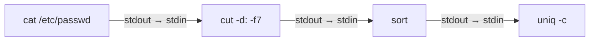

# 3. Redirecciones, tuberías y filtros

La filosofía de Unix se resume en una idea: **programas pequeños que hacen una sola cosa bien y que se pueden combinar entre sí**. Para combinarlos se usan las redirecciones y las tuberías.

## 3.1 Flujos estándar

Todo proceso dispone de tres canales de comunicación, identificados por un número llamado **descriptor de fichero**:

| Descriptor | Nombre | Por defecto | Uso |
| --- | --- | --- | --- |
| `0` | **stdin** (entrada estándar) | Teclado | Datos que lee el programa. |
| `1` | **stdout** (salida estándar) | Pantalla | Resultados normales. |
| `2` | **stderr** (salida de errores) | Pantalla | Mensajes de error. |


Que la salida normal y la de errores sean canales distintos permite, por ejemplo, guardar los resultados en un fichero y seguir viendo los errores en pantalla.

## 3.2 Redirecciones

Una **redirección** cambia el origen o el destino de uno de esos canales.

| Operador | Efecto |
| --- | --- |
| `orden > fich` | Envía stdout a `fich`. **Sobrescribe** el fichero si existe. |
| `orden >> fich` | Envía stdout a `fich`, **añadiendo** al final. |
| `orden 2> fich` | Envía stderr a `fich`. |
| `orden 2>> fich` | Añade stderr al final de `fich`. |
| `orden > fich 2>&1` | Envía stdout y stderr al mismo fichero (el orden importa: primero `>`, luego `2>&1`). |
| `orden &> fich` | Forma abreviada de Bash de lo anterior. |
| `orden < fich` | La orden lee su entrada (stdin) desde `fich`. |
| `orden > /dev/null` | Descarta la salida. `/dev/null` es un "agujero negro" que acepta y desecha todo. |

```bash
ls -l /etc > listado.txt          # Guarda el listado (si existía, se pierde)
date >> registro.txt              # Añade la fecha al final del registro
find / -name '*.conf' 2> errores.txt     # Los errores van al fichero, los resultados a pantalla
find / -name '*.conf' 2> /dev/null       # Descarta los errores
./instalar.sh > instalacion.log 2>&1     # Todo al log
wc -l < /etc/passwd               # wc lee del fichero a través de stdin
```

> [!WARNING]
> `orden fich > fich` **vacía** el fichero antes de leerlo, porque la shell prepara la redirección (truncando el fichero) antes de ejecutar la orden. Por ejemplo, `sort datos.txt > datos.txt` deja `datos.txt` vacío. Usa un fichero intermedio o la opción `-o` de `sort`.

### Documentos en línea (*here documents*)

Permiten pasar varias líneas de texto como entrada estándar sin crear un fichero. Son muy útiles en los scripts para generar ficheros de configuración o mensajes largos:

```bash
cat > saludo.txt <<EOF
Hola, $USER.
Hoy es $(date +%F).
EOF
```

El texto termina en la línea que contiene solo la palabra marcadora (`EOF`, aunque puede ser cualquiera). Si la marca se escribe entre comillas (`<<'EOF'`), las variables **no** se sustituyen.

Con `<<<` (*here string*) se pasa una sola cadena: `wc -w <<< "cuenta estas cuatro palabras"`.

## 3.3 Tuberías

Una **tubería** (*pipe*), representada por `|`, conecta la **salida estándar** de una orden con la **entrada estándar** de la siguiente. Así se construyen "cadenas de montaje" de datos:



```bash
ls -l /etc | less                 # Paginar una salida larga
ps aux | grep firefox             # Buscar un proceso concreto
cut -d: -f7 /etc/passwd | sort | uniq -c   # ¿Cuántos usuarios usan cada shell?
```

`tee` es una "T" de fontanería: copia lo que recibe a un fichero **y** lo sigue pasando por la salida estándar.

```bash
ls -l | tee listado.txt | wc -l   # Guarda el listado y además cuenta las líneas
echo "nameserver 1.1.1.1" | sudo tee -a /etc/resolv.conf   # Escribir en un fichero de root
```

> [!TIP]
> `sudo echo texto > /etc/fichero` **no funciona**: `sudo` se aplica a `echo`, pero la redirección la hace tu shell, que no es root. La forma correcta es `echo texto | sudo tee /etc/fichero` (o `sudo tee -a` para añadir).

## 3.4 Filtros de texto

Un **filtro** es una orden que lee texto (de un fichero o de stdin), lo transforma y lo escribe en stdout. Son las piezas que se encadenan con tuberías.

### `grep`: buscar líneas que contienen un patrón

```text
grep [opciones] 'patrón' [ficheros]
```

| Opción | Efecto |
| --- | --- |
| `-i` | No distingue mayúsculas de minúsculas. |
| `-v` | Invierte: muestra las líneas que **no** coinciden. |
| `-n` | Muestra el número de línea. |
| `-c` | Muestra solo el número de líneas que coinciden. |
| `-w` | Solo palabras completas. |
| `-r` | Busca recursivamente en un directorio. |
| `-l` | Muestra solo el nombre de los ficheros que contienen el patrón. |
| `-o` | Muestra solo la parte que coincide. |
| `-q` | Silencioso: no muestra nada, solo devuelve el código de salida (útil en scripts). |
| `-E` | Expresiones regulares extendidas (sustituye al obsoleto `egrep`). |

```bash
grep 'alumno' /etc/passwd
grep -i 'error' /var/log/syslog
grep -v '^#' /etc/ssh/sshd_config | grep -v '^$'   # Sin comentarios ni líneas vacías
grep -rn 'TODO' ~/proyectos/app/src                 # Tareas pendientes en el código
grep -c '/bin/bash$' /etc/passwd                    # Usuarios con shell Bash
```

Los patrones de `grep` son **expresiones regulares**. Los elementos básicos son:

| Símbolo | Significado | Ejemplo |
| --- | --- | --- |
| `^` | Principio de línea. | `^root` |
| `$` | Final de línea. | `bash$` |
| `.` | Cualquier carácter. | `c.sa` → casa, cosa |
| `*` | El elemento anterior, 0 o más veces. | `ab*c` → ac, abc, abbc |
| `[ ]` | Un carácter del conjunto. | `[0-9]` |
| `+`, `?`, `{n}`, `\|` | (Con `-E`) 1 o más, 0 o 1, n veces, alternativa. | `-E '[0-9]{3}'`, `-E 'error\|warning'` |

### `cut`: extraer columnas

```bash
cut -d: -f1 /etc/passwd          # Campo 1 usando ":" como delimitador
cut -d: -f1,6 /etc/passwd        # Campos 1 y 6
cut -d, -f2- alumnos.csv         # Del campo 2 al final
cut -c1-8 fichero.txt            # Caracteres del 1 al 8 de cada línea
```

### `sort` y `uniq`: ordenar y eliminar repetidos

| Opción de `sort` | Efecto |
| --- | --- |
| `-n` | Orden numérico (si no, `10` va antes que `9`). |
| `-r` | Orden inverso. |
| `-t X -k N` | Ordena por la columna N usando X como separador. |
| `-u` | Elimina duplicados. |
| `-h` | Entiende tamaños legibles (`2K`, `1G`). |

`uniq` elimina las líneas repetidas **consecutivas** (por eso casi siempre va detrás de `sort`). Con `-c` cuenta las repeticiones y con `-d` muestra solo las repetidas.

```bash
sort -t: -k3 -n /etc/passwd      # Usuarios ordenados por UID
du -sh ~/* | sort -h             # Directorios ordenados por tamaño
sort nombres.txt | uniq -c | sort -nr   # Ranking de los valores más repetidos
```

### `tr`: traducir o borrar caracteres

```bash
echo "hola mundo" | tr 'a-z' 'A-Z'     # HOLA MUNDO
echo "a;b;c" | tr ';' '\n'             # Un elemento por línea
echo "texto   con   espacios" | tr -s ' '   # -s comprime repeticiones: "texto con espacios"
echo "tel: 600-11-22-33" | tr -d '-'   # -d borra: "tel: 600112233"
```

### `wc`, `head` y `tail` en tuberías

```bash
ls | wc -l                         # ¿Cuántos ficheros hay en el directorio?
ps aux --sort=-%mem | head -n 6    # Cabecera + los 5 procesos que más memoria usan
history | tail -n 20               # Las últimas 20 órdenes
```

### Dos herramientas más potentes: `awk` y `sed`

`awk` y `sed` son, en realidad, pequeños lenguajes de programación para procesar texto. Basta con conocer sus usos más habituales:

```bash
# awk: trabaja por columnas. -F indica el separador; $1, $2… son los campos
awk -F: '{ print $1, $7 }' /etc/passwd          # Usuario y shell
awk -F: '$3 >= 1000 { print $1 }' /etc/passwd   # Usuarios con UID >= 1000
df -h | awk 'NR > 1 { print $5, $6 }'           # Uso (%) y punto de montaje (NR = n.º de línea)

# sed: edita flujos de texto. s/buscar/reemplazar/g
sed 's/http:/https:/g' enlaces.txt              # Muestra el resultado (no modifica el fichero)
sed -i 's/DEBUG=true/DEBUG=false/' .env         # -i modifica el fichero "in situ"
sed -n '5,10p' fichero.txt                      # Muestra solo las líneas 5 a 10
sed '3d' fichero.txt                            # Muestra el fichero sin la línea 3
```

### `xargs`: convertir líneas en argumentos

Algunas órdenes (como `rm`, `cp` o `mkdir`) no leen datos de stdin, sino que esperan **argumentos**. `xargs` lee líneas de su entrada y las pasa como argumentos a otra orden:

```bash
cat lista_directorios.txt | xargs mkdir -p      # Crea los directorios de la lista
find . -name '*.bak' -print0 | xargs -0 rm      # -print0/-0 soportan nombres con espacios
```

## 3.5 Encadenar órdenes

| Operador | Significado |
| --- | --- |
| `orden1 ; orden2` | Ejecuta una detrás de otra, pase lo que pase. |
| `orden1 && orden2` | Ejecuta `orden2` **solo si** `orden1` termina **bien**. |
| `orden1 \|\| orden2` | Ejecuta `orden2` **solo si** `orden1` **falla**. |
| `$(orden)` | **Sustitución de órdenes**: se sustituye por la salida de `orden`. |

```bash
sudo apt update && sudo apt upgrade -y     # Solo actualiza si la lista se descargó bien
mkdir copia || echo "No se pudo crear el directorio"
echo "Hay $(ls | wc -l) ficheros en $(pwd)"
cp informe.txt "informe_$(date +%F).txt"   # informe_2026-11-08.txt
```

¿Cómo sabe la shell si una orden ha ido "bien"? Lo veremos en detalle en el apartado 7: toda orden devuelve un **código de salida**, que vale `0` si ha terminado correctamente.

---

## Ejercicios resueltos

Para los ejercicios 3.3 y 3.4 crea primero un fichero de ejemplo con un *here document*:

```bash
cat > accesos.log <<'EOF'
192.168.1.10 - - [08/Nov/2026:10:01:12] "GET /index.html" 200
192.168.1.22 - - [08/Nov/2026:10:01:15] "GET /login" 200
192.168.1.10 - - [08/Nov/2026:10:02:01] "POST /login" 401
10.0.0.5 - - [08/Nov/2026:10:03:44] "GET /admin" 403
192.168.1.10 - - [08/Nov/2026:10:04:10] "POST /login" 200
192.168.1.22 - - [08/Nov/2026:10:05:00] "GET /noexiste" 404
10.0.0.5 - - [08/Nov/2026:10:06:30] "GET /admin" 403
EOF
```

### Ejercicio 3.1. Usuarios y shells

Usando `/etc/passwd`, muestra: (a) solo los nombres de usuario ordenados alfabéticamente, (b) cuántos usuarios hay en total y (c) cuántos usuarios utilizan cada shell, de la más usada a la menos usada.

{}
```bash
cut -d: -f1 /etc/passwd | sort                     # (a)
wc -l < /etc/passwd                                # (b) con < solo se muestra el número
cut -d: -f7 /etc/passwd | sort | uniq -c | sort -nr   # (c)
```

En (c), el primer `sort` agrupa las shells iguales, `uniq -c` cuenta cada grupo y el segundo `sort -nr` ordena numéricamente de mayor a menor.
{}

### Ejercicio 3.2. Separar resultados y errores

Busca en `/etc` todos los ficheros cuyo nombre contenga `host`. Guarda los resultados en `encontrados.txt`, los errores en `errores.txt` y, al final, muestra cuántos resultados y cuántos errores ha habido.

{}
```bash
find /etc -name '*host*' > encontrados.txt 2> errores.txt
echo "Resultados: $(wc -l < encontrados.txt)"
echo "Errores: $(wc -l < errores.txt)"
```
{}

### Ejercicio 3.3. Analizar un registro web

Con el fichero `accesos.log`, obtén:

1. Las peticiones que han terminado en error (código 4xx).
2. Las IP distintas que aparecen.
3. Cuántas peticiones ha hecho cada IP, ordenadas de más a menos.

{}
```bash
grep -E '" 4[0-9]{2}$' accesos.log          # 1. Comillas, espacio y 4 + dos cifras al final

cut -d' ' -f1 accesos.log | sort -u          # 2. sort -u ordena y elimina duplicados

cut -d' ' -f1 accesos.log | sort | uniq -c | sort -nr   # 3.
#   3 192.168.1.10
#   2 192.168.1.22
#   2 10.0.0.5
```
{}

### Ejercicio 3.4. Intentos de acceso fallidos

Muestra solo las IP que han provocado un código `401` o `403`, sin repetir, y guárdalas también en `sospechosas.txt`.

{}
```bash
grep -E '" (401|403)$' accesos.log | awk '{ print $1 }' | sort -u | tee sospechosas.txt
# 10.0.0.5
# 192.168.1.10
```

`awk '{ print $1 }'` es equivalente a `cut -d' ' -f1`; `awk` separa por espacios por defecto. `tee` muestra el resultado y lo guarda a la vez.
{}
