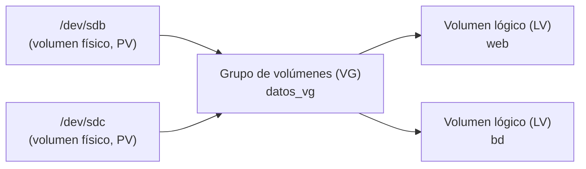

# 4. Almacenamiento y copias de seguridad

Los datos son lo más valioso de un sistema informático: el hardware y el sistema operativo se pueden reponer, pero un fichero perdido sin copia no. En este apartado veremos cómo se organiza el almacenamiento (sistemas de archivos, particiones y volúmenes), cómo consultar el espacio y localizar información, y cómo hacer y restaurar copias de seguridad.

## 4.1 Sistemas de archivos

Un **sistema de archivos** es la forma en que se organizan los datos dentro de una partición: cómo se guardan los ficheros, sus nombres, sus permisos y el espacio libre. En la Unidad 2 se estudiaron sus fundamentos; esta tabla resume los más utilizados para poder elegir uno con criterio:

| Sistema | Uso típico | Tamaño máx. de fichero | Permisos Unix | *Journaling* | Compatibilidad |
| --- | --- | --- | --- | --- | --- |
| **FAT32** | Memorias USB pequeñas, particiones de arranque EFI. | 4 GiB | No | No | Universal (Windows, Linux, macOS, televisores…). |
| **exFAT** | Memorias USB y tarjetas SD grandes. | Prácticamente ilimitado | No | No | Windows, macOS y Linux actuales. |
| **NTFS** | Discos de sistemas Windows. | Prácticamente ilimitado | No (usa ACL propias) | Sí | Windows; Linux puede leerlo y escribirlo. |
| **ext4** | Sistema por defecto en muchas distribuciones Linux. | 16 TiB | Sí | Sí | Linux (Windows no lo lee sin software adicional). |
| **XFS** | Servidores con ficheros grandes (por defecto en RHEL). | Prácticamente ilimitado | Sí | Sí | Linux. |
| **Btrfs** | Escritorios y servidores Linux que necesitan instantáneas (*snapshots*). | Prácticamente ilimitado | Sí | Copia en escritura | Linux. |

> [!NOTE]
> El ***journaling*** (registro por diario) consiste en anotar los cambios antes de hacerlos. Si el equipo se apaga de golpe, el sistema de archivos puede recuperar un estado coherente rápidamente, lo que mejora la **integridad de los datos**.

## 4.2 Discos, particiones y volúmenes

### Cómo nombra Linux los discos

Cada disco aparece como un fichero especial dentro de `/dev`, y cada partición añade un número:

| Nombre | Significado |
| --- | --- |
| `/dev/sda`, `/dev/sdb`… | Discos SATA, SCSI o USB (primero, segundo…). |
| `/dev/sda1`, `/dev/sda2`… | Particiones del disco `sda`. |
| `/dev/nvme0n1`, `/dev/nvme0n1p1` | Disco NVMe y su primera partición. |
| `/dev/vda` | Disco de una máquina virtual (virtio). |

### Consultar discos y espacio

| Orden | Función |
| --- | --- |
| `lsblk -f` | Discos, particiones, sistema de archivos, etiqueta y punto de montaje, en forma de árbol. |
| `df -h` | Espacio total, usado y libre de cada sistema de archivos montado. |
| `df -hT` | Igual, indicando el tipo de sistema de archivos. |
| `du -sh dir` | Espacio que ocupa un directorio. |
| `sudo fdisk -l` | Tabla de particiones de todos los discos. |
| `sudo blkid` | Identificador único (UUID), etiqueta y tipo de cada partición. |
| `findmnt` | Sistemas de archivos montados y sus opciones. |

```bash
lsblk -f
```

```text
NAME   FSTYPE LABEL  UUID                                 MOUNTPOINTS
sda
├─sda1 vfat          5A1B-2C3D                            /boot/efi
└─sda2 ext4          3f1c2a9e-1b2c-4d5e-8f90-123456789abc /
sdb
└─sdb1 ext4   DATOS  8e2d4c6a-0f1e-4b3a-9c8d-abcdef012345
```

### Crear, formatear y montar una partición

{}
1. ## Crear la partición

   Con `fdisk` (tablas MBR o GPT) o `parted`. Ambos son interactivos; en `fdisk`, `n` crea una partición nueva, `p` muestra la tabla y `w` guarda los cambios.

   ```bash
   sudo fdisk /dev/sdb
   ```

2. ## Crear el sistema de archivos (formatear)

   ```bash
   sudo mkfs.ext4 -L DATOS /dev/sdb1   # -L asigna una etiqueta
   # Otros: mkfs.vfat -F 32, mkfs.exfat, mkfs.ntfs, mkfs.xfs
   ```

3. ## Montarla

   **Montar** es hacer accesible el sistema de archivos dentro de un directorio del árbol (el **punto de montaje**).

   ```bash
   sudo mkdir -p /mnt/datos
   sudo mount /dev/sdb1 /mnt/datos
   df -h /mnt/datos
   sudo umount /mnt/datos            # Desmontar (nadie debe estar usándola)
   ```

4. ## Montarla automáticamente al arrancar

   Se añade una línea al fichero `/etc/fstab`, identificando la partición por su UUID (no cambia aunque cambie el orden de los discos):

   ```text
   # <dispositivo>                            <punto de montaje>  <tipo>  <opciones>  <dump> <pass>
   UUID=8e2d4c6a-0f1e-4b3a-9c8d-abcdef012345  /mnt/datos          ext4    defaults    0      2
   ```

   Después, `sudo mount -a` monta todo lo indicado en el fichero y permite detectar errores **antes** de reiniciar. Un error en `fstab` puede impedir que el sistema arranque con normalidad.
{}

> [!CAUTION]
> `mkfs` **borra** todo el contenido de la partición. Comprueba dos veces el nombre del dispositivo con `lsblk` antes de ejecutarlo. Practica siempre en una máquina virtual con un disco añadido para la ocasión.

### Volúmenes lógicos (LVM)

Las particiones tienen un tamaño fijo y difícil de cambiar. **LVM** (*Logical Volume Manager*) añade una capa intermedia que permite agrupar varios discos y repartir el espacio en **volúmenes lógicos** que se pueden ampliar en caliente:



```bash
sudo pvcreate /dev/sdb /dev/sdc               # 1. Marca los discos como volúmenes físicos
sudo vgcreate datos_vg /dev/sdb /dev/sdc      # 2. Los agrupa en un grupo de volúmenes
sudo lvcreate -n web -L 10G datos_vg          # 3. Crea un volumen lógico de 10 GiB
sudo mkfs.ext4 /dev/datos_vg/web              # 4. Lo formatea como cualquier partición
sudo lvextend -r -L +5G /dev/datos_vg/web     # Amplía 5 GiB y (-r) el sistema de archivos
sudo pvs; sudo vgs; sudo lvs                  # Resumen de cada capa
```

> [!NOTE]
> En Windows, la herramienta equivalente es **Administración de discos** (`diskmgmt.msc`), que permite crear, formatear y ampliar volúmenes de forma gráfica. Desde PowerShell se usan `Get-Disk`, `New-Partition` y `Format-Volume` (apartado 13).

## 4.3 Localizar información

Además de `find` y `grep` (apartados 2 y 3), hay otras herramientas para encontrar ficheros y saber qué ocupa el espacio:

| Herramienta | Tipo | Uso |
| --- | --- | --- |
| `find` | Terminal | Búsqueda por nombre, tipo, tamaño, fecha… recorriendo los directorios. Siempre actualizada, pero lenta en árboles grandes. |
| `locate` / `plocate` | Terminal | Búsqueda instantánea por nombre en una base de datos que se actualiza periódicamente (`sudo updatedb`). Instalación: `sudo apt install plocate`. |
| `grep -r` | Terminal | Busca texto dentro de los ficheros. |
| `du -h --max-depth=1 \| sort -h` | Terminal | Qué subdirectorios ocupan más espacio. |
| `ncdu` | Terminal (interactiva) | Explorador del uso del disco navegable con el teclado (`sudo apt install ncdu`). |
| **Analizador de uso de disco** (Baobab) | Gráfica (GNOME) | Muestra el espacio ocupado con gráficos circulares. |
| **Buscador de Archivos** / Explorador | Gráfica | Búsquedas desde el gestor de ficheros (Nautilus, Dolphin, Explorador de Windows). |
| **Configuración > Sistema > Almacenamiento** | Gráfica (Windows) | Uso del disco por categorías y limpieza de temporales. |

```bash
locate -i informe.pdf                       # Instantáneo (si la base de datos está al día)
du -h --max-depth=1 ~ 2>/dev/null | sort -h | tail -n 5   # Los 5 directorios que más ocupan
find / -xdev -type f -size +500M 2>/dev/null              # Ficheros de más de 500 MiB
```

`-xdev` evita que `find` salte a otros sistemas de archivos montados (discos externos, `/proc`…).

## 4.4 Copias de seguridad

Una **copia de seguridad** (*backup*) es un duplicado de los datos guardado en otro lugar para poder **restaurarlos** si se pierden por una avería, un borrado accidental o un ataque (por ejemplo, *ransomware*).

### Tipos de copia

| Tipo | Qué copia | Ventajas | Inconvenientes |
| --- | --- | --- | --- |
| **Completa** | Todos los datos. | Restauración sencilla: basta una sola copia. | Lenta y ocupa mucho. |
| **Incremental** | Lo modificado desde la **última copia** (de cualquier tipo). | Muy rápida y pequeña. | Para restaurar se necesitan la última completa y **todas** las incrementales posteriores. |
| **Diferencial** | Lo modificado desde la **última copia completa**. | Para restaurar bastan la completa y la última diferencial. | Cada diferencial es más grande que la anterior. |

Una estrategia habitual es una copia **completa semanal** y **incrementales diarias**.

### La regla 3-2-1

- **3** copias de los datos (el original y dos copias),
- en **2** soportes distintos (por ejemplo, disco interno y disco externo o NAS),
- **1** de ellas fuera del lugar de trabajo (otra sede o la nube).

> [!IMPORTANT]
> Una copia de seguridad que nunca se ha probado a restaurar **no es una copia fiable**. Comprueba periódicamente que puedes recuperar los datos.

### Copias con `tar`

**Empaquetar** es juntar muchos ficheros en uno solo (sin reducir su tamaño); **comprimir** es reducir el tamaño. `tar` empaqueta y, con las opciones adecuadas, también comprime.

| Opción de `tar` | Significado |
| --- | --- |
| `-c` | Crear un paquete. |
| `-x` | Extraer. |
| `-t` | Listar el contenido. |
| `-f fichero` | Nombre del fichero `.tar` (siempre la **última** de las opciones agrupadas). |
| `-v` | Detallado: muestra los ficheros procesados. |
| `-z` / `-j` / `-J` | Comprimir con gzip (`.tar.gz`) / bzip2 (`.tar.bz2`) / xz (`.tar.xz`). |
| `-C dir` | Cambia al directorio indicado antes de crear o extraer. |
| `--newer-mtime=FECHA` | Solo incluye los ficheros modificados después de la fecha (útil para copias incrementales sencillas). |

```bash
tar -czvf proyecto.tar.gz proyecto/       # Empaquetar y comprimir
tar -tzf proyecto.tar.gz                  # Ver el contenido sin extraer
tar -xzvf proyecto.tar.gz -C /tmp         # Extraer (restaurar) en /tmp
tar -czf "backup_$(date +%F).tar.gz" ~/Documentos          # Con la fecha en el nombre
tar -czf incremental.tar.gz --newer-mtime="1 day ago" ~/Documentos   # Solo lo del último día
```

Otras herramientas de compresión:

```bash
gzip fichero.log        # Crea fichero.log.gz y borra el original
gunzip fichero.log.gz   # Descomprime (equivale a gzip -d)
zip -r web.zip web/     # Formato zip, compatible con Windows
unzip web.zip -d destino/
zstd fichero            # Zstandard: compresión muy rápida, cada vez más usada
```

### Sincronizar con `rsync`

`rsync` copia un directorio en otro (local o remoto por SSH) transfiriendo **solo las diferencias**, lo que lo hace ideal para copias frecuentes. Puede que haya que instalarlo (`sudo apt install rsync`).

| Opción | Significado |
| --- | --- |
| `-a` | Modo archivo: recursivo y conservando permisos, fechas y enlaces. |
| `-v` | Detallado. |
| `-h` | Tamaños legibles. |
| `-n` | **Simulación**: muestra qué haría sin copiar nada (`--dry-run`). |
| `--delete` | Borra en el destino lo que ya no existe en el origen (copia "espejo"). |
| `--exclude=patrón` | Excluye ficheros o directorios. |

```bash
rsync -avh ~/Documentos/ /media/usb/Documentos/            # Copia local
rsync -avhn --delete ~/Documentos/ /media/usb/Documentos/  # Primero simular…
rsync -avh --delete ~/Documentos/ /media/usb/Documentos/   # …y después ejecutar
rsync -avh ~/proyecto/ usuario@servidor:/backups/proyecto/ # Copia remota por SSH
```

> [!WARNING]
> La barra final del origen importa: `rsync -a dir/ destino/` copia el **contenido** de `dir` dentro de `destino`, mientras que `rsync -a dir destino/` crea `destino/dir`. Simula siempre con `-n` antes de usar `--delete`.

### Utilidades gráficas de copia

| Utilidad | Sistema | Características |
| --- | --- | --- |
| **Déjà Dup** (Copias de seguridad) | Linux (GNOME) | Copias programadas, cifradas e incrementales de la carpeta personal, en local, red o nube. |
| **Timeshift** | Linux | Instantáneas del **sistema** (no de los datos personales) para volver atrás tras una actualización fallida. |
| **Historial de archivos** | Windows | Copia periódica de las bibliotecas del usuario en otra unidad. |
| **Copia de seguridad de Windows** | Windows | Copia de carpetas, configuración y aplicaciones en la cuenta de Microsoft. |

---

## Ejercicios resueltos

### Ejercicio 4.1. Reconocer el almacenamiento del equipo

Averigua: (a) cuántos discos tiene tu equipo y su tamaño, (b) qué sistema de archivos usa la partición montada en `/`, (c) cuánto espacio libre queda en ella y (d) su UUID.

{}
```bash
lsblk -d -o NAME,SIZE,TYPE          # (a) -d: solo los discos, sin particiones
df -hT /                            # (b) columna Type y (c) columna Avail
findmnt -n -o SOURCE /              # Dispositivo montado en / (p. ej. /dev/sda2)
sudo blkid "$(findmnt -n -o SOURCE /)"   # (d) UUID de ese dispositivo
```
{}

### Ejercicio 4.2. Elegir sistema de archivos

Indica qué sistema de archivos elegirías en cada caso y por qué: (1) un USB de 64 GB para llevar películas entre un PC con Windows y otro con Linux; (2) el disco de datos de un servidor Linux; (3) un USB de 16 GB que debe leer la radio del coche.

{}
1. **exFAT**: lo leen y escriben Windows, Linux y macOS, y admite ficheros de más de 4 GiB (una película en alta definición los supera con facilidad).
2. **ext4** (o XFS): sistema nativo de Linux, con permisos Unix y *journaling*, lo que protege la integridad de los datos.
3. **FAT32**: es el sistema con mayor compatibilidad con dispositivos sencillos; su límite de 4 GiB por fichero no es un problema para música.
{}

### Ejercicio 4.3. Practicar sin riesgo con un disco virtual

Sin tocar ningún disco real, crea un fichero de 200 MiB que actúe como disco, dale formato ext4 con la etiqueta `PRUEBAS`, móntalo en `/mnt/pruebas`, copia en él algún fichero, comprueba el espacio y desmóntalo.

{}
```bash
truncate -s 200M ~/disco.img            # Fichero vacío de 200 MiB
mkfs.ext4 -L PRUEBAS ~/disco.img        # Le damos formato como si fuera una partición
sudo mkdir -p /mnt/pruebas
sudo mount -o loop ~/disco.img /mnt/pruebas   # -o loop: monta un fichero como disco
sudo cp /etc/hosts /mnt/pruebas/
df -h /mnt/pruebas
lsblk -f | grep loop                    # Aparece como /dev/loopN con la etiqueta PRUEBAS
sudo umount /mnt/pruebas
```

Un dispositivo ***loop*** permite usar un fichero como si fuera un disco. Es una forma segura de practicar `mkfs` y `mount`.
{}

### Ejercicio 4.4. Copia de seguridad y restauración

Crea una copia comprimida de tu directorio `~/practicas` llamada `practicas_AAAA-MM-DD.tar.gz` en `/tmp`, comprueba su contenido, borra un fichero del original y recupéralo **solo a él** desde la copia.

{}
```bash
copia="/tmp/practicas_$(date +%F).tar.gz"   # Guardamos el nombre en una variable (apartado 6)
tar -czf "$copia" -C ~ practicas
tar -tzf "$copia"                          # Lista: practicas/, practicas/notas.txt…

rm ~/practicas/notas.txt                   # Simulamos la pérdida
tar -xzf "$copia" -C ~ practicas/notas.txt # Extraemos solo ese fichero
ls -l ~/practicas/notas.txt
```

La opción `-C ~` hace que `tar` guarde las rutas como `practicas/…` en lugar de `/home/alumno/practicas/…`, lo que permite restaurar la copia en cualquier lugar y extraer ficheros concretos por su ruta relativa.
{}

### Ejercicio 4.5. Copia espejo con `rsync`

Mantén en `/media/usb/copia` una copia exacta de `~/proyectos`, excluyendo los directorios `node_modules` y `build`. Antes de ejecutarla, comprueba qué se va a copiar y borrar.

{}
```bash
rsync -avhn --delete --exclude='node_modules/' --exclude='build/' \
      ~/proyectos/ /media/usb/copia/     # 1.º: simulación (-n)

rsync -avh --delete --exclude='node_modules/' --exclude='build/' \
      ~/proyectos/ /media/usb/copia/     # 2.º: copia real
```

La barra invertida `\` al final de la línea permite continuar la orden en la siguiente. Excluir las dependencias y los ficheros compilados ahorra mucho espacio, porque se pueden regenerar a partir del código.
{}
