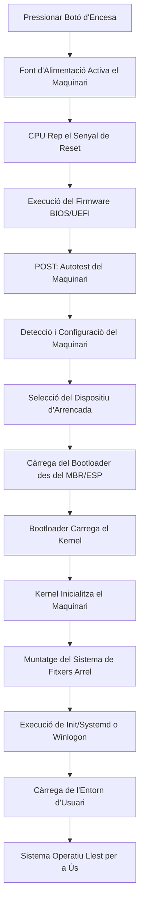
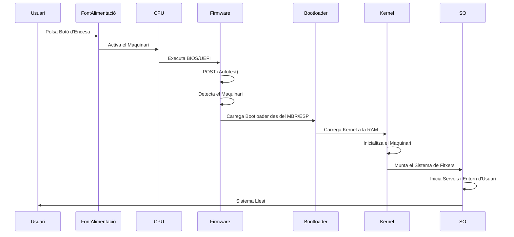
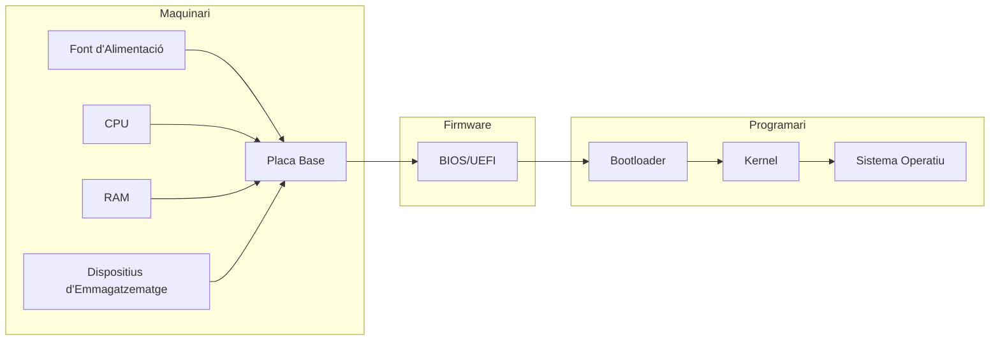

# Procés d'Arrencada d'un Sistema Operatiu

---

## **1. Introducció**

El procés d'arrencada (o *boot*) d'un sistema operatiu és una seqüència crítica que permet que un ordinador passi d'un estat d'apagat total a l'execució del sistema operatiu. Aquest procés involucra tant *hardware* com *software*, i la seva execució correcta és essencial per al funcionament del sistema.

---

## **2. Components Clau Involucrats**

### **2.1. Maquinari (*Hardware*)**

- **Font d'alimentació**: Subministra energia a tots els components.
- **Placa base (*Motherboard*)**: Conté el *firmware* (BIOS/UEFI) i connecta tots els components.
- **CPU (Unitat Central de Processament)**: Executa les instruccions del *firmware* i del sistema operatiu.
- **RAM (Memòria d'Accés Aleatori)**: Emmagatzema temporalment les dades i els programes necessaris per a l'arrencada.
- **Dispositius d'emmagatzematge (HDD/SSD)**: Contenen el sistema operatiu i els arxius d'arrencada.
- **ROM (Memòria de Només Lectura)**: Emmagatzema el *firmware* (BIOS/UEFI).
- **Targeta gràfica, teclat, ratolí, etc.**: Dispositius perifèrics que poden ser necessaris per a la interacció durant l'arrencada.

### **2.2. Programari (*Software*)**

- **Firmware (BIOS/UEFI)**: Programari de baix nivell emmagatzemat a la ROM que inicialitza el *hardware* i carrega el *bootloader*.
- **Bootloader (GRUB, LILO, Windows Boot Manager, etc.)**: Programa que carrega el sistema operatiu a la memòria RAM.
- **Sistema Operatiu (Windows, Linux, macOS, etc.)**: Gestiona els recursos del *hardware* i proporciona una interfície per a l'usuari.

---

## **3. Fases del Procés d'Arrencada**

### **3.1. Encesa del Maquinari**

1. **Polsació del botó d'encès**:
   - L'usuari polsa el botó d'encès de la torre o del portàtil.
   - La font d'alimentació rep el senyal i comença a subministrar energia a la placa base i a la resta de components.
2. **Senyal de Power-On Reset (POR)**:
   - La placa base envia un senyal de *reset* a la CPU per inicialitzar-la.
   - La CPU comença a executar instruccions des d'una adreça de memòria predefinida (generalment `0xFFFFFFF0` en arquitectures x86), on resideix el *firmware* (BIOS/UEFI).

---

### **3.2. Execució del *Firmware* (BIOS/UEFI)**

#### **3.2.1. POST (*Power-On Self-Test*)**

- **Objectiu**: Verificar que el *hardware* essencial funciona correctament.
- **Procés**:
  1. La CPU executa el codi del **BIOS/UEFI** emmagatzemat a la ROM.
  2. El *firmware* realitza un **autotest** dels components crítics:
     - Comprova la integritat de la CPU.
     - Verifica la presència i funcionalitat de la RAM.
     - Detecta i configura dispositius d'emmagatzematge (HDD/SSD).
     - Inicialitza la targeta gràfica i altres perifèrics.
  3. Si algun component falla, el sistema emet un **codi d'error** (xiulets, missatges a la pantalla o codis numèrics).

#### **3.2.2. Detecció i Configuració del Maquinari**

- El *firmware* identifica tots els dispositius connectats (teclat, ratolí, discs durs, USB, etc.).
- Configura els paràmetres bàsics del *hardware* (freqüència de la CPU, temporització de la RAM, etc.).
- En sistemes moderns amb **UEFI**, aquesta fase pot incloure la càrrega de controladors bàsics per als dispositius.

#### **3.2.3. Selecció del Dispositiu d'Arrencada**

- El *firmware* busca l'**ordre d'arrencada** configurat a la seva configuració (generalment accessible mitjançant una tecla com `F2`, `F12`, `DEL`, etc.).
- L'ordre d'arrencada determina quin dispositiu (HDD, SSD, USB, CD/DVD, xarxa) s'utilitzarà per carregar el sistema operatiu.
- Si no es troba cap dispositiu d'arrencada vàlid, el sistema mostra un error (ex: `No bootable device found`).

---

### **3.3. Càrrega del *Bootloader***

#### **3.3.1. Localització del *Bootloader***

- El *firmware* busca al **MBR (*Master Boot Record*)** del dispositiu d'arrencada seleccionat.
  - En discs amb **MBR**, el *bootloader* resideix als primers **512 bytes** del disc (sector d'arrencada).
  - En discs amb **GPT (*Taula de Particions GUID*)**, el *firmware* busca a la **EFI System Partition (ESP)**.
- El **MBR** conté:
  - Codi del *bootloader* (ex: **GRUB** a Linux, **Windows Boot Manager** a Windows).
  - Taula de particions (en el cas de MBR).

#### **3.3.2. Execució del *Bootloader***

- El *firmware* carrega el **bootloader** a la memòria RAM i li transfereix el control.
- **Funcions del *bootloader***:
  1. **Carregar el *kernel* del sistema operatiu**:
     - En sistemes **Linux**, el *bootloader* (ex: GRUB) carrega el *kernel* (`vmlinuz`) i el sistema de fitxers inicial (`initramfs`).
     - En sistemes **Windows**, el **Windows Boot Manager** carrega l'arxiu `bootmgr` i després el *kernel* (`ntoskrnl.exe`).
  2. **Configuració de paràmetres d'arrencada**:
     - El *bootloader* pot permetre a l'usuari seleccionar entre diferents sistemes operatius (arrencada dual) o configuracions del *kernel* (ex: mode segur, mode recuperació).
  3. **Transició a mode protegit (en arquitectures x86)**:
     - El *bootloader* prepara la CPU per passar del **mode real** (16 bits) al **mode protegit** (32 bits) o **mode llarg** (64 bits), necessari per a sistemes operatius moderns.

---
### **3.4. Càrrega del *Kernel* del Sistema Operatiu**

#### **3.4.1. Inicialització del *Kernel***

- El **kernel** (nucli del sistema operatiu) és carregat a la memòria RAM pel *bootloader*.
- El *kernel* és el component central del sistema operatiu i s'encarrega de:
  - Gestionar els recursos del *hardware* (CPU, RAM, dispositius d'E/S).
  - Proporcionar una interfície entre el *hardware* i el programari d'aplicació.

#### **3.4.2. Configuració del Maquinari en Mode *Kernel***

- El *kernel* realitza una **detecció més avançada** del *hardware*:
  - Inicialitza controladors per a dispositius no detectats pel *firmware*.
  - Configura la gestió de memòria (paginació, segmentació).
  - Inicialitza el sistema de fitxers.

#### **3.4.3. Muntatge del Sistema de Fitxers Arrel**

- En sistemes **Linux/Unix**:
  - El *kernel* muntarà el sistema de fitxers arrel (`/`) utilitzant el `initramfs` (sistema de fitxers inicial en memòria).
  - El `initramfs` conté els controladors i eines necessàries per muntar el sistema de fitxers real des del disc.
- En sistemes **Windows**:
  - El *kernel* carrega el **Registry** i els controladors essencials.
  - Inicialitza el sistema de fitxers NTFS.

---
### **3.5. Inici del Sistema Operatiu**

#### **3.5.1. Execució del Procés *Init* (Linux/Unix)**

- El *kernel* executa el procés **`init`** (en sistemes moderns, sol ser `systemd` o `upstart`).
- **`init`** és el primer procés (PID 1) i s'encarrega de:
  - Inicialitzar els serveis del sistema (xarxa, gràfics, so, etc.).
  - Muntar la resta de sistemes de fitxers.
  - Iniciar l'entorn gràfic (ex: GNOME, KDE, Xfce) o la interfície de línia d'ordres.

#### **3.5.2. Inici de Sessió (Windows)**

- A Windows, el *kernel* carrega el **Subsistema d'Entrada/Sortida (Win32)** i el **Gestor de Sessions (SMSS)**.
- El **Gestor d'Inici de Sessió (Winlogon)** mostra la pantalla d'inici de sessió.
- Un cop l'usuari inicia la sessió, es carrega l'**Explorador de Windows** (`explorer.exe`) i la resta d'aplicacions d'inici.

#### **3.5.3. Càrrega de l'Entorn d'Usuari**

- El sistema operatiu carrega la configuració específica de l'usuari (perfil, preferències, aplicacions d'inici).
- En sistemes gràfics, es mostra l'**escriptori** o el **gestor de finestres**.

---
## **4. Esquemes del Procés d'Arrencada**

### **4.1. Diagrama de Flux**

---
### **4.2. Diagrama de Seqüència**

---
### **4.3. Diagrama de Components**

---
## **5. Diferències entre BIOS i UEFI**

| **Característica**      | **BIOS**                       | **UEFI**                        |
|-------------------------|--------------------------------|---------------------------------|
| **Arquitectura**        | 16 bits                        | 32/64 bits                      |
| **Interfície**          | Text (mode llegat)             | Gràfica (GUI)                   |
| **Suport per a discs**  | MBR (fins a 2TB)               | GPT (més de 2TB)                |
| **Temps d'arrencada**  | Lent                           | Ràpid                           |
| **Seguretat**           | Sense suport per a Secure Boot | Suport per a Secure Boot        |
| **Compatibilitat**      | Llegat                         | Compatible amb BIOS (CSM)       |
| **Particions**          | Màxim 4 particions primàries   | Fins a 128 particions primàries |

---
## **6. Arrencada de Linux amb GRUB**

1. **Encesa**: L'usuari polsa el botó d'encès.
2. **POST**: El BIOS/UEFI verifica el *hardware*.
3. **Selecció del dispositiu**: El *firmware* busca el dispositiu d'arrencada (ex: `/dev/sda`).
4. **Càrrega de GRUB**: El BIOS/UEFI carrega el **GRUB** des del MBR o l'ESP.
5. **Menú de GRUB**: L'usuari pot seleccionar entre diferents *kernels* o sistemes operatius.
6. **Càrrega del *kernel***: GRUB carrega el *kernel* (`vmlinuz`) i el `initramfs` a la RAM.
7. **Inicialització del *kernel***: El *kernel* detecta el *hardware* i muntarà el sistema de fitxers arrel.
8. **Execució de `systemd`**: El *kernel* executa `systemd`, que inicialitza els serveis.
9. **Entorn gràfic**: Es carrega el gestor de finestres (ex: GNOME) i l'usuari pot interactuar amb el sistema.

---
## **7. Arrencada de Windows**

1. **Encesa**: L'usuari polsa el botó d'encès.
2. **POST**: El UEFI verifica el *hardware*.
3. **Selecció del dispositiu**: El UEFI busca el dispositiu d'arrencada (ex: `C:\`).
4. **Càrrega del Windows Boot Manager**: El UEFI carrega `bootmgr` des de l'ESP.
5. **Càrrega del *kernel***: `bootmgr` carrega `ntoskrnl.exe` i el *Registry*.
6. **Inicialització del *kernel***: El *kernel* detecta el *hardware* i carrega els controladors.
7. **Winlogon**: Es mostra la pantalla d'inici de sessió.
8. **Explorador de Windows**: Després de l'inici de sessió, es carrega `explorer.exe` i l'escriptori.

---
## **8. Problemes Comuns i Solucions**

| **Problema**                | **Possible Causa**                            | **Solució**                                |
|-----------------------------|-----------------------------------------------|--------------------------------------------|
| No hi ha senyal a la pantalla | Fallada a la targeta gràfica o RAM            | Revisar connexions, provar amb una altra RAM |
| Xiulets en engegar          | Fallada al POST (*hardware* defectuós)       | Consultar el manual de la placa base       |
| "No bootable device found"  | Dispositiu d'arrencada no detectat           | Verificar l'ordre d'arrencada al BIOS/UEFI |
| "GRUB rescue>"              | *Bootloader* danyat o configuració incorrecta | Reinstal·lar GRUB o reparar amb Live CD     |
| Pantalla blava a Windows     | Fallada en controladors o *hardware*         | Iniciar en mode segur i actualitzar *drivers* |
| El sistema operatiu no carrega | *Kernel* danyat o manca d'arxius          | Reparar la instal·lació amb eines del SO   |

