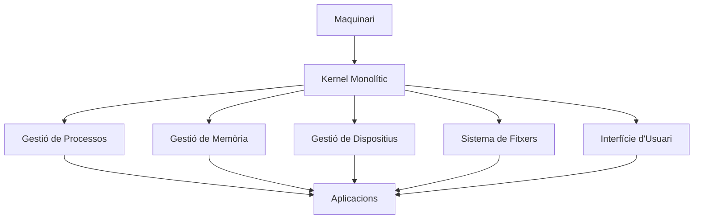
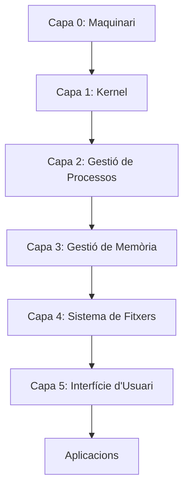
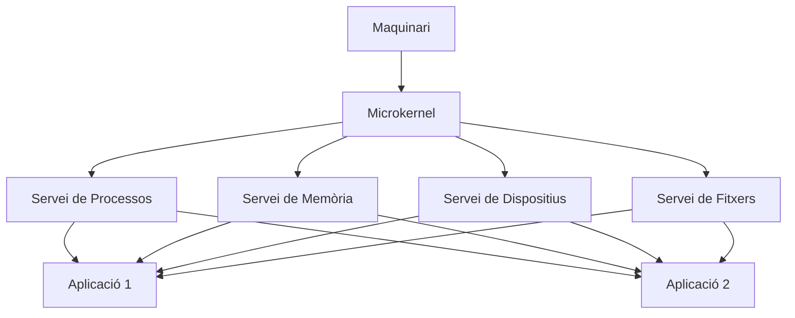
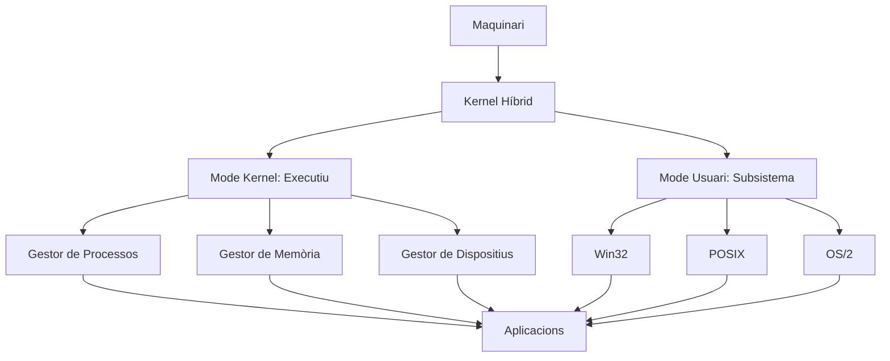
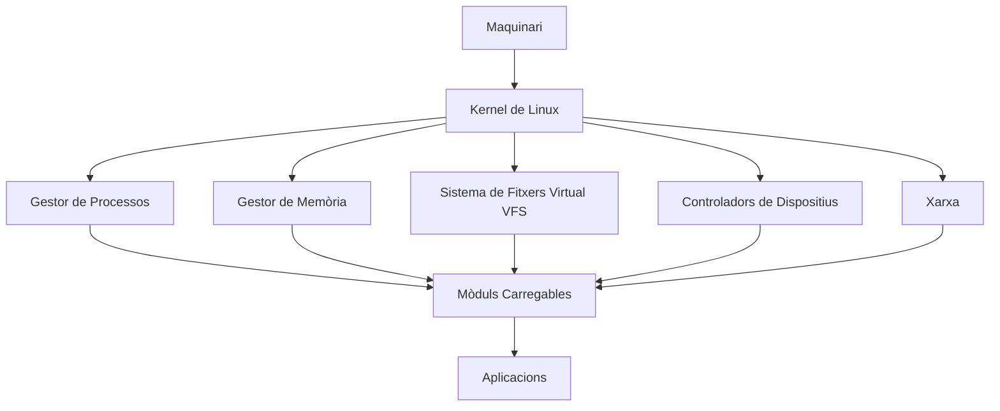
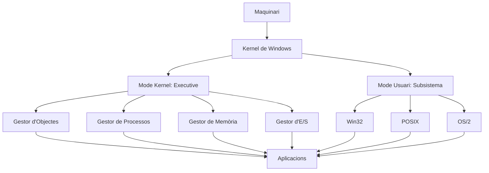
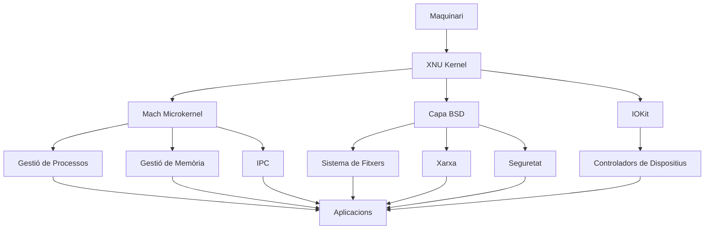
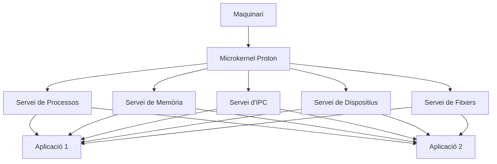
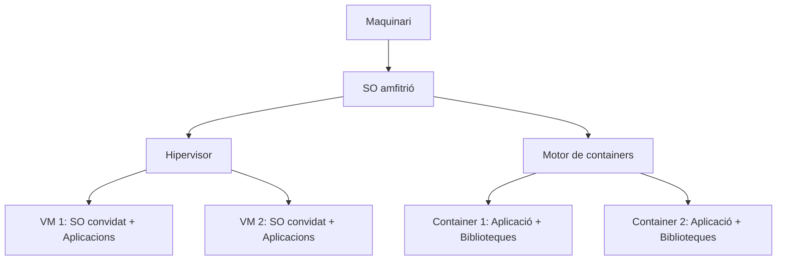

## **1. Introducció**
Els sistemes operatius (SO) són el **cor** de qualsevol dispositiu computacional, des de supercomputadors fins a sistemes encastats. El seu disseny i la seva arquitectura determinen l'eficiència, la seguretat i la funcionalitat del sistema en conjunt. Aquesta documentació explora en profunditat els conceptes fonamentals, les estructures, els components i les tendències modernes en l'arquitectura dels SO.

---

## **2. Definició i Evolució dels Sistemes Operatius**

### **2.1. Què és un Sistema Operatiu?**
Un **sistema operatiu** és un **programari de sistema** que actua com a **interfície entre el maquinari i les aplicacions d'usuari**, i gestiona els recursos del sistema de manera eficient, segura i transparent. El seu objectiu principal és:
- **Abstraure la complexitat del maquinari** perquè les aplicacions puguen executar-se sense conéixer els detalls físics.
- **Gestionar els recursos** (CPU, memòria, dispositius d'E/S) de manera òptima.
- **Proporcionar un entorn d'execució** estable i predictible per a programes i usuaris.

---

### **2.2. Evolució Històrica**
L'arquitectura dels SO ha evolucionat en resposta als avanços tecnològics i a les necessitats dels usuaris. A continuació, es presenta una línia temporal amb les fites més rellevants:

| **Període**       | **Generació**       | **Característiques Principals**                                                                                     | **Exemples de SO**               |
|-------------------|----------------------|---------------------------------------------------------------------------------------------------------------------|----------------------------------|
| **1940-1950**     | Primera Generació   | Sense SO. Programació directa en llenguatge màquina. Ús exclusiu de targetes perforades.                              | ENIAC, UNIVAC                    |
| **1950-1960**     | Segona Generació   | Primers SO **monotasca** i **per lots (batch)**. Ús de transistors.                                             | GM-NAA I/O, IBM SOS             |
| **1960-1970**     | Tercera Generació   | **Multitasca** i **multiprogramació**. Introducció dels circuits integrats.                                        | IBM/360, Unix (1969)            |
| **1970-1980**     | Quarta Generació    | **Sistemes de temps compartit** i **xarxes**. SO més interactius.                                                 | Unix (AT&T), CP/M, MS-DOS       |
| **1980-1990**     | Cinquena Generació    | **Interfície gràfica (GUI)**. SO per a PC.                                                                           | Windows 3.1, Mac OS, AmigaOS    |
| **1990-2000**     | Sisena Generació     | **Multimèdia**, **xarxes avançades** i **suport per a 64 bits**.                                                   | Windows 95/NT, Linux, Solaris   |
| **2000-2010**     | Setena Generació   | **SO distribuïts**, **virtualització** i **mòbils**.                                                             | Windows XP, macOS X, Android     |
| **2010-Actualitat** | Huitena Generació  | **Cloud computing**, **IoT**, **containers** i **seguretat avançada**.                                              | Windows 10/11, iOS, Chrome OS   |

---
### **2.3. Classificació dels Sistemes Operatius**
Els SO es poden classificar segons diferents criteris:

#### **Segons la seva Estructura**
1. **Monolítics**: Tot el codi del SO s'executa en un únic espai de memòria (p. ex. **MS-DOS**, **els primers Unix**).
2. **Per Capes**: El SO s'organitza en capes jeràrquiques, cadascuna amb funcions específiques (p. ex. **Windows NT**).
3. **Microkernel**: Només les funcions essencials (gestió de processos, memòria) s'executen en mode kernel; la resta, en mode usuari (p. ex. **QNX**, **MINIX**).
4. **Híbrids**: Combinen elements de les arquitectures anteriors (p. ex. **Windows 7/10**, **macOS**).

#### **Segons el seu Ús**
| **Tipus**               | **Descripció**                                                                                     | **Exemples**                          |
|------------------------|-----------------------------------------------------------------------------------------------------|---------------------------------------|
| **SO de Propòsit General** | Dissenyats per a una àmplia varietat d'aplicacions (oficina, desenvolupament, entreteniment).        | Windows, macOS, Linux                 |
| **SO en Temps Real (RTOS)** | Garanteixen respostes en terminis de temps estrictes. S'utilitzen en sistemes crítics.                | FreeRTOS, VxWorks, QNX                |
| **SO Encastats**       | Optimitzats per a dispositius amb recursos limitats (p. ex. electrodomèstics, routers).          | Embedded Linux, FreeRTOS             |
| **SO Distribuïts**    | Gestionen recursos en múltiples màquines interconnectades.                                         | Plan 9, Amoeba                       |
| **SO de Xarxa**          | Proporcionen serveis de xarxa (p. ex. encaminament, tallafoc).                                       | Cisco IOS, Juniper JunOS              |
| **SO per a Mòbils**    | Optimitzats per a dispositius portàtils (baix consum, tàctil).                                | Android, iOS                         |

#### **Segons la seva Interfície**
- **CLI (Command Line Interface)**: Interfície basada en text (p. ex. **MS-DOS**, **Bash de Linux**).
- **GUI (Graphical User Interface)**: Interfície gràfica amb finestres, icones i menús (p. ex. **Windows**, **macOS**).
- **Híbrida**: Combina CLI i GUI (p. ex. **Linux amb GNOME/KDE**).

---
## **3. Arquitectures de Sistemes Operatius**

---
### **3.1. Arquitectura Monolítica**
#### **Definició**
En una arquitectura **monolítica**, **tot el sistema operatiu s'executa en un únic espai d'adreces de memòria** (mode kernel). Totes les funcions (gestió de processos, memòria, dispositius) estan integrades en un sol programa.

---
#### **Característiques**
| **Aspecte**               | **Descripció**                                                                                     |
|---------------------------|-----------------------------------------------------------------------------------------------------|
| **Estructura**            | Codi únic i compacte.                                                                           |
| **Rendiment**           | Alt (sense sobrecàrrega, *overhead*, de comunicació entre mòduls).                                                |
| **Modularitat**           | Baixa (els canvis requereixen recompilar tot el SO).                                                     |
| **Seguretat**             | Baixa (un error en un mòdul pot penjar tot el sistema).                                         |
| **Exemples**              | MS-DOS, Unix (primeres versions), Linux (en el seu nucli).                                          |

---
#### **Diagrama d'Arquitectura Monolítica**

---
#### **Avantatges i Inconvenients**
| **Avantatges**                          | **Inconvenients**                          |
|---------------------------------------|-----------------------------------------|
| Alt rendiment (sense *overhead*).      | Poc modular (difícil de mantindre).     |
| Senzill d'implementar.                | Poc segur (les fallades afecten tot el SO). |
| Comunicació ràpida entre mòduls.    | Difícil d'escalar.                     |

---
### **3.2. Arquitectura per Capes**
#### **Definició**
En una arquitectura **per capes**, el SO es divideix en **capes jeràrquiques**, on cada capa proporciona serveis a la capa superior i utilitza els serveis de la capa inferior.

---
#### **Característiques**
| **Aspecte**               | **Descripció**                                                                                     |
|---------------------------|-----------------------------------------------------------------------------------------------------|
| **Estructura**            | Capes ben definides (p. ex. maquinari, kernel, serveis, aplicacions).                             |
| **Rendiment**           | Mitjà (*overhead* per les crides entre capes).                                                          |
| **Modularitat**           | Alta (cada capa es pot modificar de manera independent).                                            |
| **Seguretat**             | Mitjana (les fallades en una capa poden afectar les capes superiors).                                     |
| **Exemples**              | Windows NT, THE OS.                                                                                 |

---
#### **Diagrama d'Arquitectura per Capes**

---
#### **Avantatges i Inconvenients**
| **Avantatges**                          | **Inconvenients**                          |
|---------------------------------------|-----------------------------------------|
| Alta modularitat.                     | *Overhead* en les crides entre capes.       |
| Fàcil de mantindre i actualitzar.       | Menor rendiment que el monolític.      |
| Millor seguretat que el monolític.      | Complexitat en el disseny.              |

---
### **3.3. Arquitectura Microkernel**
#### **Definició**
En una arquitectura **microkernel**, **només les funcions essencials del SO s'executen en mode kernel** (p. ex. gestió de processos, memòria, comunicació entre processos). La resta de serveis (p. ex. sistema de fitxers, controladors de dispositius) s'executen en **mode usuari** com a processos independents.

---
#### **Característiques**
| **Aspecte**               | **Descripció**                                                                                     |
|---------------------------|-----------------------------------------------------------------------------------------------------|
| **Estructura**            | Kernel mínim + serveis en mode usuari.                                                         |
| **Rendiment**           | Mitjà-baix (*overhead* en la comunicació entre processos).                                              |
| **Modularitat**           | Molt alta (els serveis es poden afegir o eliminar dinàmicament).                                  |
| **Seguretat**             | Alta (les fallades en els serveis no afecten el kernel).                                                   |
| **Exemples**              | QNX, MINIX, L4, macOS (en part).                                                                  |

---
#### **Diagrama d'Arquitectura Microkernel**

---
#### **Avantatges i Inconvenients**
| **Avantatges**                          | **Inconvenients**                          |
|---------------------------------------|-----------------------------------------|
| Alta modularitat i extensibilitat.    | *Overhead* en la comunicació entre processos.|
| Alta seguretat i estabilitat.        | Menor rendiment que el monolític.      |
| Fàcil de portar a noves plataformes. | Complexitat en el disseny.              |

---
#### **Exemple: QNX**
- **Microkernel**: **Proton** (gestió de processos, IPC, interrupcions).
- **Serveis en Mode Usuari**:
  - **Gestor de processos**: `proc`.
  - **Gestor de fitxers**: `fs`.
  - **Controladors de dispositius**: `devc-*`.

---
### **3.4. Arquitectura Híbrida**
#### **Definició**
Una arquitectura **híbrida** combina elements de les arquitectures **monolítica**, **per capes** i **microkernel**. Per exemple, pot tindre un kernel monolític amb alguns serveis en mode usuari.

---
#### **Característiques**
| **Aspecte**               | **Descripció**                                                                                     |
|---------------------------|-----------------------------------------------------------------------------------------------------|
| **Estructura**            | Kernel amb alguns serveis integrats i altres en mode usuari.                                  |
| **Rendiment**           | Alt (semblant al monolític per als serveis integrats).                                            |
| **Modularitat**           | Mitjana-Alta (depén de quins serveis estan en mode usuari).                                       |
| **Seguretat**             | Mitjana-Alta (les fallades en serveis en mode usuari no afecten el kernel).                            |
| **Exemples**              | Windows (a partir de NT), macOS, Linux (amb mòduls carregables).                                     |

---
#### **Diagrama d'Arquitectura Híbrida (Windows NT)**

---
#### **Avantatges i Inconvenients**
| **Avantatges**                          | **Inconvenients**                          |
|---------------------------------------|-----------------------------------------|
| Alt rendiment.                     | Complexitat en el disseny.              |
| Bon equilibri entre modularitat i eficiència. | Menys modular que un microkernel pur. |
| Compatibilitat amb múltiples API.   | Risc de fallades en el kernel.          |

---
## **4. Exemples Pràctics d'Arquitectures**

### **4.1. Linux (Arquitectura Híbrida/Monolítica)**
- **Kernel**: Monolític amb mòduls carregables (`.ko`).
- **Mode d'Operació**:
  - **Mode Kernel**: Executa el kernel i els controladors.
  - **Mode Usuari**: Executa aplicacions i serveis.
- **Sistema de Fitxers**: Suport per a ext4, XFS, Btrfs, etc.
- **Interfície**: CLI (Bash) i GUI (GNOME, KDE).

---
#### **Estructura del Kernel de Linux**

---
#### **Avantatges de Linux**
- **Open Source**: Codi obert i personalitzable.
- **Portabilitat**: Funciona en múltiples arquitectures (x86, ARM, etc.).
- **Estabilitat**: Kernel robust i ben provat.
- **Comunitat**: Gran suport de la comunitat i d'empreses (Red Hat, Canonical).

---
### **4.2. Windows (Arquitectura Híbrida)**
- **Kernel**: Híbrid (mode kernel + mode usuari).
- **Mode d'Operació**:
  - **Mode Kernel**: Executa l'**Executive** (gestió de processos, memòria, E/S).
  - **Mode Usuari**: Executa el **Subsistema Win32**, aplicacions i serveis.
- **Sistema de Fitxers**: NTFS, FAT32, ReFS.
- **Interfície**: GUI (Explorador de Windows) i CLI (PowerShell, cmd.exe).

---
#### **Estructura de Windows NT**

---
#### **Avantatges de Windows**
- **Compatibilitat**: Suport per a una àmplia gamma de maquinari i programari.
- **Interfície Gràfica**: GUI intuïtiva i fàcil d'utilitzar.
- **Integració**: Bona integració amb altres productes de Microsoft (Office, Azure).
- **Suport**: Ampli suport tècnic i documentació.

---
### **4.3. macOS (Arquitectura Híbrida/Microkernel)**
- **Kernel**: **XNU** (híbrid: microkernel Mach + BSD + IOKit).
- **Mode d'Operació**:
  - **Mode Kernel**: Executa Mach i el kernel BSD.
  - **Mode Usuari**: Executa aplicacions i serveis (p. ex. Finder, Safari).
- **Sistema de Fitxers**: APFS (Apple File System).
- **Interfície**: GUI (Aqua) i CLI (Terminal).

---
#### **Estructura de XNU (macOS)**

---
#### **Avantatges de macOS**
- **Disseny Integrat**: Optimitzat per al maquinari d'Apple.
- **Seguretat**: Sandboxing, Gatekeeper, FileVault (xifratge de disc).
- **Ecosistema**: Integració amb iOS, iPadOS i altres dispositius Apple.
- **Rendiment**: Optimitzat per a SSD i xips Apple Silicon (M1, M2).

---
### **4.4. QNX (Arquitectura Microkernel)**
- **Kernel**: **Microkernel Proton** (gestió de processos, memòria, IPC).
- **Mode d'Operació**:
  - **Mode Kernel**: Només el microkernel.
  - **Mode Usuari**: Tots els serveis (p. ex. sistema de fitxers, xarxa) s'executen com a processos.
- **Sistema de Fitxers**: Suport per a múltiples sistemes de fitxers (ext2, NTFS, etc.).
- **Interfície**: CLI (QNX Shell) i GUI (Photon).

---
#### **Estructura de QNX**

---
#### **Avantatges de QNX**
- **Microkernel Pur**: Alta modularitat i seguretat.
- **Temps Real**: Ideal per a sistemes encastats i crítics (p. ex. automoció, medicina).
- **Escalabilitat**: Funciona en sistemes des de microcontroladors fins a servidors.
- **Fiabilitat**: S'utilitza en sistemes on la fallada no és una opció (p. ex. cotxes autònoms).

---
## **5. Tendències Modernes en Arquitectures de SO**

### **5.1. Virtualització**
La **virtualització de sistemes operatius** és una tecnologia que permet executar diversos sistemes operatius de manera independent en un mateix equip físic. Cada sistema funciona dins d'una **màquina virtual**, administrada per un programari anomenat **hipervisor**, que distribueix els recursos del maquinari, com ara la memòria, el processador i l'emmagatzematge.

Els seus principals avantatges són el millor aprofitament dels recursos, l'aïllament entre sistemes, la reducció de costos i la facilitat per a provar o administrar diferents entorns.

Els hipervisors són programes que permeten crear i administrar màquines virtuals. Hi ha dos tipus principals:

#### Hipervisor de tipus 1

S'instal·la directament sobre el maquinari físic, sense necessitat d'un sistema operatiu amfitrió. Per això també s'anomena **bare-metal**.

- Ofereix més rendiment i seguretat.
- S'utilitza principalment en servidors i centres de dades.
- Exemples: **VMware ESXi, Microsoft Hyper-V i Proxmox**.

#### Hipervisor de tipus 2

S'instal·la com una aplicació dins d'un sistema operatiu existent, que actua com a amfitrió.

- És més senzill d'instal·lar i d'utilitzar.
- És adequat per a ordinadors personals, proves i aprenentatge.
- Pot tindre un rendiment lleugerament inferior al del tipus 1.
- Exemples: **VirtualBox, VMware Workstation i Parallels Desktop**.

En resum: el **tipus 1** és més eficient i s'utilitza en entorns professionals; el **tipus 2** és més pràctic per a usuaris i desenvolupadors.

#### Eines de Virtualització

| **Eina**               | **Descripció**                                                                                     | **SO Compatible**               |
|-------------------------------|-----------------------------------------------------------------------------------------------------|---------------------------------|
| **QEMU**                      | Emulador de maquinari de codi obert.                                                           | Linux, macOS, Windows           |
| **VirtualBox**                | Programari de virtualització per a executar múltiples SO en una sola màquina.                        | Linux, macOS, Windows           |
| **VMware**                    | Plataforma de virtualització comercial.                                                           | Linux, macOS, Windows           |
| **KVM (Kernel-based Virtual Machine)** | Mòdul del kernel de Linux per a la virtualització.                                              | Linux                           |
| **Docker**                    | Plataforma per a desenvolupar, distribuir i executar aplicacions en containers.                      | Linux, macOS, Windows           |

### **5.2. Containers i Virtualització**
#### **Containers**
- **Definició**: Tecnologia de **virtualització a nivell de SO** que permet executar aplicacions en entorns aïllats (**containers**).
- **Avantatges**:
  - **Aïllament**: Cada container té el seu propi espai d'usuari, biblioteques i configuracions.
  - **Portabilitat**: Els containers es poden moure entre sistemes sense canvis.
  - **Eficiència**: Comparteixen el mateix kernel del SO, per la qual cosa són més lleugers que les màquines virtuals.
- **Exemples**: Docker, LXC (Linux Containers), Podman.

---
#### **Diferència entre Containers i Màquines Virtuals (VM)**

| **Aspecte**               | **Containers**                          | **Màquines Virtuals**               |
|---------------------------|-----------------------------------------|-------------------------------------|
| **Nivell de Virtualització** | SO (comparteixen kernel).               | Maquinari (requereixen SO convidat).      |
| **Rendiment**           | Alt (sense l'*overhead* del SO convidat).       | Mitjà (*overhead* de l'hipervisor).    |
| **Aïllament**           | Mitjà (comparteixen kernel).              | Alt (aïllament complet).         |
| **Portabilitat**          | Alta (mateix SO amfitrió).                  | Mitjana (depén de l'hipervisor).     |
| **Ús de Recursos**       | Baix (comparteixen recursos de l'amfitrió).    | Alt (requereixen recursos dedicats).|
| **Exemples**              | Docker, LXC.                           | VMware, VirtualBox, KVM.             |

---
### **5.3. Sistemes Operatius per al Núvol**
Els SO moderns estan optimitzats per a entorns de **cloud computing** (computació en el núvol), on l'escalabilitat, la virtualització i la gestió de recursos distribuïts són clau. Exemples:
- **AWS Amazon Linux**: Optimitzat per a Amazon Web Services (AWS).
- **Google Container OS**: Dissenyat per a executar containers en Google Cloud.
- **Azure Linux**: Versió de Linux optimitzada per a Microsoft Azure.

---
#### **Característiques dels SO en el Núvol**
| **Característica**               | **Descripció**                                                                                     |
|----------------------------------|-----------------------------------------------------------------------------------------------------|
| **Escalabilitat Automàtica**     | Capacitat d'ajustar els recursos (CPU, memòria) segons la demanda.                                      |
| **Alta Disponibilitat**          | Dissenyats per a minimitzar el temps d'inactivitat (p. ex. balanceig de càrrega).                         |
| **Seguretat Avançada**          | Inclouen mecanismes de xifratge, autenticació i control d'accés granular.                         |
| **Suport per a Containers**      | Integració nativa amb Docker, Kubernetes, etc.                                                    |
| **Gestió de Recursos Distribuïts** | Capacitat de gestionar recursos en múltiples nodes (p. ex. clústers de Kubernetes).              |

---
### **5.4. Sistemes Operatius per a IoT**
Els dispositius **IoT (Internet of Things, Internet de les coses)** requereixen SO lleugers, eficients i segurs. Exemples:
- **FreeRTOS**: SO en temps real per a microcontroladors.
- **Zephyr**: SO modular i escalable per a IoT.
- **Raspberry Pi OS**: Basat en Linux, optimitzat per a la Raspberry Pi.

---
#### **Requisits dels SO per a IoT**
| **Requisit**               | **Descripció**                                                                                     |
|-----------------------------|-----------------------------------------------------------------------------------------------------|
| **Baix Consum**            | Optimitzats per a funcionar amb bateries o energia limitada.                                       |
| **Poc Espai**            | Mida reduïda per a cabre en dispositius amb memòria limitada (p. ex. 16 KB - 1 MB).              |
| **Temps Real**             | Capacitat de respondre a esdeveniments en terminis estrictes (p. ex. sensors, actuadors).                     |
| **Seguretat**              | Protecció contra atacs (p. ex. xifratge, autenticació lleugera).                                     |
| **Connectivitat**            | Suport per a protocols de xarxa (p. ex. MQTT, CoAP, Bluetooth, LoRaWAN).                                |

---
### **5.5. Sistemes Operatius per a Edge Computing**
L'**edge computing** (computació en la vora) porta el processament de les dades a prop de la font on es generen (p. ex. dispositius IoT, sensors). Els SO per a edge computing han de ser:
- **Lleugers**: Per a executar-se en dispositius amb recursos limitats.
- **Eficients**: Capaços de processar dades en temps real.
- **Segurs**: Protegits contra ciberatacs.

---
#### **Exemples de SO per a Edge Computing**
| **SO**               | **Descripció**                                                                                     | **Casos d'Ús**                          |
|---------------------|-----------------------------------------------------------------------------------------------------|------------------------------------------|
| **KubeEdge**        | Extensió de Kubernetes per a edge computing.                                                        | Orquestració de containers en l'edge.   |
| **Akraino**         | Plataforma de codi obert per a edge computing.                                                 | Xarxes 5G, IoT industrial.                |
| **Azure IoT Edge**  | SO de Microsoft per a executar contenidors i funcions en dispositius edge.                    | Anàlisi de dades en temps real.        |

---
### **5.6. Sistemes Operatius en Temps Real (RTOS)**
Els **RTOS (Real-Time Operating Systems)** estan dissenyats per a sistemes en què el temps de resposta és crític. Exemples:
- **FreeRTOS**: SO en temps real per a microcontroladors.
- **VxWorks**: SO per a sistemes encastats en l'aeroespacial, la defensa i l'automoció.
- **QNX**: SO microkernel per a sistemes en temps real.

---
#### **Característiques dels RTOS**
| **Característica**               | **Descripció**                                                                                     |
|----------------------------------|-----------------------------------------------------------------------------------------------------|
| **Determinisme**                | Capacitat de garantir que una operació es complete en un temps màxim conegut.                 |
| **Prioritats**                  | Els processos s'executen segons prioritats estrictes.                                               |
| **Latència Baixa**                | Temps mínim entre la sol·licitud d'una operació i la seva finalització.                               |
| **Suport per a Interrupcions**  | Gestió eficient de les interrupcions per a respondre ràpidament a esdeveniments externs.                    |
| **Escalabilitat**                | Capacitat de funcionar en sistemes des de microcontroladors fins a servidors.                      |
