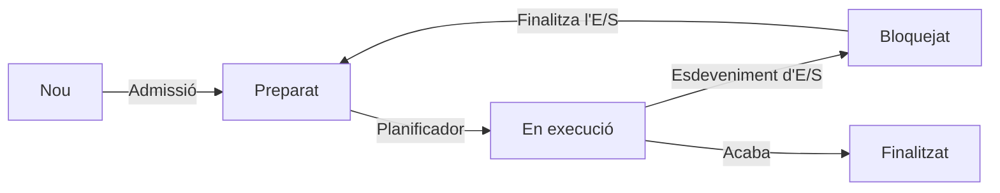
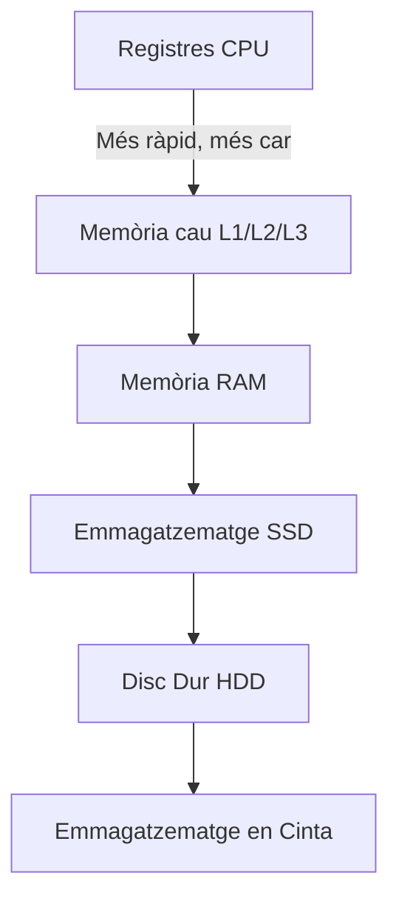
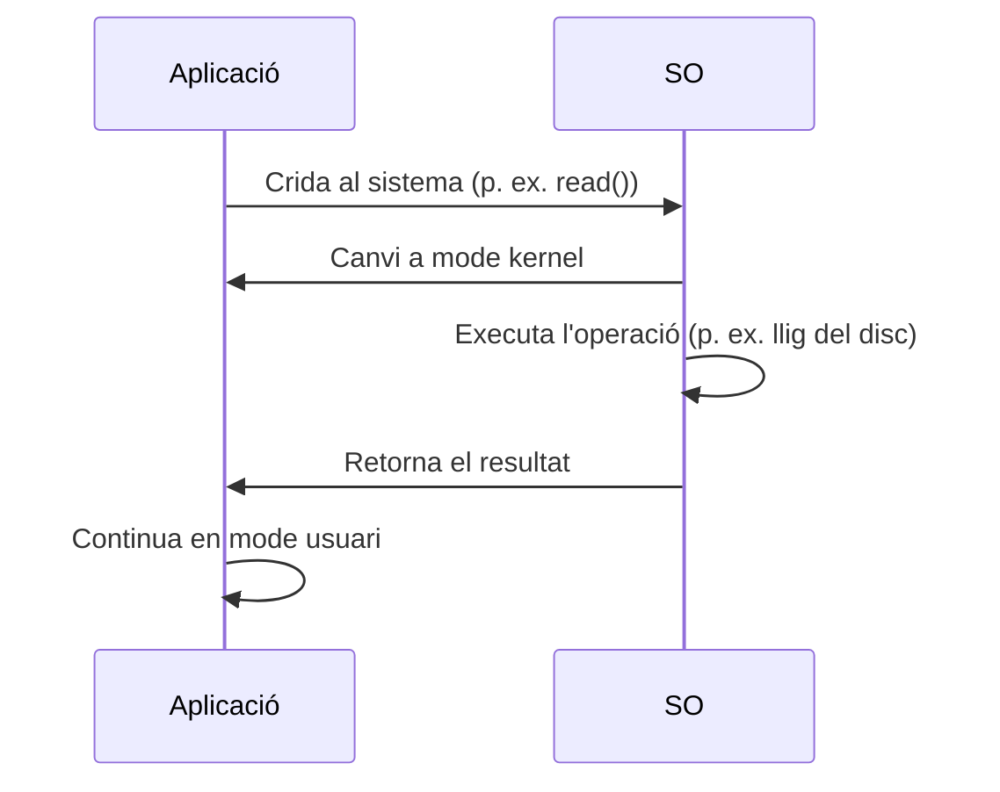

## **1. Funcions Principals d'un Sistema Operatiu**

Les funcions d'un SO es poden agrupar en **6 pilars fonamentals**:

---

### **1.1. Gestió de Processos**
#### **Definició**
Un **procés** és un **programa en execució** que requereix recursos (CPU, memòria, fitxers). El SO és responsable de:
- Crear, suspendre, reprendre i finalitzar processos.
- Assignar temps de CPU a cada procés (**planificació**).
- Gestionar la **comunicació entre processos (IPC)**.

#### **Estats d'un Procés**
Els processos poden estar en un dels estats següents:



| **Estat**      | **Descripció**                                                                                     |
|-----------------|-----------------------------------------------------------------------------------------------------|
| **Nou**       | El procés s'ha creat però encara no s'ha carregat en memòria.                                       |
| **Preparat**       | El procés està en memòria i preparat per a executar-se (espera la CPU).                                    |
| **En execució**  | El procés està utilitzant la CPU.                                                                     |
| **Bloquejat**   | El procés espera un esdeveniment extern (p. ex. lectura de disc, entrada de l'usuari).                   |
| **Finalitzat**   | El procés ha acabat la seva execució.                                                             |

---
#### **Planificació de Processos (CPU Scheduling)**
El **planificador de CPU** decideix quin procés s'executa i en quin ordre. Els algorismes més comuns són:

| **Algorisme**          | **Descripció**                                                                                     | **Avantatges**                          | **Inconvenients**                          |
|------------------------|-----------------------------------------------------------------------------------------------------|---------------------------------------|-----------------------------------------|
| **FCFS (First-Come, First-Served)** | Executa els processos en l'ordre en què arriben.                                                   | Senzill, just.                        | Poc eficient (efecte "comboi").       |
| **SJF (Shortest Job First)** | Executa primer el procés amb el temps d'execució més curt.                                 | Minimitza el temps d'espera mitjà.| Difícil de predir el temps d'execució. |
| **Round Robin (RR)**   | Assigna a cada procés un **quàntum de temps (time slice)** en ordre cíclic.                       | Just, evita el monopoli de la CPU.        | Pot augmentar el temps d'espera.    |
| **Prioritat**          | Els processos amb més prioritat s'executen primer.                                             | Flexible (prioritats dinàmiques).     | Risc d'**inanició (starvation)**.   |
| **Multinivell**         | Combina diversos algorismes (p. ex. RR per a processos interactius, FCFS per a processos per lots).      | Adaptable a diferents tipus de processos. | Complexitat en la implementació.       |

---
#### **Comunicació entre Processos (IPC)**
Els processos es poden comunicar mitjançant:
1. **Memòria Compartida**: Els dos processos accedeixen a una regió de memòria comuna (p. ex. **POSIX Shared Memory**).
2. **Pas de Missatges**: Els processos es comuniquen mitjançant missatges (p. ex. **pipes**, **cues de missatges**).
   - **Pipes** (canonades): Comunicació unidireccional (p. ex. `ls | grep "txt"` en Linux).
   - **Cues de Missatges**: Comunicació bidireccional (p. ex. **Message Queuing Telemetry Transport (MQTT)**).
3. **Semàfors**: Mecanisme de sincronització per a evitar condicions de carrera (p. ex. **semàfors de Dijkstra**).
4. **Sockets**: Comunicació entre processos en màquines diferents (p. ex. **TCP/IP**).

---
### **1.2. Gestió de Memòria**
#### **Jerarquia de Memòria**
Els sistemes operatius gestionen una **jerarquia de memòria** per a optimitzar l'accés a les dades:



| **Nivell**       | **Tecnologia**       | **Velocitat**       | **Capacitat** | **Cost per GB** |
|-----------------|----------------------|---------------------|---------------|-------------------|
| Registres       | Registres interns de la CPU | ~1 ns               | KB            | Molt alt          |
| Memòria cau L1        | SRAM                 | ~1-4 ns             | KB-MB         | Alt              |
| Memòria cau L2/L3     | SRAM                 | ~10-50 ns           | MB            | Alt              |
| RAM             | DRAM                 | ~100 ns             | GB            | Mitjà             |
| SSD             | Flash (NAND)         | ~10-100 µs          | TB            | Baix              |
| HDD             | Discs magnètics    | ~5-10 ms            | TB            | Molt baix          |
| Cinta           | Cinta magnètica      | ~Segons           | TB-PB         | Molt baix          |

---
#### **Tècniques de Gestió de Memòria**
| **Tècnica**               | **Descripció**                                                                                     | **Avantatges**                          | **Inconvenients**                          |
|---------------------------|-----------------------------------------------------------------------------------------------------|---------------------------------------|-----------------------------------------|
| **Partició Fixa**        | La memòria es divideix en particions estàtiques. Cada procés es carrega en una partició.           | Senzill.                              | Fragmentació interna.                  |
| **Partició Dinàmica**    | Les particions es creen dinàmicament segons la mida del procés.                               | Sense fragmentació interna.           | Fragmentació externa.                  |
| **Paginació**            | La memòria física es divideix en **marcs (frames)** i la lògica en **pàgines**.                    | Sense fragmentació externa.            | *Overhead* en les taules de pàgines.           |
| **Segmentació**          | La memòria es divideix en **segments lògics** (codi, dades, pila).                              | Protecció i compartició fàcils.     | Fragmentació externa.                  |
| **Memòria Virtual**       | Combina la paginació i l'emmagatzematge en disc per a simular una memòria més gran que la RAM.      | Permet executar programes grans.  | *Overhead* en l'accés a disc.             |

---
#### **Paginació i Memòria Virtual**
- **Pàgina**: Bloc de mida fixa (p. ex. 4 KB) en la memòria lògica.
- **Marc (Frame)**: Bloc de mida fixa en la memòria física.
- **Taula de Pàgines**: Estructura que relaciona (mapa) les pàgines lògiques amb els marcs físics.
- **Page Fault** (fallada de pàgina): Es produeix quan una pàgina no està en la RAM i s'ha de carregar des del disc (**swap**).

**Exemple de Taula de Pàgines**:
| **Pàgina Lògica** | **Marc Físic** | **Bit de Presència** | **Bit de Modificació** | **Bit de Referència** |
|-------------------|-------------------|----------------------|-------------------------|-----------------------|
| 0                 | 5                 | 1                    | 0                       | 1                     |
| 1                 | -                 | 0                    | -                       | -                     |
| 2                 | 10                | 1                    | 1                       | 1                     |

## **2. Modes d'Operació del Processador**

Els processadors moderns admeten **dos modes principals d'operació** per a protegir el sistema:

---
### **2.1. Mode Usuari (User Mode)**
- **Definició**: Mode d'execució amb **restriccions**. Les aplicacions s'executen en aquest mode.
- **Característiques**:
  - No pot accedir directament al maquinari.
  - No pot executar instruccions privilegiades (p. ex. deshabilitar interrupcions).
  - Si intenta accedir a recursos protegits, genera una **excepció (trap)** i el control passa al SO.
- **Exemple**: Un programa en Python o un navegador web.

---
### **2.2. Mode Kernel (Kernel Mode)**
- **Definició**: Mode d'execució amb **accés total al maquinari**. El SO s'executa en aquest mode.
- **Característiques**:
  - Pot executar qualsevol instrucció (p. ex. llegir/escriure en ports d'E/S).
  - Té accés directe a la memòria física i als dispositius.
  - Si un procés en mode kernel falla, pot **penjar tot el sistema**.
- **Exemple**: El kernel de Linux o de Windows.

---
### **2.3. Transició entre Modes**
La transició entre **mode usuari** i **mode kernel** es fa mitjançant:
1. **Crides al Sistema (System Calls)**:
   - Un procés en mode usuari sol·licita un servei al SO (p. ex. llegir un fitxer).
2. **Interrupcions (Interrupts)**:
   - Senyals generats pel maquinari (p. ex. teclat, disc dur) que requereixen l'atenció del SO.
3. **Excepcions (Traps)**:
   - Esdeveniments generats pel programari (p. ex. divisió per zero, accés a memòria no vàlida).

---
#### **Mecanisme d'una Crida al Sistema**



## **3. Components Clau d'un Sistema Operatiu**

---
### **3.1. Kernel**
El **kernel** és el **nucli del sistema operatiu** i s'encarrega de:
- **Gestió de processos**: Creació, planificació i finalització.
- **Gestió de memòria**: Assignació i alliberament de memòria.
- **Gestió de dispositius**: Controladors de maquinari.
- **Sistema de fitxers**: Organització i accés a les dades.
- **Comunicació entre processos (IPC)**: Mecanismes perquè els processos es comuniquen.

---
#### **Tipus de Kernel**
| **Tipus**               | **Descripció**                                                                                     | **Exemples**                          |
|------------------------|-----------------------------------------------------------------------------------------------------|---------------------------------------|
| **Monolític**         | Tot el kernel s'executa en un sol espai de memòria.                                           | Linux (en el seu nucli), Unix           |
| **Microkernel**        | Només les funcions essencials en mode kernel; la resta en mode usuari.                               | QNX, MINIX, L4                       |
| **Híbrid**           | Combina elements del monolític i del microkernel.                                                     | Windows NT, macOS                    |

---
### **3.2. Shell**
El **shell** és la **interfície entre l'usuari i el kernel**. La seva funció és:
- **Interpretar ordres**: Tradueix les ordres de l'usuari a crides al sistema.
- **Executar programes**: Inicia aplicacions o scripts.
- **Gestionar l'entorn**: Configura variables d'entorn i redireccions.

---
#### **Tipus de Shell**
| **Shell**               | **Descripció**                                                                                     | **SO**               |
|-------------------------|-----------------------------------------------------------------------------------------------------|---------------------|
| **Bash**               | Shell per defecte en Linux. Suport per a scripts avançats.                                         | Linux, macOS        |
| **PowerShell**          | Shell avançat de Microsoft amb suport per a objectes .NET.                                         | Windows             |
| **Zsh**                | Shell millorat amb autocompletació i temes personalitzables.                                         | Linux, macOS        |
| **cmd.exe**            | Shell bàsic de Windows.                                                                             | Windows             |

---
#### **Exemple de Script en Bash**
```bash
#!/bin/bash
# Script per a llistar fitxers i mostrar la data
echo "Hui és: $(date)"
echo "Fitxers en el directori actual:"
ls -l
```

---
### **3.3. Sistema de Fitxers**
Com s'ha esmentat anteriorment, el **sistema de fitxers** organitza les dades en l'emmagatzematge. Els seus components són:
1. **Superbloc**: Conté metadades del sistema de fitxers (p. ex. mida, nombre de blocs lliures).
2. **Taula d'Inodes**: Emmagatzema les metadades dels fitxers (p. ex. permisos, mida, punters als blocs de dades).
3. **Blocs de Dades**: Contenen les dades reals dels fitxers.

---
### **3.4. Controladors de Dispositius**
Els **controladors de dispositius** (drivers) són mòduls de programari que permeten al SO interactuar amb el maquinari. Poden ser:
- **Controladors de Bloc**: Per a dispositius com els discs durs (p. ex. `sda` en Linux).
- **Controladors de Caràcter**: Per a dispositius com teclats o ratolins (p. ex. `/dev/tty` en Linux).
- **Controladors de Xarxa**: Per a targetes de xarxa (p. ex. `eth0`, `wlan0`).

---
#### **Exemple: Càrrega d'un Controlador en Linux**
```bash
# Carregar un controlador de dispositiu (p. ex. per a una targeta de xarxa)
sudo modprobe e1000

# Veure els controladors carregats
lsmod
```

---
### **3.5. Biblioteques del Sistema**
Les **biblioteques del sistema** són conjunts de funcions precompilades que les aplicacions poden utilitzar per a interactuar amb el SO. Exemples:
- **glibc (GNU C Library)**: Biblioteca estàndard de C en Linux.
- **WinAPI**: Biblioteca de funcions per a Windows.
- **POSIX**: Conjunt d'estàndards per a SO de tipus Unix.
