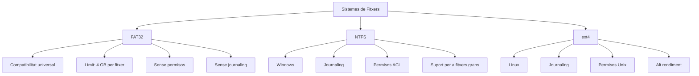

Un **sistema de fitxers** és una estructura lògica que organitza i gestiona les dades en un dispositiu d'emmagatzematge (discs durs, SSD, memòries USB, etc.). Defineix com s'emmagatzemen, s'accedeix i s'organitzen els fitxers, així com les metadades associades (permisos, dates, mida, etc.).

Cada sistema de fitxers té **avantatges, limitacions i casos d'ús específics**, cosa que els fa més adequats per a certes situacions. A continuació, es detallen tres dels més rellevants: **FAT32**, **NTFS** i **ext4**.

---

## **1. Agrupació de Registres**
En l'emmagatzematge de dades, **els registres són la unitat lògica d'accés a la informació**, mentre que **els blocs representen la unitat física mínima** de transferència de dades en disc. Els registres es poden agrupar en blocs de mida fixa, de longitud variable per trams o sense trams.

A més, a l'hora d'assignar memòria, aquesta pot ser predefinida, assignant un espai fix en el moment de la creació, o dinàmica, a mesura que el fitxer creix.

Es poden seguir diverses estratègies a l'hora de fer l'assignació. Si es fa de **forma contínua**, el fitxer rep un conjunt de blocs contigus. Això és eficient per a un accés seqüencial, però provoca fragmentació en el disc i no s'arriben a ocupar tots els blocs disponibles.



L'**assignació encadenada** és quan un fitxer es divideix en blocs individuals i cada bloc té un punter al següent. No provoca fragmentació, però alenteix la lectura, ja que el sistema ha de recórrer tota la cadena de blocs per a accedir a les dades.



L'**assignació indexada** és quan s'utilitza un índex per a emmagatzemar les adreces de tots els blocs d'un fitxer. Evita la fragmentació i permet tant l'accés seqüencial com l'aleatori. És el mètode més utilitzat.



Per a administrar les parts de l'emmagatzematge que estan ocupades o disponibles, s'utilitzen taules d'assignació. Aquestes poden ser de bits o llistes.

## **2. FAT32 (File Allocation Table 32)**

### **2.1. Definició**

- **FAT32** és un sistema de fitxers desenvolupat per Microsoft com una evolució dels sistemes **FAT16** i **FAT12**. Utilitza una taula d'assignació de fitxers de **32 bits** per a gestionar l'espai en disc.

### **2.2. Característiques**

| **Atribut**                    | **Detall**                                                                     |
| ------------------------------- | ------------------------------------------------------------------------------- |
| **Estructura**                  | Taula d'assignació de fitxers (FAT) per a fer el seguiment dels *clusters*.                   |
| **Mida màxima de fitxer**    | **4 GB** (limitació de disseny).                                               |
| **Mida màxima de partició**  | **2 TB** (amb sectors de 512 bytes). L'eina de formatació de Windows només crea volums FAT32 de fins a **32 GB**, però és un límit d'aquesta eina, no del sistema de fitxers. |
| **Compatibilitat**              | Àmplia: Windows, macOS (només lectura), Linux, consoles, dispositius encastats. |
| **Suport per a permisos**       | **No** (no té gestió de permisos d'usuari).                               |
| **Fragmentació**               | Alta (no gestiona bé la fragmentació en discs grans).                       |
| **Journaling**                  | **No** (no registra els canvis per a recuperar-se de fallades).                     |
| **Suport per a noms llargs** | Sí (fins a 255 caràcters, Unicode).                                             |

### **2.3. Avantatges**

- **Compatibilitat universal**: Funciona en quasi qualsevol dispositiu o sistema operatiu.
- **Baix consum de recursos**: Ideal per a dispositius amb poca memòria o capacitat de processament (p. ex.: memòries USB).
- **Senzillesa**: Fàcil d'implementar i de mantindre.

### **2.4. Inconvenients**

- **Límit de 4 GB per fitxer**: No pot gestionar fitxers més grans.
- **No admet permisos de seguretat**: No és adequat per a entorns multiusuari.
- **Fragmentació**: Pot degradar el rendiment amb el temps.
- **Sense journaling**: Més risc de corrupció de dades davant de fallades sobtades.

### **2.5. Casos d'Ús**

- Memòries USB i targetes SD.
- Discs durs externs, per compatibilitat entre sistemes.
- Sistemes encastats o dispositius antics.

---

## **3. NTFS (New Technology File System)**

### **3.1. Definició**

- **NTFS** és el sistema de fitxers principal de Microsoft, introduït amb **Windows NT** i utilitzat en les versions modernes de Windows (Windows 2000, XP, 7, 10, 11).

### **3.2. Característiques**

| **Atribut**                    | **Detall**                                                                             |
| ------------------------------- | --------------------------------------------------------------------------------------- |
| **Estructura**                  | Basat en una **Master File Table (MFT)** que emmagatzema les metadades de tots els fitxers. |
| **Mida màxima de fitxer**    | **16 EB** (exabytes) en teoria (limitat pel maquinari).                              |
| **Mida màxima de partició**  | **16 EB** (a la pràctica, depén del maquinari).                                       |
| **Compatibilitat**              | Windows (completa), Linux (lectura/escriptura amb controladors), macOS (només lectura).  |
| **Suport per a permisos**       | **Sí** (ACL: llistes de control d'accés).                                             |
| **Fragmentació**               | Gestió avançada (menys fragmentació que FAT32).                                        |
| **Journaling**                  | **Sí** (registra els canvis per a recuperar-se de fallades).                                |
| **Compressió**                  | Suport natiu per a la compressió de fitxers i carpetes.                                  |
| **Xifratge**                     | Suport per a **EFS (Encrypting File System)**.                                          |
| **Noms llargs**              | Sí (fins a 255 caràcters, Unicode).                                                     |
| **Hard Links i Symbolic Links** | Suport per a enllaços durs i simbòlics.                                                |

### **3.3. Avantatges**

- **Rendiment**: Més eficient que FAT32 en discs grans.
- **Seguretat**: Permisos d'usuari, xifratge i auditoria.
- **Journaling**: Recuperació de dades davant de fallades.
- **Suport per a fitxers grans**: Ideal per als discs durs moderns.
- **Característiques avançades**: Quotes de disc, compressió, enllaços simbòlics.

### **3.4. Inconvenients**

- **Menor compatibilitat**: No funciona en alguns dispositius antics o sistemes que no són Windows.
- **Més consum de recursos**: Requereix més memòria i capacitat de processament.

### **3.5. Casos d'Ús**

- Discs durs interns en sistemes Windows.
- Servidors amb Windows Server.
- Entorns on es requereixen permisos de seguretat i journaling.

---

## **4. ext4 (Fourth Extended Filesystem)**

### **4.1. Definició**

- **ext4** és el sistema de fitxers més utilitzat en les distribucions de **Linux**. És una evolució d'**ext3**, que al seu torn prové d'**ext2**. Es va publicar el 2008 i és l'estàndard en la majoria de les distribucions modernes.

### **4.2. Característiques**

| **Atribut**                    | **Detall**                                                                   |
| ------------------------------- | ----------------------------------------------------------------------------- |
| **Estructura**                  | Basat en **inodes** (estructures que emmagatzemen les metadades dels fitxers).       |
| **Mida màxima de fitxer**    | **16 TB** (amb blocs de 4 KB).                                              |
| **Mida màxima de partició**  | **1 EB** (exabyte) en teoria.                                                 |
| **Compatibilitat**              | Linux (completa), Android, alguns sistemes encastats.                        |
| **Suport per a permisos**       | **Sí** (permisos Unix: usuari, grup, altres).                                |
| **Fragmentació**               | Gestió eficient (millor que FAT32 i NTFS en alguns casos).                   |
| **Journaling**                  | **Sí** (mode complet, ordenat o només metadades).                            |
| **Compressió**                  | No de manera nativa (però es pot utilitzar amb eines externes com `e2compr`). |
| **Xifratge**                     | Suport mitjançant eines com `eCryptfs` o `LUKS`.                       |
| **Noms llargs**              | Sí (fins a 255 caràcters, UTF-8).                                             |
| **Hard Links i Symbolic Links** | Suport natiu.                                                               |

### **4.3. Avantatges**

- **Rendiment**: Optimitzat per a Linux, amb un alt rendiment en operacions de lectura/escriptura.
- **Escalabilitat**: Suport per a particions i fitxers molt grans.
- **Journaling**: Recuperació ràpida davant de fallades.
- **Permisos avançats**: Compatible amb el model de permisos d'Unix.
- **Extensions**: Suport per a **extensions** (p. ex.: `extents` per a una gestió eficient de l'espai).
- **Compatibilitat amb SSD**: Optimitzat per a dispositius d'emmagatzematge ràpid.

### **4.4. Inconvenients**

- **Compatibilitat limitada**: No és compatible de manera nativa amb Windows (requereix controladors de tercers).
- **Sense compressió nativa**: Requereix eines externes.

### **4.5. Casos d'Ús**

- Discs durs i SSD en sistemes Linux.
- Servidors amb Linux.
- Dispositius encastats amb Linux (p. ex.: Raspberry Pi).

---

## **5. Comparativa entre FAT32, NTFS i ext4**

### **5.1. Taula Comparativa**

| **Característica**              | **FAT32**           | **NTFS**                 | **ext4**                     |
| ------------------------------- | ------------------- | ------------------------ | ---------------------------- |
| **Sistema Operatiu Principal** | Tots (universal)   | Windows                  | Linux                        |
| **Mida màxima de fitxer**    | 4 GB                | 16 EB                    | 16 TB                        |
| **Mida màxima de partició**  | 2 TB (*)            | 16 EB                    | 1 EB                         |
| **Journaling**                  | No                | Sí                     | Sí                         |
| **Permisos de seguretat**       | No                | Sí (ACL)               | Sí (Unix)                  |
| **Compatibilitat amb Windows**  | Sí                | Sí                     | No (sense controladors)     |
| **Compatibilitat amb Linux**    | Sí                | Sí (lectura/escriptura) | Sí                         |
| **Compatibilitat amb macOS**    | Sí (només lectura) | Sí (només lectura)      | No                         |
| **Fragmentació**               | Alta                | Baixa                     | Baixa                         |
| **Compressió nativa**           | No                | Sí                     | No                         |
| **Xifratge natiu**              | No                | Sí (EFS)               | No (eines externes) |
| **Enllaços simbòlics**          | No                | Sí                     | Sí                         |
| **Ús típic**                  | USB, targetes SD    | Discs durs (Windows)   | Discs durs (Linux)         |

(*) Límit del sistema de fitxers amb sectors de 512 bytes. El formatador de Windows només permet crear volums FAT32 de fins a 32 GB; per a volums més grans cal utilitzar altres eines (per exemple, `mkfs.vfat` en Linux) o triar exFAT o NTFS.

---

## **6. Quin cal triar?**

### **6.1. FAT32**

- **Tria'l si**:
  - Necessites **compatibilitat universal** (USB, targetes SD, dispositius antics).
  - No treballes amb fitxers de més de **4 GB**.
  - No necessites permisos de seguretat.

### **6.2. NTFS**

- **Tria'l si**:
  - Utilitzes **Windows** com a sistema operatiu principal.
  - Necessites **seguretat** (permisos, xifratge).
  - Treballes amb **fitxers molt grans** (de més de 4 GB).
  - Necessites **journaling** per a la recuperació de dades.

### **6.3. ext4**

- **Tria'l si**:
  - Utilitzes **Linux** com a sistema operatiu principal.
  - Necessites un **alt rendiment** en discs durs o SSD.
  - Necessites **journaling** i permisos avançats.
  - Treballes amb **particions o fitxers molt grans**.

---

## **7. Altres Sistemes de Fitxers Rellevants**

### **7.1. exFAT (Extended File Allocation Table)**

- **Desenvolupat per**: Microsoft.
- **Avantatges**:
  - Sense el límit de **4 GB per fitxer** (suport per a fitxers &gt; 4 GB).
  - Compatible amb **Windows, macOS i Linux** (amb controladors).
  - Ideal per a **memòries USB i targetes SD d'alta capacitat**.
- **Inconvenients**:
  - No admet **permisos de seguretat** ni **journaling**.

### **7.2. Btrfs (B-tree File System)**

- **Desenvolupat per a**: Linux.
- **Avantatges**:
  - **Journaling avançat** i **snapshots** (instantànies o còpies de seguretat instantànies).
  - **Compressió transparent** i **deduplicació**.
  - Suport per a **RAID per programari**.
- **Inconvenients**:
  - Menys madur que ext4 en alguns entorns.

### **7.3. ZFS (Z File System)**

- **Desenvolupat per**: Sun Microsystems (ara Oracle).
- **Avantatges**:
  - **Alta integritat de les dades** (sumes de verificació, detecció de corrupció).
  - **Snapshots**, **clonació** i **compressió**.
  - Suport per a **pools d'emmagatzematge** i **RAID avançat**.
- **Inconvenients**:
  - Alt consum de **RAM** (requereix almenys 4 GB per a un funcionament òptim).
  - No és natiu en Windows (requereix controladors).

