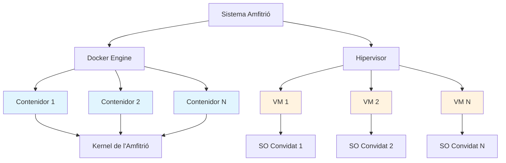
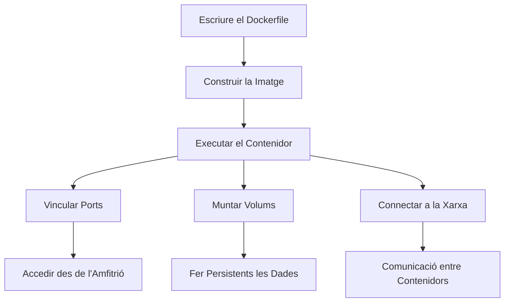

## **1. Què és Docker?**

Docker és una **plataforma de contenidorització** que permet empaquetar, distribuir i executar aplicacions en **contenidors**. Un contenidor és una unitat lleugera i portable que inclou tot el que cal per a executar una aplicació: codi, entorn d'execució (*runtime*), eines del sistema, biblioteques i configuracions.

### **1.1 Característiques principals de Docker**

- **Aïllament**: Cada contenidor s'executa de manera independent, sense interferir amb altres contenidors ni amb el sistema amfitrió.
- **Portabilitat**: Els contenidors es poden executar en qualsevol entorn que tinga Docker instal·lat (Linux, Windows, macOS, núvol, etc.).
- **Eficiència**: Els contenidors comparteixen el kernel del sistema operatiu de l'amfitrió, cosa que els fa més lleugers que les màquines virtuals.
- **Escalabilitat**: Facilita l'escalabilitat horitzontal de les aplicacions.
- **Automatització**: Permet definir infraestructures com a codi (IaC) mitjançant fitxers `Dockerfile`.

---

## **2. Comparació entre Docker i Màquines Virtuals (VM)**

### **2.1 Docker (Contenidors)**

- **Arquitectura**: Comparteix el kernel del sistema operatiu de l'amfitrió.
- **Rendiment**: Més ràpid i lleuger, ja que no requereix un sistema operatiu complet per contenidor.
- **Recursos**: Consumeix menys CPU, RAM i emmagatzematge.
- **Aïllament**: Aïllament a nivell de processos (menys segur que les VM, però suficient per a la majoria de casos d'ús).
- **Ús típic**: Aplicacions de microserveis, entorns de desenvolupament, desplegaments en el núvol.

### **2.2 Màquines Virtuals (VM)**

- **Arquitectura**: Requereix un sistema operatiu complet (*guest OS*) per a cada VM.
- **Rendiment**: Més lent i pesat a causa de la virtualització completa del maquinari.
- **Recursos**: Consumeix més CPU, RAM i emmagatzematge.
- **Aïllament**: Aïllament complet a nivell de maquinari (més segur).
- **Ús típic**: Execució de múltiples sistemes operatius en un mateix maquinari, entorns de prova, servidors complets.

| **Aspecte**             | **Docker (Contenidors)**        | **Màquines Virtuals (VM)**    |
| ----------------------- | -------------------------------- | ------------------------------ |
| **Sistema Operatiu**   | Comparteix el kernel de l'amfitrió | Requereix un SO complet        |
| **Rendiment**         | Alt (lleuger)                    | Baix (pesat)                  |
| **Consum de Recursos** | Baix                             | Alt                           |
| **Aïllament**         | A nivell de processos              | A nivell de maquinari            |
| **Temps d'Inici**    | Segons                         | Minuts                        |
| **Portabilitat**        | Alta                             | Mitjana (depén de l'hipervisor) |
| **Ús Típic**          | Microserveis, desenvolupament       | Entorns complets, servidors |


---

## **3. Conceptes Clau en Docker**

### **3.1 Vinculació de Ports**

La **vinculació de ports** (*port binding*) permet associar un port del contenidor a un port de l'amfitrió, cosa que facilita l'accés des de l'exterior als serveis que s'executen dins del contenidor.

**Exemple:**

```bash
# Associar el port 80 del contenidor al port 8080 de l'amfitrió
docker run -p 8080:80 nginx
```

- **`-p 8080:80`**: El port `80` del contenidor s'exposa en el port `8080` de l'amfitrió.

**Casos d'ús:**

- Executar un servidor web (p. ex. Nginx, Apache) i accedir-hi des del navegador.
- Exposar API o bases de dades per al desenvolupament local.

---

### **3.2 Volums**

Els **volums** permeten fer persistents les dades generades pels contenidors en el sistema de fitxers de l'amfitrió o en un emmagatzematge extern. Això és útil per a bases de dades, fitxers de configuració o qualsevol dada que haja de persistir després que el contenidor s'ature.

**Exemple:**

```bash
# Crear un volum i muntar-lo en un contenidor
docker volume create my_volume
docker run -v my_volume:/data my_container
```

- **`-v my_volume:/data`**: Munta el volum `my_volume` en el directori `/data` del contenidor.

**Casos d'ús:**

- Emmagatzemar les dades de bases de dades (p. ex. MySQL, PostgreSQL).
- Compartir fitxers entre contenidors.

---

### **3.3 Xarxes**

Docker proporciona xarxes virtuals perquè els contenidors puguen comunicar-se entre si i amb l'exterior. Per defecte, els contenidors es connecten a una xarxa anomenada `bridge`, però també es poden crear xarxes personalitzades.

**Exemple:**

```bash
# Crear una xarxa personalitzada
docker network create my_network

# Executar contenidors en la mateixa xarxa
docker run --network my_network --name container1 nginx
docker run --network my_network --name container2 nginx
```

- **`--network my_network`**: Connecta els contenidors a la xarxa `my_network`.

**Casos d'ús:**

- Comunicació entre microserveis.
- Aïllament de grups de contenidors.

---

### **3.4 Consoles Remotes**

Docker permet accedir al terminal d'un contenidor en execució per a depurar-lo o administrar-lo.

**Exemple:**

```bash
# Accedir al terminal d'un contenidor en execució
docker exec -it my_container bash
```

- **`exec -it`**: Executa una ordre interactiva (`-it`) en el contenidor.
- **`bash`**: Inicia una sessió de Bash (pot ser `sh` en contenidors basats en Alpine).

**Casos d'ús:**

- Depurar aplicacions en execució.
- Modificar configuracions en temps real.

---

### **3.5 Construcció d'Imatges Personalitzades**

Docker permet crear imatges personalitzades mitjançant un fitxer `Dockerfile`. Aquest fitxer defineix els passos per a construir la imatge, com ara instal·lar dependències, copiar fitxers i configurar l'entorn.

**Exemple de `Dockerfile`:**

```dockerfile
# Utilitzar una imatge base
FROM ubuntu:22.04

# Instal·lar dependències
RUN apt-get update && apt-get install -y python3

# Copiar fitxers locals al contenidor
COPY app.py /app/

# Definir l'ordre per defecte
CMD ["python3", "/app/app.py"]
```

**Passos per a construir la imatge:**

```bash
# Construir la imatge a partir del Dockerfile
docker build -t my_custom_image .

# Executar un contenidor a partir de la imatge
docker run my_custom_image
```

- **`docker build -t my_custom_image .`**: Construeix una imatge anomenada `my_custom_image` utilitzant el `Dockerfile` del directori actual.

**Casos d'ús:**

- Crear entorns de desenvolupament reproduïbles.
- Desplegar aplicacions amb totes les seves dependències.

---

## **4. Arquitectura de Docker vs. Màquines Virtuals**



**Explicació:**

- **Docker**: Els contenidors comparteixen el kernel del sistema amfitrió, cosa que els fa lleugers.
- **VM**: Cada VM requereix un sistema operatiu complet (*guest OS*), cosa que consumeix més recursos.

---

### **4.1 Flux de Treball amb Docker**



**Explicació:**

1. Es defineix un `Dockerfile` per a crear una imatge personalitzada.
2. Es construeix la imatge amb `docker build`.
3. S'executa un contenidor a partir de la imatge.
4. Es configuren els ports, els volums i les xarxes segons calga.

## **5. Què és Docker Compose?**

Docker Compose és una **eina d'orquestració** que permet definir i gestionar aplicacions multicontenidor mitjançant un fitxer YAML (`docker-compose.yml`). En lloc d'executar i configurar cada contenidor individualment amb ordres `docker run`, Compose simplifica el procés agrupant tots els serveis, xarxes, volums i configuracions en un sol fitxer. Això facilita el desplegament, l'escalabilitat i la gestió d'entorns complexos amb una sola ordre.

---

### **5.1 Com s'utilitza Docker Compose?**

1. **Definir el fitxer `docker-compose.yml`**: En aquest fitxer s'especifiquen els serveis (contenidors), les xarxes, els volums i altres configuracions necessàries per a l'aplicació. Cada servei es defineix com un bloc dins del fitxer, amb opcions com la imatge que s'ha d'utilitzar, els ports, els volums, les variables d'entorn, etc.

**Exemple bàsic**:
```yaml
   version: "3.8"
   services:
     web:
       image: nginx\:latest
       ports:
         - "8080:80"
       volumes:
         - ./html:/usr/share/nginx/html
     db:
       image: postgres:13
       environment:
         POSTGRES_PASSWORD: mysecretpassword
       volumes:
         - postgres_data:/var/lib/postgresql/data

   volumes:
     postgres_data:
```

- **`services`**: Defineix els contenidors que formaran part de l'aplicació (p. ex. `web` i `db`).
- **`ports`**: Associa ports del contenidor a ports de l'amfitrió.
- **`volumes`**: Fa persistents les dades o munta directoris locals.
- **`environment`**: Configura variables d'entorn per al contenidor.

2. **Iniciar els serveis**: Una vegada definit el fitxer, s'executa l'ordre següent per a crear i iniciar tots els contenidors:

```bash
docker-compose up -d
```

- **`-d`**: Executa els contenidors en segon pla (mode _detached_).

3. **Gestionar els serveis**:
    
- **Aturar els serveis**:
```bash
docker-compose down
```
        
- **Veure els registres (logs)**:
```bash
docker-compose logs
```
        
- **Escalar serveis** (p. ex. 3 instàncies de `web`):
```bash
docker-compose up -d --scale web=3
```
        
4. **Reconstruir les imatges** (si hi ha canvis en el `Dockerfile`):
```bash
docker-compose build
``` 

---

### **5.2 Casos d'ús típics**

- **Desenvolupament local**: Desplegar entorns complets (p. ex. base de dades + backend + frontend) amb una sola ordre.
- **Proves**: Crear entorns aïllats per a proves d'integració.
- **Producció**: Desplegar aplicacions multicontenidor en servidors (encara que per a entorns crítics es recomana utilitzar eines com Kubernetes o Docker Swarm).

---

## **6. Taula Resum: Ordres de Docker i Dockerfile**

Ordres típiques de Docker i Dockerfile

| **Categoria**                | **Ordre/Instrucció**                   | **Descripció**                                                                    |
| ---------------------------- | ----------------------------------------- | ---------------------------------------------------------------------------------- |
| **Gestió de Contenidors**  | `docker run [imatge]`                     | Crea i executa un contenidor a partir d'una imatge.                                     |
|                              | `docker run -d [imatge]`                  | Executa el contenidor en segon pla (_detached_).                               |
|                              | `docker run -p 8080:80 [imatge]`          | Associa el port 80 del contenidor al 8080 de l'amfitrió.                           |
|                              | `docker run -v /host:/container [imatge]` | Munta un volum de l'amfitrió en el contenidor.                                   |
|                              | `docker ps`                               | Llista els contenidors en execució.                                               |
|                              | `docker ps -a`                            | Llista tots els contenidors (inclosos els aturats).                           |
|                              | `docker stop [id/nom]`                 | Atura un contenidor.                                                             |
|                              | `docker start [id/nom]`                | Inicia un contenidor aturat.                                                     |
|                              | `docker rm [id/nom]`                   | Elimina un contenidor.                                                             |
|                              | `docker exec -it [id] bash`               | Accedeix al terminal d'un contenidor en execució.                                |
| **Gestió d'Imatges**      | `docker build -t [nom] .`              | Construeix una imatge a partir d'un `Dockerfile` del directori actual.                |
|                              | `docker images`                           | Llista totes les imatges locals.                                                  |
|                              | `docker pull [imatge]`                    | Descarrega una imatge de Docker Hub.                                              |
|                              | `docker push [imatge]`                    | Puja una imatge a un registre (p. ex. Docker Hub).                                    |
|                              | `docker rmi [imatge]`                     | Elimina una imatge local.                                                          |
| **Xarxes i Volums**        | `docker network ls`                       | Llista totes les xarxes de Docker.                                                   |
|                              | `docker network create [nom]`          | Crea una xarxa personalitzada.                                                        |
|                              | `docker volume ls`                        | Llista tots els volums.                                                         |
|                              | `docker volume create [nom]`           | Crea un volum.                                                                   |
| **Docker Compose**           | `docker-compose up -d`                    | Inicia en segon pla tots els serveis definits en `docker-compose.yml`.     |
|                              | `docker-compose down`                     | Atura i elimina els contenidors, les xarxes i els volums definits en el fitxer.     |
|                              | `docker-compose logs`                     | Mostra els registres (logs) de tots els serveis.                                           |
|                              | `docker-compose build`                    | Reconstrueix les imatges dels serveis si hi ha canvis en els `Dockerfile`.      |
| **Instruccions Dockerfile** | `FROM [imatge]`                           | Defineix la imatge base per a construir la nova imatge.                              |
|                              | `RUN [ordre]`                           | Executa una ordre durant la construcció de la imatge (p. ex. instal·lar paquets).   |
|                              | `COPY [origen] [destinació]`                 | Copia fitxers de l'amfitrió al contenidor.                                        |
|                              | `ADD [origen] [destinació]`                  | Semblant a `COPY`, però també admet URL i descompressió automàtica.            |
|                              | `WORKDIR [directori]`                    | Estableix el directori de treball dins del contenidor.                          |
|                              | `ENV [variable]=valor`                    | Defineix una variable d'entorn en el contenidor.                                   |
|                              | `CMD [ordre]`                           | Defineix l'ordre per defecte que s'executarà en iniciar el contenidor.           |
|                              | `ENTRYPOINT [ordre]`                    | Configura el punt d'entrada del contenidor (semblant a `CMD`, però més flexible). |
|                              | `EXPOSE [port]`                         | Declara en quins ports escolta el contenidor (no els associa a l'amfitrió).             |
|                              | `VOLUME [directori]`                     | Crea un punt de muntatge per a un volum en el contenidor.                         |
