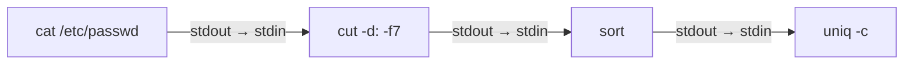

# 3. Redireccions, canonades i filtres

La filosofia d'Unix es resumeix en una idea: **programes xicotets que fan una sola cosa bé i que es poden combinar entre si**. Per a combinar-los s'utilitzen les redireccions i les canonades.

## 3.1 Fluxos estàndard

Tot procés disposa de tres canals de comunicació, identificats per un número anomenat **descriptor de fitxer**:

| Descriptor | Nom | Per defecte | Ús |
| --- | --- | --- | --- |
| `0` | **stdin** (entrada estàndard) | Teclat | Dades que llig el programa. |
| `1` | **stdout** (eixida estàndard) | Pantalla | Resultats normals. |
| `2` | **stderr** (eixida d'errors) | Pantalla | Missatges d'error. |


Que l'eixida normal i la d'errors siguen canals distints permet, per exemple, guardar els resultats en un fitxer i continuar veient els errors en pantalla.

## 3.2 Redireccions

Una **redirecció** canvia l'origen o la destinació d'un d'aquests canals.

| Operador | Efecte |
| --- | --- |
| `ordre > fitx` | Envia stdout a `fitx`. **Sobreescriu** el fitxer si existeix. |
| `ordre >> fitx` | Envia stdout a `fitx`, **afegint** al final. |
| `ordre 2> fitx` | Envia stderr a `fitx`. |
| `ordre 2>> fitx` | Afig stderr al final de `fitx`. |
| `ordre > fitx 2>&1` | Envia stdout i stderr al mateix fitxer (l'ordre importa: primer `>`, després `2>&1`). |
| `ordre &> fitx` | Forma abreujada de Bash de l'anterior. |
| `ordre < fitx` | L'ordre llig la seua entrada (stdin) des de `fitx`. |
| `ordre > /dev/null` | Descarta l'eixida. `/dev/null` és un "forat negre" que accepta i descarta tot. |

```bash
ls -l /etc > listado.txt          # Guarda el llistat (si existia, es perd)
date >> registro.txt              # Afig la data al final del registre
find / -name '*.conf' 2> errores.txt     # Els errors van al fitxer, els resultats a pantalla
find / -name '*.conf' 2> /dev/null       # Descarta els errors
./instalar.sh > instalacion.log 2>&1     # Tot al log
wc -l < /etc/passwd               # wc llig del fitxer a través de stdin
```

> [!WARNING]
> `ordre fitx > fitx` **buida** el fitxer abans de llegir-lo, perquè la shell prepara la redirecció (truncant el fitxer) abans d'executar l'ordre. Per exemple, `sort datos.txt > datos.txt` deixa `datos.txt` buit. Utilitza un fitxer intermedi o l'opció `-o` de `sort`.

### Documents en línia (*here documents*)

Permeten passar diverses línies de text com a entrada estàndard sense crear un fitxer. Són molt útils en els scripts per a generar fitxers de configuració o missatges llargs:

```bash
cat > saludo.txt <<EOF
Hola, $USER.
Hui és $(date +%F).
EOF
```

El text acaba en la línia que conté només la paraula marcadora (`EOF`, encara que pot ser qualsevol). Si la marca s'escriu entre cometes (`<<'EOF'`), les variables **no** se substitueixen.

Amb `<<<` (*here string*) es passa una sola cadena: `wc -w <<< "compta aquestes quatre paraules"`.

## 3.3 Canonades

Una **canonada** (*pipe*), representada per `|`, connecta l'**eixida estàndard** d'una ordre amb l'**entrada estàndard** de la següent. Així es construeixen "cadenes de muntatge" de dades:



```bash
ls -l /etc | less                 # Paginar una eixida llarga
ps aux | grep firefox             # Buscar un procés concret
cut -d: -f7 /etc/passwd | sort | uniq -c   # Quants usuaris utilitzen cada shell?
```

`tee` és una "T" de lampisteria: copia el que rep a un fitxer **i** ho continua passant per l'eixida estàndard.

```bash
ls -l | tee listado.txt | wc -l   # Guarda el llistat i a més compta les línies
echo "nameserver 1.1.1.1" | sudo tee -a /etc/resolv.conf   # Escriure en un fitxer de root
```

> [!TIP]
> `sudo echo text > /etc/fitxer` **no funciona**: `sudo` s'aplica a `echo`, però la redirecció la fa la teua shell, que no és root. La forma correcta és `echo text | sudo tee /etc/fitxer` (o `sudo tee -a` per a afegir).

## 3.4 Filtres de text

Un **filtre** és una ordre que llig text (d'un fitxer o de stdin), el transforma i l'escriu en stdout. Són les peces que s'encadenen amb canonades.

### `grep`: buscar línies que contenen un patró

```text
grep [opcions] 'patró' [fitxers]
```

| Opció | Efecte |
| --- | --- |
| `-i` | No distingeix majúscules de minúscules. |
| `-v` | Inverteix: mostra les línies que **no** coincideixen. |
| `-n` | Mostra el número de línia. |
| `-c` | Mostra només el nombre de línies que coincideixen. |
| `-w` | Només paraules completes. |
| `-r` | Busca recursivament en un directori. |
| `-l` | Mostra només el nom dels fitxers que contenen el patró. |
| `-o` | Mostra només la part que coincideix. |
| `-q` | Silenciós: no mostra res, només retorna el codi d'eixida (útil en scripts). |
| `-E` | Expressions regulars esteses (substitueix l'obsolet `egrep`). |

```bash
grep 'alumno' /etc/passwd
grep -i 'error' /var/log/syslog
grep -v '^#' /etc/ssh/sshd_config | grep -v '^$'   # Sense comentaris ni línies buides
grep -rn 'TODO' ~/proyectos/app/src                 # Tasques pendents en el codi
grep -c '/bin/bash$' /etc/passwd                    # Usuaris amb shell Bash
```

Els patrons de `grep` són **expressions regulars**. Els elements bàsics són:

| Símbol | Significat | Exemple |
| --- | --- | --- |
| `^` | Principi de línia. | `^root` |
| `$` | Final de línia. | `bash$` |
| `.` | Qualsevol caràcter. | `c.sa` → casa, cosa |
| `*` | L'element anterior, 0 o més vegades. | `ab*c` → ac, abc, abbc |
| `[ ]` | Un caràcter del conjunt. | `[0-9]` |
| `+`, `?`, `{n}`, `\|` | (Amb `-E`) 1 o més, 0 o 1, n vegades, alternativa. | `-E '[0-9]{3}'`, `-E 'error\|warning'` |

### `cut`: extraure columnes

```bash
cut -d: -f1 /etc/passwd          # Camp 1 utilitzant ":" com a delimitador
cut -d: -f1,6 /etc/passwd        # Camps 1 i 6
cut -d, -f2- alumnos.csv         # Del camp 2 al final
cut -c1-8 fichero.txt            # Caràcters de l'1 al 8 de cada línia
```

### `sort` i `uniq`: ordenar i eliminar repetits

| Opció de `sort` | Efecte |
| --- | --- |
| `-n` | Ordenació numèrica (si no, `10` va abans que `9`). |
| `-r` | Ordenació inversa. |
| `-t X -k N` | Ordena per la columna N utilitzant X com a separador. |
| `-u` | Elimina duplicats. |
| `-h` | Entén grandàries llegibles (`2K`, `1G`). |

`uniq` elimina les línies repetides **consecutives** (per això quasi sempre va darrere de `sort`). Amb `-c` compta les repeticions i amb `-d` mostra només les repetides.

```bash
sort -t: -k3 -n /etc/passwd      # Usuaris ordenats per UID
du -sh ~/* | sort -h             # Directoris ordenats per grandària
sort nombres.txt | uniq -c | sort -nr   # Rànquing dels valors més repetits
```

### `tr`: traduir o esborrar caràcters

```bash
echo "hola mon" | tr 'a-z' 'A-Z'       # HOLA MON
echo "a;b;c" | tr ';' '\n'             # Un element per línia
echo "text   amb   espais" | tr -s ' '   # -s comprimeix repeticions: "text amb espais"
echo "tel: 600-11-22-33" | tr -d '-'   # -d esborra: "tel: 600112233"
```

### `wc`, `head` i `tail` en canonades

```bash
ls | wc -l                         # Quants fitxers hi ha en el directori?
ps aux --sort=-%mem | head -n 6    # Capçalera + els 5 processos que més memòria utilitzen
history | tail -n 20               # Les últimes 20 ordres
```

### Dues eines més potents: `awk` i `sed`

`awk` i `sed` són, en realitat, xicotets llenguatges de programació per a processar text. N'hi ha prou de conéixer-ne els usos més habituals:

```bash
# awk: treballa per columnes. -F indica el separador; $1, $2… són els camps
awk -F: '{ print $1, $7 }' /etc/passwd          # Usuari i shell
awk -F: '$3 >= 1000 { print $1 }' /etc/passwd   # Usuaris amb UID >= 1000
df -h | awk 'NR > 1 { print $5, $6 }'           # Ús (%) i punt de muntatge (NR = núm. de línia)

# sed: edita fluxos de text. s/buscar/reemplaçar/g
sed 's/http:/https:/g' enlaces.txt              # Mostra el resultat (no modifica el fitxer)
sed -i 's/DEBUG=true/DEBUG=false/' .env         # -i modifica el fitxer "in situ"
sed -n '5,10p' fichero.txt                      # Mostra només les línies 5 a 10
sed '3d' fichero.txt                            # Mostra el fitxer sense la línia 3
```

### `xargs`: convertir línies en arguments

Algunes ordres (com `rm`, `cp` o `mkdir`) no llegeixen dades de stdin, sinó que esperen **arguments**. `xargs` llig línies de la seua entrada i les passa com a arguments a una altra ordre:

```bash
cat lista_directorios.txt | xargs mkdir -p      # Crea els directoris de la llista
find . -name '*.bak' -print0 | xargs -0 rm      # -print0/-0 suporten noms amb espais
```

## 3.5 Encadenar ordres

| Operador | Significat |
| --- | --- |
| `ordre1 ; ordre2` | Executa l'una darrere de l'altra, passe el que passe. |
| `ordre1 && ordre2` | Executa `ordre2` **només si** `ordre1` acaba **bé**. |
| `ordre1 \|\| ordre2` | Executa `ordre2` **només si** `ordre1` **falla**. |
| `$(ordre)` | **Substitució d'ordres**: se substitueix per l'eixida d'`ordre`. |

```bash
sudo apt update && sudo apt upgrade -y     # Només actualitza si la llista s'ha descarregat bé
mkdir copia || echo "No s'ha pogut crear el directori"
echo "Hi ha $(ls | wc -l) fitxers en $(pwd)"
cp informe.txt "informe_$(date +%F).txt"   # informe_2026-11-08.txt
```

Com sap la shell si una ordre ha anat "bé"? Ho veurem en detall en l'apartat 7: tota ordre retorna un **codi d'eixida**, que val `0` si ha acabat correctament.

---

## Exercicis resolts

Per als exercicis 3.3 i 3.4 crea primer un fitxer d'exemple amb un *here document*:

```bash
cat > accesos.log <<'EOF'
192.168.1.10 - - [08/Nov/2026:10:01:12] "GET /index.html" 200
192.168.1.22 - - [08/Nov/2026:10:01:15] "GET /login" 200
192.168.1.10 - - [08/Nov/2026:10:02:01] "POST /login" 401
10.0.0.5 - - [08/Nov/2026:10:03:44] "GET /admin" 403
192.168.1.10 - - [08/Nov/2026:10:04:10] "POST /login" 200
192.168.1.22 - - [08/Nov/2026:10:05:00] "GET /noexiste" 404
10.0.0.5 - - [08/Nov/2026:10:06:30] "GET /admin" 403
EOF
```

### Exercici 3.1. Usuaris i shells

Utilitzant `/etc/passwd`, mostra: (a) només els noms d'usuari ordenats alfabèticament, (b) quants usuaris hi ha en total i (c) quants usuaris utilitzen cada shell, de la més utilitzada a la menys utilitzada.

{}
```bash
cut -d: -f1 /etc/passwd | sort                     # (a)
wc -l < /etc/passwd                                # (b) amb < només es mostra el número
cut -d: -f7 /etc/passwd | sort | uniq -c | sort -nr   # (c)
```

En (c), el primer `sort` agrupa les shells iguals, `uniq -c` compta cada grup i el segon `sort -nr` ordena numèricament de major a menor.
{}

### Exercici 3.2. Separar resultats i errors

Busca en `/etc` tots els fitxers el nom dels quals continga `host`. Guarda els resultats en `encontrados.txt`, els errors en `errores.txt` i, al final, mostra quants resultats i quants errors hi ha hagut.

{}
```bash
find /etc -name '*host*' > encontrados.txt 2> errores.txt
echo "Resultats: $(wc -l < encontrados.txt)"
echo "Errors: $(wc -l < errores.txt)"
```
{}

### Exercici 3.3. Analitzar un registre web

Amb el fitxer `accesos.log`, obtín:

1. Les peticions que han acabat en error (codi 4xx).
2. Les IP distintes que hi apareixen.
3. Quantes peticions ha fet cada IP, ordenades de més a menys.

{}
```bash
grep -E '" 4[0-9]{2}$' accesos.log          # 1. Cometes, espai i 4 + dues xifres al final

cut -d' ' -f1 accesos.log | sort -u          # 2. sort -u ordena i elimina duplicats

cut -d' ' -f1 accesos.log | sort | uniq -c | sort -nr   # 3.
#   3 192.168.1.10
#   2 192.168.1.22
#   2 10.0.0.5
```
{}

### Exercici 3.4. Intents d'accés fallits

Mostra només les IP que han provocat un codi `401` o `403`, sense repetir, i guarda-les també en `sospechosas.txt`.

{}
```bash
grep -E '" (401|403)$' accesos.log | awk '{ print $1 }' | sort -u | tee sospechosas.txt
# 10.0.0.5
# 192.168.1.10
```

`awk '{ print $1 }'` és equivalent a `cut -d' ' -f1`; `awk` separa per espais per defecte. `tee` mostra el resultat i el guarda alhora.
{}
