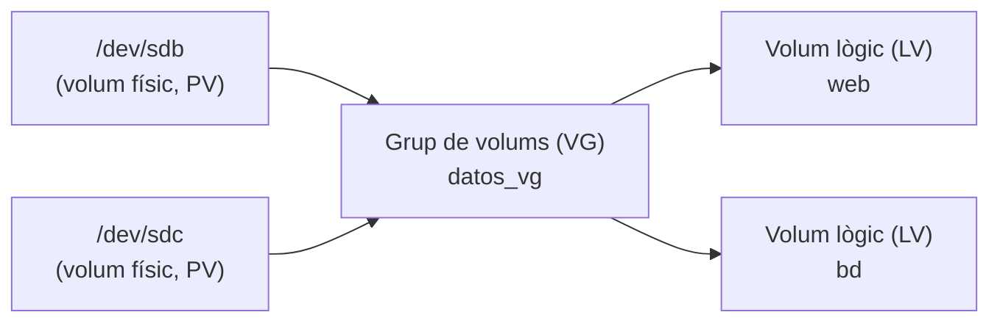

# 4. Emmagatzematge i còpies de seguretat

Les dades són el més valuós d'un sistema informàtic: el maquinari i el sistema operatiu es poden reposar, però un fitxer perdut sense còpia no. En aquest apartat veurem com s'organitza l'emmagatzematge (sistemes d'arxius, particions i volums), com consultar l'espai i localitzar informació, i com fer i restaurar còpies de seguretat.

## 4.1 Sistemes d'arxius

Un **sistema d'arxius** és la manera en què s'organitzen les dades dins d'una partició: com es guarden els fitxers, els seus noms, els seus permisos i l'espai lliure. En la Unitat 2 se'n van estudiar els fonaments; aquesta taula resumeix els més utilitzats per a poder triar-ne un amb criteri:

| Sistema | Ús típic | Grandària màx. de fitxer | Permisos Unix | *Journaling* | Compatibilitat |
| --- | --- | --- | --- | --- | --- |
| **FAT32** | Memòries USB xicotetes, particions d'arrancada EFI. | 4 GiB | No | No | Universal (Windows, Linux, macOS, televisors…). |
| **exFAT** | Memòries USB i targetes SD grans. | Pràcticament il·limitada | No | No | Windows, macOS i Linux actuals. |
| **NTFS** | Discos de sistemes Windows. | Pràcticament il·limitada | No (utilitza ACL pròpies) | Sí | Windows; Linux pot llegir-lo i escriure-hi. |
| **ext4** | Sistema per defecte en moltes distribucions Linux. | 16 TiB | Sí | Sí | Linux (Windows no el llig sense programari addicional). |
| **XFS** | Servidors amb fitxers grans (per defecte en RHEL). | Pràcticament il·limitada | Sí | Sí | Linux. |
| **Btrfs** | Escriptoris i servidors Linux que necessiten instantànies (*snapshots*). | Pràcticament il·limitada | Sí | Còpia en escriptura | Linux. |

> [!NOTE]
> El ***journaling*** (registre per diari) consisteix a anotar els canvis abans de fer-los. Si l'equip s'apaga de colp, el sistema d'arxius pot recuperar un estat coherent ràpidament, cosa que millora la **integritat de les dades**.

## 4.2 Discos, particions i volums

### Com anomena Linux els discos

Cada disc apareix com un fitxer especial dins de `/dev`, i cada partició hi afig un número:

| Nom | Significat |
| --- | --- |
| `/dev/sda`, `/dev/sdb`… | Discos SATA, SCSI o USB (primer, segon…). |
| `/dev/sda1`, `/dev/sda2`… | Particions del disc `sda`. |
| `/dev/nvme0n1`, `/dev/nvme0n1p1` | Disc NVMe i la seua primera partició. |
| `/dev/vda` | Disc d'una màquina virtual (virtio). |

### Consultar discos i espai

| Ordre | Funció |
| --- | --- |
| `lsblk -f` | Discos, particions, sistema d'arxius, etiqueta i punt de muntatge, en forma d'arbre. |
| `df -h` | Espai total, utilitzat i lliure de cada sistema d'arxius muntat. |
| `df -hT` | Igual, indicant el tipus de sistema d'arxius. |
| `du -sh dir` | Espai que ocupa un directori. |
| `sudo fdisk -l` | Taula de particions de tots els discos. |
| `sudo blkid` | Identificador únic (UUID), etiqueta i tipus de cada partició. |
| `findmnt` | Sistemes d'arxius muntats i les seues opcions. |

```bash
lsblk -f
```

```text
NAME   FSTYPE LABEL  UUID                                 MOUNTPOINTS
sda
├─sda1 vfat          5A1B-2C3D                            /boot/efi
└─sda2 ext4          3f1c2a9e-1b2c-4d5e-8f90-123456789abc /
sdb
└─sdb1 ext4   DATOS  8e2d4c6a-0f1e-4b3a-9c8d-abcdef012345
```

### Crear, formatar i muntar una partició

{}
1. ## Crear la partició

   Amb `fdisk` (taules MBR o GPT) o `parted`. Tots dos són interactius; en `fdisk`, `n` crea una partició nova, `p` mostra la taula i `w` guarda els canvis.

   ```bash
   sudo fdisk /dev/sdb
   ```

2. ## Crear el sistema d'arxius (formatar)

   ```bash
   sudo mkfs.ext4 -L DATOS /dev/sdb1   # -L assigna una etiqueta
   # Altres: mkfs.vfat -F 32, mkfs.exfat, mkfs.ntfs, mkfs.xfs
   ```

3. ## Muntar-la

   **Muntar** és fer accessible el sistema d'arxius dins d'un directori de l'arbre (el **punt de muntatge**).

   ```bash
   sudo mkdir -p /mnt/datos
   sudo mount /dev/sdb1 /mnt/datos
   df -h /mnt/datos
   sudo umount /mnt/datos            # Desmuntar (ningú no l'ha d'estar utilitzant)
   ```

4. ## Muntar-la automàticament en arrancar

   S'afig una línia al fitxer `/etc/fstab`, identificant la partició pel seu UUID (no canvia encara que canvie l'ordre dels discos):

   ```text
   # <dispositiu>                             <punt de muntatge>  <tipus> <opcions>   <dump> <pass>
   UUID=8e2d4c6a-0f1e-4b3a-9c8d-abcdef012345  /mnt/datos          ext4    defaults    0      2
   ```

   Després, `sudo mount -a` munta tot el que indica el fitxer i permet detectar errors **abans** de reiniciar. Un error en `fstab` pot impedir que el sistema arranque amb normalitat.
{}

> [!CAUTION]
> `mkfs` **esborra** tot el contingut de la partició. Comprova dues vegades el nom del dispositiu amb `lsblk` abans d'executar-lo. Practica sempre en una màquina virtual amb un disc afegit per a l'ocasió.

### Volums lògics (LVM)

Les particions tenen una grandària fixa i difícil de canviar. **LVM** (*Logical Volume Manager*) afig una capa intermèdia que permet agrupar diversos discos i repartir l'espai en **volums lògics** que es poden ampliar en calent:



```bash
sudo pvcreate /dev/sdb /dev/sdc               # 1. Marca els discos com a volums físics
sudo vgcreate datos_vg /dev/sdb /dev/sdc      # 2. Els agrupa en un grup de volums
sudo lvcreate -n web -L 10G datos_vg          # 3. Crea un volum lògic de 10 GiB
sudo mkfs.ext4 /dev/datos_vg/web              # 4. El formata com qualsevol partició
sudo lvextend -r -L +5G /dev/datos_vg/web     # Amplia 5 GiB i (-r) el sistema d'arxius
sudo pvs; sudo vgs; sudo lvs                  # Resum de cada capa
```

> [!NOTE]
> En Windows, l'eina equivalent és **Administració de discos** (`diskmgmt.msc`), que permet crear, formatar i ampliar volums de manera gràfica. Des de PowerShell s'utilitzen `Get-Disk`, `New-Partition` i `Format-Volume` (apartat 13).

## 4.3 Localitzar informació

A més de `find` i `grep` (apartats 2 i 3), hi ha altres eines per a trobar fitxers i saber què ocupa l'espai:

| Eina | Tipus | Ús |
| --- | --- | --- |
| `find` | Terminal | Cerca per nom, tipus, grandària, data… recorrent els directoris. Sempre actualitzada, però lenta en arbres grans. |
| `locate` / `plocate` | Terminal | Cerca instantània per nom en una base de dades que s'actualitza periòdicament (`sudo updatedb`). Instal·lació: `sudo apt install plocate`. |
| `grep -r` | Terminal | Busca text dins dels fitxers. |
| `du -h --max-depth=1 \| sort -h` | Terminal | Quins subdirectoris ocupen més espai. |
| `ncdu` | Terminal (interactiva) | Explorador de l'ús del disc navegable amb el teclat (`sudo apt install ncdu`). |
| **Analitzador d'ús de disc** (Baobab) | Gràfica (GNOME) | Mostra l'espai ocupat amb gràfics circulars. |
| **Cercador de fitxers** / Explorador | Gràfica | Cerques des del gestor de fitxers (Nautilus, Dolphin, Explorador de Windows). |
| **Configuració > Sistema > Emmagatzematge** | Gràfica (Windows) | Ús del disc per categories i neteja de temporals. |

```bash
locate -i informe.pdf                       # Instantani (si la base de dades està al dia)
du -h --max-depth=1 ~ 2>/dev/null | sort -h | tail -n 5   # Els 5 directoris que més ocupen
find / -xdev -type f -size +500M 2>/dev/null              # Fitxers de més de 500 MiB
```

`-xdev` evita que `find` bote a altres sistemes d'arxius muntats (discos externs, `/proc`…).

## 4.4 Còpies de seguretat

Una **còpia de seguretat** (*backup*) és un duplicat de les dades guardat en un altre lloc per a poder **restaurar-les** si es perden per una avaria, un esborrament accidental o un atac (per exemple, *ransomware*).

### Tipus de còpia

| Tipus | Què copia | Avantatges | Inconvenients |
| --- | --- | --- | --- |
| **Completa** | Totes les dades. | Restauració senzilla: n'hi ha prou amb una sola còpia. | Lenta i ocupa molt. |
| **Incremental** | El que s'ha modificat des de l'**última còpia** (de qualsevol tipus). | Molt ràpida i xicoteta. | Per a restaurar cal l'última completa i **totes** les incrementals posteriors. |
| **Diferencial** | El que s'ha modificat des de l'**última còpia completa**. | Per a restaurar n'hi ha prou amb la completa i l'última diferencial. | Cada diferencial és més gran que l'anterior. |

Una estratègia habitual és una còpia **completa setmanal** i **incrementals diàries**.

### La regla 3-2-1

- **3** còpies de les dades (l'original i dues còpies),
- en **2** suports distints (per exemple, disc intern i disc extern o NAS),
- **1** d'elles fora del lloc de treball (una altra seu o el núvol).

> [!IMPORTANT]
> Una còpia de seguretat que mai s'ha provat a restaurar **no és una còpia fiable**. Comprova periòdicament que pots recuperar les dades.

### Còpies amb `tar`

**Empaquetar** és ajuntar molts fitxers en un de sol (sense reduir-ne la grandària); **comprimir** és reduir la grandària. `tar` empaqueta i, amb les opcions adequades, també comprimeix.

| Opció de `tar` | Significat |
| --- | --- |
| `-c` | Crear un paquet. |
| `-x` | Extraure. |
| `-t` | Llistar el contingut. |
| `-f fitxer` | Nom del fitxer `.tar` (sempre l'**última** de les opcions agrupades). |
| `-v` | Detallat: mostra els fitxers processats. |
| `-z` / `-j` / `-J` | Comprimir amb gzip (`.tar.gz`) / bzip2 (`.tar.bz2`) / xz (`.tar.xz`). |
| `-C dir` | Canvia al directori indicat abans de crear o extraure. |
| `--newer-mtime=DATA` | Només inclou els fitxers modificats després de la data (útil per a còpies incrementals senzilles). |

```bash
tar -czvf proyecto.tar.gz proyecto/       # Empaquetar i comprimir
tar -tzf proyecto.tar.gz                  # Veure el contingut sense extraure
tar -xzvf proyecto.tar.gz -C /tmp         # Extraure (restaurar) en /tmp
tar -czf "backup_$(date +%F).tar.gz" ~/Documentos          # Amb la data en el nom
tar -czf incremental.tar.gz --newer-mtime="1 day ago" ~/Documentos   # Només el de l'últim dia
```

Altres eines de compressió:

```bash
gzip fichero.log        # Crea fichero.log.gz i esborra l'original
gunzip fichero.log.gz   # Descomprimeix (equival a gzip -d)
zip -r web.zip web/     # Format zip, compatible amb Windows
unzip web.zip -d destino/
zstd fichero            # Zstandard: compressió molt ràpida, cada vegada més utilitzada
```

### Sincronitzar amb `rsync`

`rsync` copia un directori en un altre (local o remot per SSH) transferint **només les diferències**, cosa que el fa ideal per a còpies freqüents. Pot ser que calga instal·lar-lo (`sudo apt install rsync`).

| Opció | Significat |
| --- | --- |
| `-a` | Mode arxiu: recursiu i conservant permisos, dates i enllaços. |
| `-v` | Detallat. |
| `-h` | Grandàries llegibles. |
| `-n` | **Simulació**: mostra què faria sense copiar res (`--dry-run`). |
| `--delete` | Esborra en la destinació el que ja no existeix en l'origen (còpia "espill"). |
| `--exclude=patró` | Exclou fitxers o directoris. |

```bash
rsync -avh ~/Documentos/ /media/usb/Documentos/            # Còpia local
rsync -avhn --delete ~/Documentos/ /media/usb/Documentos/  # Primer simular…
rsync -avh --delete ~/Documentos/ /media/usb/Documentos/   # …i després executar
rsync -avh ~/proyecto/ usuario@servidor:/backups/proyecto/ # Còpia remota per SSH
```

> [!WARNING]
> La barra final de l'origen importa: `rsync -a dir/ destino/` copia el **contingut** de `dir` dins de `destino`, mentre que `rsync -a dir destino/` crea `destino/dir`. Simula sempre amb `-n` abans d'utilitzar `--delete`.

### Utilitats gràfiques de còpia

| Utilitat | Sistema | Característiques |
| --- | --- | --- |
| **Déjà Dup** (Còpies de seguretat) | Linux (GNOME) | Còpies programades, xifrades i incrementals de la carpeta personal, en local, xarxa o núvol. |
| **Timeshift** | Linux | Instantànies del **sistema** (no de les dades personals) per a tornar arrere després d'una actualització fallida. |
| **Historial de fitxers** | Windows | Còpia periòdica de les biblioteques de l'usuari en una altra unitat. |
| **Còpia de seguretat de Windows** | Windows | Còpia de carpetes, configuració i aplicacions en el compte de Microsoft. |

---

## Exercicis resolts

### Exercici 4.1. Reconéixer l'emmagatzematge de l'equip

Esbrina: (a) quants discos té el teu equip i la seua grandària, (b) quin sistema d'arxius utilitza la partició muntada en `/`, (c) quant d'espai lliure hi queda i (d) el seu UUID.

{}
```bash
lsblk -d -o NAME,SIZE,TYPE          # (a) -d: només els discos, sense particions
df -hT /                            # (b) columna Type i (c) columna Avail
findmnt -n -o SOURCE /              # Dispositiu muntat en / (p. ex. /dev/sda2)
sudo blkid "$(findmnt -n -o SOURCE /)"   # (d) UUID d'aquest dispositiu
```
{}

### Exercici 4.2. Triar sistema d'arxius

Indica quin sistema d'arxius triaries en cada cas i per què: (1) un USB de 64 GB per a portar pel·lícules entre un PC amb Windows i un altre amb Linux; (2) el disc de dades d'un servidor Linux; (3) un USB de 16 GB que ha de llegir la ràdio del cotxe.

{}
1. **exFAT**: el llegeixen i hi escriuen Windows, Linux i macOS, i admet fitxers de més de 4 GiB (una pel·lícula en alta definició els supera amb facilitat).
2. **ext4** (o XFS): sistema natiu de Linux, amb permisos Unix i *journaling*, cosa que protegeix la integritat de les dades.
3. **FAT32**: és el sistema amb més compatibilitat amb dispositius senzills; el seu límit de 4 GiB per fitxer no és un problema per a música.
{}

### Exercici 4.3. Practicar sense risc amb un disc virtual

Sense tocar cap disc real, crea un fitxer de 200 MiB que actue com a disc, dona-li format ext4 amb l'etiqueta `PRUEBAS`, munta'l en `/mnt/pruebas`, copia-hi algun fitxer, comprova l'espai i desmunta'l.

{}
```bash
truncate -s 200M ~/disco.img            # Fitxer buit de 200 MiB
mkfs.ext4 -L PRUEBAS ~/disco.img        # Li donem format com si fora una partició
sudo mkdir -p /mnt/pruebas
sudo mount -o loop ~/disco.img /mnt/pruebas   # -o loop: munta un fitxer com a disc
sudo cp /etc/hosts /mnt/pruebas/
df -h /mnt/pruebas
lsblk -f | grep loop                    # Apareix com /dev/loopN amb l'etiqueta PRUEBAS
sudo umount /mnt/pruebas
```

Un dispositiu ***loop*** permet utilitzar un fitxer com si fora un disc. És una manera segura de practicar `mkfs` i `mount`.
{}

### Exercici 4.4. Còpia de seguretat i restauració

Crea una còpia comprimida del teu directori `~/practicas` anomenada `practicas_AAAA-MM-DD.tar.gz` en `/tmp`, comprova'n el contingut, esborra un fitxer de l'original i recupera'l **només a ell** des de la còpia.

{}
```bash
copia="/tmp/practicas_$(date +%F).tar.gz"   # Guardem el nom en una variable (apartat 6)
tar -czf "$copia" -C ~ practicas
tar -tzf "$copia"                          # Llista: practicas/, practicas/notas.txt…

rm ~/practicas/notas.txt                   # Simulem la pèrdua
tar -xzf "$copia" -C ~ practicas/notas.txt # Extraiem només aquest fitxer
ls -l ~/practicas/notas.txt
```

L'opció `-C ~` fa que `tar` guarde les rutes com a `practicas/…` en lloc de `/home/alumno/practicas/…`, cosa que permet restaurar la còpia en qualsevol lloc i extraure fitxers concrets per la seua ruta relativa.
{}

### Exercici 4.5. Còpia espill amb `rsync`

Mantín en `/media/usb/copia` una còpia exacta de `~/proyectos`, excloent els directoris `node_modules` i `build`. Abans d'executar-la, comprova què es copiarà i què s'esborrarà.

{}
```bash
rsync -avhn --delete --exclude='node_modules/' --exclude='build/' \
      ~/proyectos/ /media/usb/copia/     # 1r: simulació (-n)

rsync -avh --delete --exclude='node_modules/' --exclude='build/' \
      ~/proyectos/ /media/usb/copia/     # 2n: còpia real
```

La barra invertida `\` al final de la línia permet continuar l'ordre en la següent. Excloure les dependències i els fitxers compilats estalvia molt d'espai, perquè es poden regenerar a partir del codi.
{}
